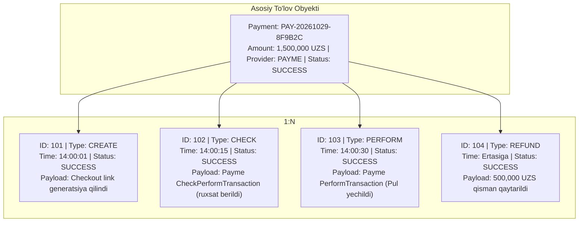
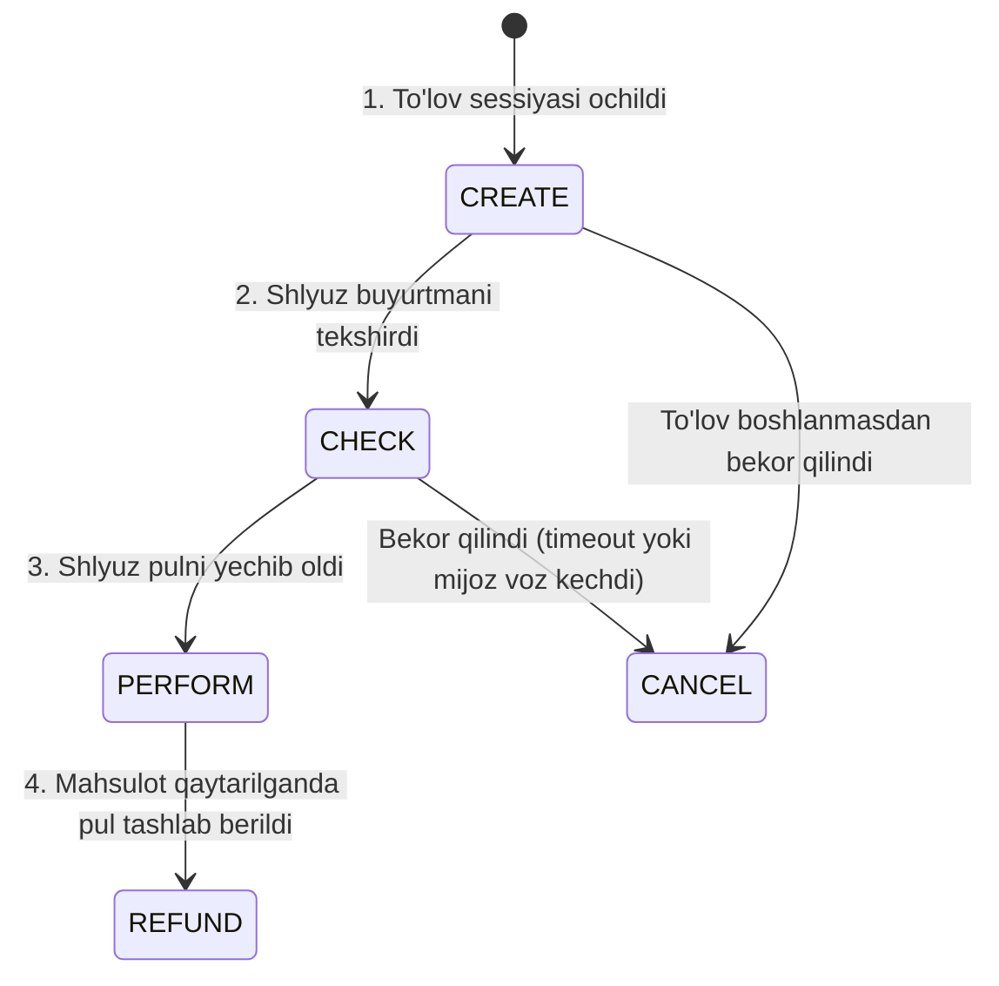
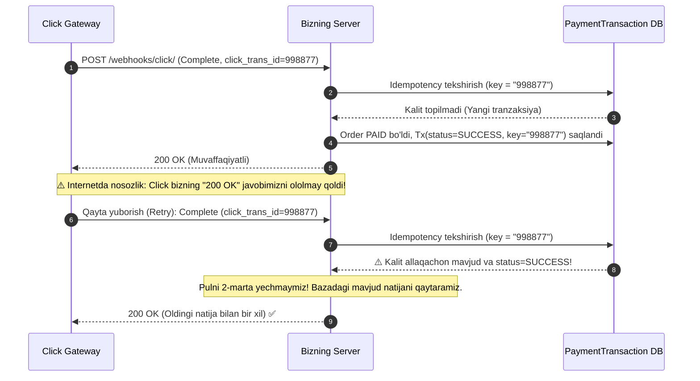

# PaymentTransaction Modeli — Mohiyati, Vazifasi va Ishlash Mexanizmi

Fayl joylashuvi: [`apps/payments/models.py` (241–339 qatorlar)](file:///Users/djumanov/network-school/Groups/NS26-BD-01/ecommerce/apps/payments/models.py#L241-L339)

---

## 1. `PaymentTransaction` nima va nega faqat `Payment` yetarli emas?

Ko'pchilik dasturchilar to'lov tizimida faqat bitta `Payment` jadvali bo'lsa kifoya deb o'ylashadi. Biroq **haqiqiy e-commerce va fintech arxitekturasida bitta to'lov niyati (`Payment`) ortida shlyuz bilan 3–5 tagacha alohida texnik muloqot yuz beradi**.

### Oddiy misol:
Mijoz Payme orqali 1,000,000 so'm to'lamoqchi:
1. Tizimimiz to'lov havolasini yaratdi (1-aloqa: `CREATE`).
2. Payme bizdan "Bu buyurtma bormi, summa to'g'rimi?" deb so'radi (2-aloqa: `CHECK`).
3. Payme mijoz kartasidan pulni yechib oldi (3-aloqa: `PERFORM`).
4. Keyinroq mijoz tovarini qaytardi, pul orqaga tashlandi (4-aloqa: `REFUND`).

> **Xulosa:**  
> `Payment` — bu umumiy status (`SUCCESS`, `PENDING`, `FAILED`).  
> **`PaymentTransaction`** — bu **har bir HTTP so'rov/javobning qora qutisi (Black Box Audit Ledger)**. Hech qanday ma'lumot o'chirilmaydi va o'zgartirilmaydi!

---

## 2. Vizual Tushuntirish: Payment va PaymentTransaction bog'liqligi

Bitta `Payment` ostida bir nechta `PaymentTransaction` yozuvlari vaqt o'qi bo'yicha bog'lanadi:



---

## 3. Model Maydonlarining Chuqur Tahlili

```python
class PaymentTransaction(models.Model):
    id = models.BigAutoField(primary_key=True)
    payment = models.ForeignKey(Payment, on_delete=models.CASCADE, related_name='transactions')
    transaction_type = models.CharField(max_length=30, choices=TransactionType.choices)
    amount = models.DecimalField(max_digits=14, decimal_places=2, default=Decimal('0.00'))
    status = models.CharField(max_length=20, choices=TransactionStatus.choices, default=TransactionStatus.PENDING)
    idempotency_key = models.CharField(max_length=100, blank=True, null=True, db_index=True)
    provider_transaction_id = models.CharField(max_length=255, blank=True, null=True)
    request_payload = models.JSONField(default=dict, blank=True)
    response_payload = models.JSONField(default=dict, blank=True)
    error_code = models.CharField(max_length=50, blank=True, null=True)
    error_message = models.TextField(blank=True, null=True)
    ip_address = models.GenericIPAddressField(null=True, blank=True)
    created_at = models.DateTimeField(auto_now_add=True, db_index=True)
```

| Maydon | Turi | Nega kerak? (Ahamiyati) |
|---|---|---|
| `payment` | `ForeignKey(Payment)` | Tranzaksiya qaysi asosiy to'lovga tegishli ekanligini ko'rsatadi (`payment.transactions.all()`). |
| `transaction_type` | `CharField` | Ushbu aniq operatsiya qanday maqsad bilan qilingani (`CHECK`, `CREATE`, `PERFORM`, `CANCEL`, `REFUND`, `WEBHOOK`). |
| `amount` | `DecimalField` | Ushbu aniq qadamda qatnashgan pul miqdori (Refund bo'lsa faqat qaytarilayotgan qism, masalan 300,000 UZS). |
| `status` | `CharField` | Operatsiya natijasi: `PENDING` (bajarilmoqda), `SUCCESS` (muvaffaqiyatli), `FAILED` (xato bo'ldi). |
| `idempotency_key` | `CharField(IDX)` | **Eng muhim xavfsizlik maydoni!** Internet uzilib, shlyuz so'rovni 2 marta yuborsa, ikkinchi marta pul yechilmasligi uchun himoya kaliti. |
| `provider_transaction_id` | `CharField` | Shlyuz tomonidagi unikal ID (Payme transaction id, Click `click_trans_id`, Uzum `payment_id`). |
| `request_payload` | `JSONField` | Shlyuzdan kelgan yoki unga yuborilgan **aniq xom JSON ma'lumot**. Barcha argumentlar, parametrlar to'liq saqlanadi. |
| `response_payload` | `JSONField` | Tizimimiz shlyuzga qaytargan rasmiy javob. Nizo chiqqanda "biz sizga mana bunday javob qaytarganmiz" deb ko'rsatish uchun isbot. |
| `error_code` / `error_message` | `string` / `text` | Agar to'lov o'xshamasa, shlyuzning texnik xato kodi (masalan, `-31001: Invalid amount` yoki `Karta balansi yetarli emas`). |
| `ip_address` | `IPAddressField` | Xavfsizlik auditi: So'rov haqiqatan ham Payme/Click serveridan keldimi yoki xaker soxta so'rov yubordimi? |
| `created_at` | `DateTimeField` | Har bir aloqaning aniq millisekundigacha bo'lgan vaqt muhri. |

---

## 4. `TransactionType` — 6 Ta Asosiy Operatsiya Turi



1. **`CHECK` (Tekshirish)**:
   - Payme: `CheckPerformTransaction`
   - Click: `action = 0` (Prepare)
   - Shlyuz so'raydi: "Ushbu buyurtma bormi? Summasi to'g'rimi? Boshqa odam to'lab qo'ymaganmi?"
   - Tizim javob beradi: "Ha, hammasi to'g'ri, to'lovni qabul qilishga tayyorman".

2. **`CREATE` (Yaratish)**:
   - Tizim ichida to'lov linki (`checkout_url`) generatsiya qilinganda yoki Payme'da `CreateTransaction` chaqirilganda saqlanadi.

3. **`PERFORM` (Pulni yechish / Yakunlash)**:
   - Payme: `PerformTransaction`
   - Click: `action = 1` (Complete)
   - Saqlangan karta (1-click checkout) orqali to'lov yechilganda.
   - Pul haqiqatda mijoz hisobidan yechilganini tasdiqlovchi asosiy tranzaksiya turi.

4. **`CANCEL` (Bekor qilish)**:
   - To'lov vaqti tugaganda (timeout) yoki mijoz o'z xohishi bilan bekor qilganda yoziladi.

5. **`REFUND` (Mablag'ni qaytarish)**:
   - Mijozga tovar uchun to'langan pul to'liq yoki qisman qaytarib berilganda yoziladi.

6. **`WEBHOOK` (Bildirishnoma)**:
   - Uzum Bank yoki boshqa asinxron shlyuzlardan kelgan xom kvitansiya xabarlari.

---

## 5. Idempotency Kaliti Qanday Ishlaydi? (Hayotiy Misol)

Tasavvur qiling, Click shlyuzi orqali 500,000 so'm to'lanmoqda:



---

## 6. Loyihamizda `PaymentTransaction` Yaratiladigan 5 Ta Joy

Kodimizda `PaymentTransaction` qanday yaratilishini ko'rib chiqamiz:

### 1) To'lov boshlanganda (`PaymentService.initialize_payment`):
```python
# apps/payments/services/payment_service.py (94-qator)
PaymentTransaction.objects.create(
    payment=payment,
    transaction_type=PaymentTransaction.TransactionType.CREATE,
    amount=payment.amount,
    status=PaymentTransaction.TransactionStatus.SUCCESS,
    idempotency_key=f"INIT_{payment.payment_number}",
    request_payload={'order_number': order.order_number, 'provider': provider, 'amount': str(amount)},
    response_payload={'checkout_url': checkout_url},
    ip_address=ip_address,
)
```

### 2) To'lov muvaffaqiyatli yakunlanganda (`PaymentService.process_success`):
```python
# apps/payments/services/payment_service.py (132-qator)
PaymentTransaction.objects.create(
    payment=payment,
    transaction_type=PaymentTransaction.TransactionType.PERFORM,
    amount=payment.amount,
    status=PaymentTransaction.TransactionStatus.SUCCESS,
    idempotency_key=provider_transaction_id or f"PERF_{payment.payment_number}",
    provider_transaction_id=provider_transaction_id,
    request_payload=safe_json_data(raw_request or {}),
    response_payload=safe_json_data(raw_response or {}),
    ip_address=ip_address,
)
```

### 3) To'lovda xatolik yuz berganda (`PaymentService.process_failure`):
```python
# apps/payments/services/payment_service.py (164-qator)
PaymentTransaction.objects.create(
    payment=payment,
    transaction_type=PaymentTransaction.TransactionType.PERFORM,
    amount=payment.amount,
    status=PaymentTransaction.TransactionStatus.FAILED,
    idempotency_key=f"FAIL_{payment.payment_number}_{error_code or 'UNKNOWN'}",
    error_code=error_code or 'PAYMENT_FAILED',
    error_message=reason,
    ip_address=ip_address,
)
```

### 4) To'lov bekor qilinganda (`PaymentService.process_cancellation`):
```python
# apps/payments/services/payment_service.py (197-qator)
PaymentTransaction.objects.create(
    payment=payment,
    transaction_type=PaymentTransaction.TransactionType.CANCEL,
    amount=payment.amount,
    status=PaymentTransaction.TransactionStatus.SUCCESS,
    idempotency_key=f"CANCEL_{payment.payment_number}",
    error_message=reason,
    ip_address=ip_address,
)
```

### 5) Pul qaytarilganda (`RefundService.process_refund`):
```python
# apps/payments/services/refund_service.py (59-qator)
PaymentTransaction.objects.create(
    payment=payment,
    transaction_type=PaymentTransaction.TransactionType.REFUND,
    amount=amount,
    status=PaymentTransaction.TransactionStatus.SUCCESS,
    idempotency_key=f"REF_{refund.refund_number}",
    provider_transaction_id=provider_refund_id or refund.refund_number,
    request_payload=safe_json_data({'refund_number': refund.refund_number, 'reason': reason}),
    response_payload=safe_json_data({'status': refund.status, 'processed_at': str(refund.processed_at)}),
    ip_address=ip_address,
)
```

---

## 7. Real `PaymentTransaction` Ma'lumotiga Misol (JSON)

Admin API'dan olingan haqiqiy tranzaksiya yozuvi:
`GET /api/v1/payments/admin/transactions/`

```json
{
  "id": 1052,
  "payment": 42,
  "payment_number": "PAY-20261029-8F9B2C",
  "transaction_type": "PERFORM",
  "transaction_type_display": "Perform / Charge",
  "amount": "15325000.00",
  "status": "SUCCESS",
  "status_display": "Success",
  "idempotency_key": "67210abc5820a11223344",
  "provider_transaction_id": "67210abc5820a11223344",
  "request_payload": {
    "jsonrpc": "2.0",
    "id": 142,
    "method": "PerformTransaction",
    "params": {
      "id": "67210abc5820a11223344"
    }
  },
  "response_payload": {
    "result": {
      "transaction": "67210abc5820a11223344",
      "perform_time": 1730214765000,
      "state": 2
    }
  },
  "error_code": null,
  "error_message": null,
  "ip_address": "195.158.30.12",
  "created_at": "2026-10-29T15:12:45.123890Z"
}
```

---

## 8. Xulosa: `PaymentTransaction`ning 4 Ta Oltin Qoidasi

1. **O'zgarmaslik (Append-only)**: Tranzaksiyalar hech qachon tahrirlanmaydi (`UPDATE` qilinmaydi), faqat yangisi qo'shiladi (`INSERT`).
2. **To'liq shaffoflik**: Har qanday tashqi so'rovning asl JSON nusxasi saqlanadi (`request_payload`).
3. **Dublikatsiz ishlash**: `idempotency_key` orqali qayta to'lovlar 100% bloklanadi.
4. **Nizo yechimi (Dispute Resolution)**: Bank yoki mijoz "pul yechildi, lekin buyurtma o'tmadi" desa, aynan shu jadvaldagi `request_payload`, `response_payload` va `ip_address` orqali aniq holat isbotlanadi.
