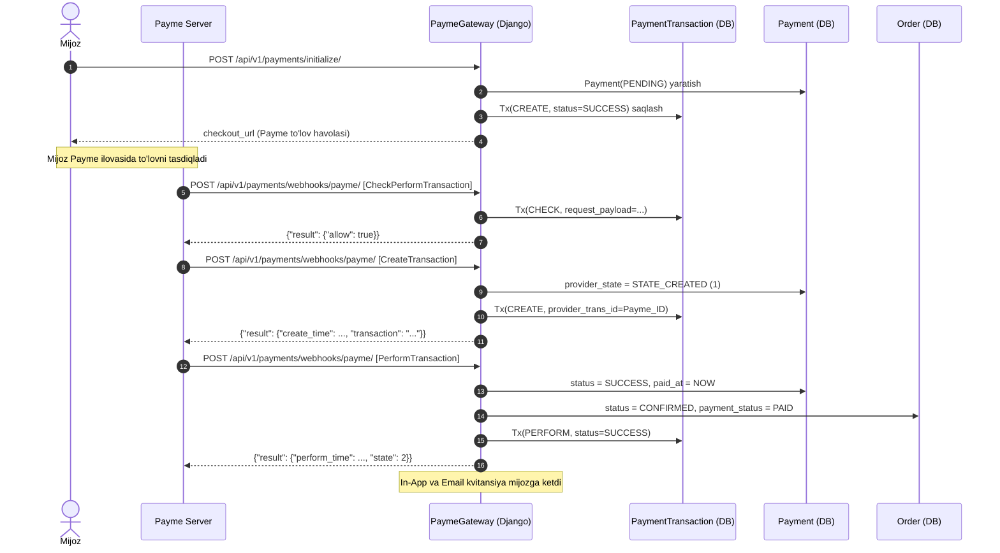
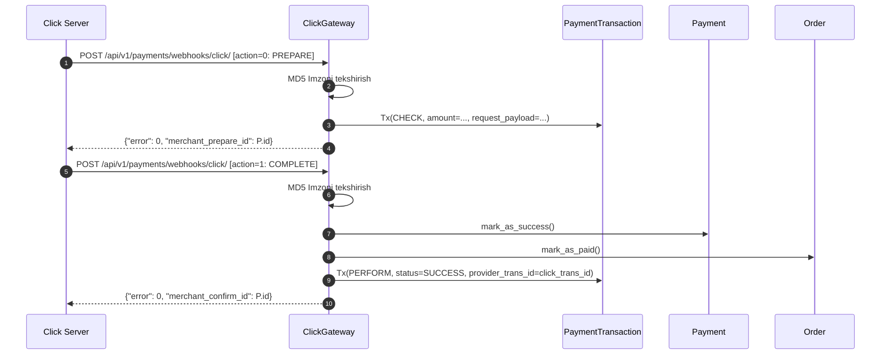
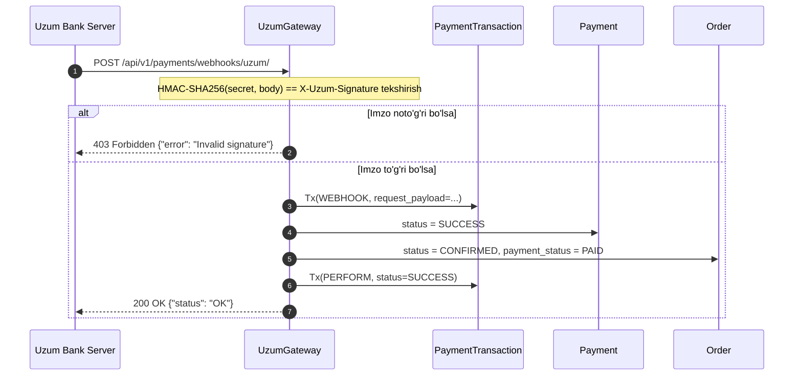
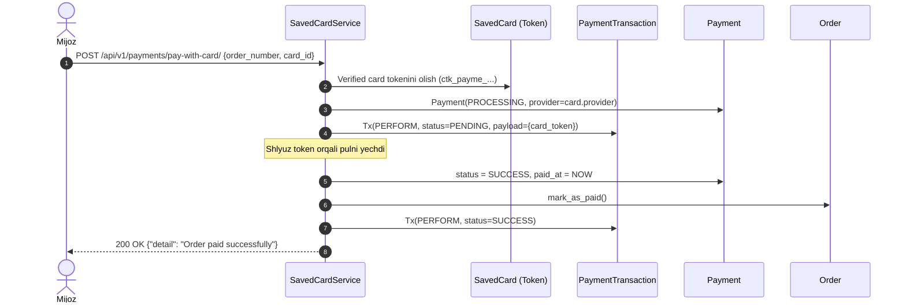
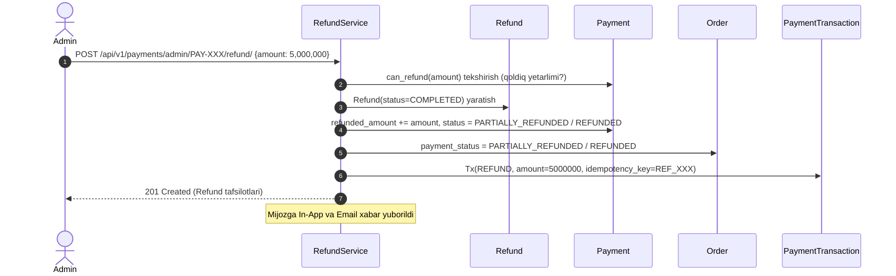

# Payment Transactions & To'lov Tizimi — To'liq Texnik Dokumentatsiya

Ushbu hujjat [`apps/payments`](file:///Users/djumanov/network-school/Groups/NS26-BD-01/ecommerce/apps/payments) moduli, xususan **`PaymentTransaction`** (shlyuz auditi va tranzaksiyalar jurnali), to'lov shlyuzlari (Payme, Click, Uzum), xavfsizlik (Idempotency, PCI-DSS tokenizatsiya), hamda qaytarishlar (Refunds) arxitekturasini to'liq yoritadi.

---

## Mundarija
1. [Arxitektura: Payment vs PaymentTransaction](#1-arxitektura-payment-vs-paymenttransaction)
2. [`PaymentTransaction` Modeli — Tizimning Yuragi](#2-paymenttransaction-modeli--tizimning-yuragi)
3. [Tranzaksiya Turlari (`TransactionType`) va Statuslar](#3-tranzaksiya-turlari-transactiontype-va-statuslar)
4. [Idempotency — Ikki Marta Pul Yechilishidan Himoya](#4-idempotency--ikki-marta-pul-yechilishidan-himoya)
5. [To'lov Shlyuzlarining Tranzaksiya Sikllari (Sequence Diagrammalar)](#5-tolov-shlyuzlarining-tranzaksiya-sikllari-sequence-diagrammalar)
   - [5.1 Payme JSON-RPC 2.0 Tranzaksiya Sikli](#51-payme-json-rpc-20-tranzaksiya-sikli)
   - [5.2 Click Shop API (Prepare & Complete) Sikli](#52-click-shop-api-prepare--complete-sikli)
   - [5.3 Uzum Bank Webhook Sikli](#53-uzum-bank-webhook-sikli)
   - [5.4 Saqlangan Karta bilan 1-Click To'lov Sikli](#54-saqlangan-karta-bilan-1-click-tolov-sikli)
   - [5.5 Refund (Mablag' Qaytarish) Tranzaksiyasi](#55-refund-mablag-qaytarish-tranzaksiyasi)
6. [`Payment` Holatlar Mashinasi (State Machine)](#6-payment-holatlar-mashinasi-state-machine)
7. [Barcha Modellar Tuzilmasi](#7-barcha-modellar-tuzilmasi)
8. [API Endpointlar Malumotnomasi](#8-api-endpointlar-malumotnomasi)
   - [Mijoz Endpointlari](#81-mijoz-endpointlari)
   - [Shlyuz Webhooklari (Server-to-Server)](#82-shlyuz-webhooklari-server-to-server)
   - [Admin / Audit Endpointlari](#83-admin--audit-endpointlari)
9. [Xavfsizlik, Fraud Monitoring va IP Nazorati](#9-xavfsizlik-fraud-monitoring-va-ip-nazorati)

---

## 1. Arxitektura: Payment vs PaymentTransaction

Moliyaviy tizimlarda **To'lov niyati (Payment)** bilan **Gateway bilan har bir texnik aloqa (PaymentTransaction)** qat'iy ajratilishi shart:

```mermaid
flowchart TD
    O["Order (Buyurtma)\nORD-20261029-A8F2K1"] --> P["Payment (To'lov sessiyasi)\nPAY-20261029-8F9B2C\nAmount: 15,325,000 UZS | Provider: PAYME | Status: SUCCESS"]
    
    subgraph Audit Trail: PaymentTransaction (Barcha aloqalar)
        P --> T1["Tx 1: CREATE\nSessiya yaratildi, checkout_url berildi\nStatus: SUCCESS"]
        P --> T2["Tx 2: CHECK\nPayme tekshirdi (CheckPerformTransaction)\nStatus: SUCCESS"]
        P --> T3["Tx 3: PERFORM\nPul yechildi (PerformTransaction)\nStatus: SUCCESS | tx_id: 67210abc..."]
        P --> T4["Tx 4: REFUND (agar qaytarilsa)\n5,000,000 UZS qaytarildi\nStatus: SUCCESS"]
    end
```

* **`Payment`**: Buyurtmachi uchun ko'rinadigan yuqori darajadagi moliyaviy yozuv (summa, provayder, umumiy status: `PENDING`, `SUCCESS`, `FAILED`).
* **`PaymentTransaction`**: **O'zgarmas (immutable) audit jurnali**. Tashqi to'lov provayderi (Payme, Click, Uzum) bilan yuz bergan **har bir** HTTP so'rov, javob, xatolik kodi, IP manzil va idempotency kalitini muhrlab boradi.

---

## 2. `PaymentTransaction` Modeli — Tizimning Yuragi

Fayl: [`apps/payments/models.py` (241-339 qatorlar)](file:///Users/djumanov/network-school/Groups/NS26-BD-01/ecommerce/apps/payments/models.py#L241-L339)

Ushbu model har qanday moliyaviy nizo (dispute), firibgarlik (fraud) yoki xatolikni millisekundigacha tergov qilish imkonini beradi:

```python
class PaymentTransaction(models.Model):
    payment = models.ForeignKey(Payment, related_name='transactions', on_delete=models.CASCADE)
    transaction_type = models.CharField(max_length=30, choices=TransactionType.choices)
    amount = models.DecimalField(max_digits=14, decimal_places=2, default=Decimal('0.00'))
    status = models.CharField(max_length=20, choices=TransactionStatus.choices, default=TransactionStatus.PENDING)
    idempotency_key = models.CharField(max_length=100, blank=True, null=True, db_index=True)
    provider_transaction_id = models.CharField(max_length=255, blank=True, null=True)
    request_payload = models.JSONField(default=dict, blank=True)   # RAW REQUEST
    response_payload = models.JSONField(default=dict, blank=True)  # RAW RESPONSE
    error_code = models.CharField(max_length=50, blank=True, null=True)
    error_message = models.TextField(blank=True, null=True)
    ip_address = models.GenericIPAddressField(null=True, blank=True)
    created_at = models.DateTimeField(auto_now_add=True, db_index=True)
```

### Maydonlarning vazifasi:

| Maydon | Turi | Maqsadi va Ahamiyati |
|---|---|---|
| `idempotency_key` | `string(100)` | Shlyuz so'rovni takror yuborganida ikkinchi marta pul yechilishini bloklovchi noyob kalit. |
| `provider_transaction_id` | `string(255)` | Tashqi tizimdagi tranzaksiya identifikatori (Payme `id`, Click `click_trans_id`, Uzum `payment_id`). |
| `request_payload` | `JSON` | Shlyuzdan kelgan yoki shlyuzga yuborilgan **aniq xom JSON ma'lumot**. Hech qanday ma'lumot yo'qotilmaydi. |
| `response_payload` | `JSON` | Tizimimiz shlyuzga qaytargan rasmiy javob. |
| `error_code` / `error_message` | `string` / `text` | Agar muammo bo'lsa, shlyuzning standart xatolik kodi (masalan, Payme `-31050`, Click `-2`). |
| `ip_address` | `IP` | Xavfsizlik auditi uchun so'rov jo'natuvchi serverning IP manzili. |

---

## 3. Tranzaksiya Turlari (`TransactionType`) va Statuslar

```python
class TransactionType(models.TextChoices):
    CHECK   = 'CHECK', 'Check / Verify'            # Tekshirish (buyurtma bormi, summa to'g'rimi)
    CREATE  = 'CREATE', 'Create Transaction'       # Shlyuzda tranzaksiya ochish / checkout URL yaratish
    PERFORM = 'PERFORM', 'Perform / Charge'        # Pulni yechish (yakunlash)
    CANCEL  = 'CANCEL', 'Cancel / Reverse'         # To'lovni bekor qilish / pulni qaytarish
    REFUND  = 'REFUND', 'Refund'                   # Rasmiy mablag' qaytarish operatsiyasi
    WEBHOOK = 'WEBHOOK', 'Webhook Notification'    # Asinxron xabarnomalar
```

```python
class TransactionStatus(models.TextChoices):
    PENDING = 'PENDING', 'Pending'   # Jarayonda
    SUCCESS = 'SUCCESS', 'Success'   # Muvaffaqiyatli yakunlandi
    FAILED  = 'FAILED', 'Failed'     # Xatolik yuz berdi
```

---

## 4. Idempotency — Ikki Marta Pul Yechilishidan Himoya

Internet sekin ishlaganda to'lov shlyuzlari bitta so'rovni 2-3 marta qayta yuborishi (retry) mumkin. Agar tizim buni nazorat qilmasa, **mijozdan 2 marta pul yechib olinadi**.

Loyihamizda bu quyidagicha hal qilingan:

1. **Har bir bosqich uchun noyob `idempotency_key` tuziladi:**
   - Boshlashda: `INIT_{payment.payment_number}`
   - Yechishda: `provider_transaction_id` yoki `PERF_{payment.payment_number}`
   - Bekor qilishda: `CANCEL_{payment.payment_number}`
   - Qaytarishda: `REF_{refund.refund_number}`
2. Tranzaksiya bajarilishidan oldin DB'da ushbu kalit bo'yicha qidiriladi:
   - Agar mavjud bo'lsa va allaqachon `SUCCESS` bo'lsa — yangi tranzaksiya yaratilmaydi, avvalgi muvaffaqiyatli javob shlyuzga qaytariladi.
   - Bu **to'liq xavfsiz va dublikatsiz** ishlashni ta'minlaydi.

---

## 5. To'lov Shlyuzlarining Tranzaksiya Sikllari (Sequence Diagrammalar)

### 5.1 Payme JSON-RPC 2.0 Tranzaksiya Sikli

Payme protokoli 5 ta asosiy JSON-RPC metodidan foydalanadi:
1. `CheckPerformTransaction` — Buyurtma va summani tekshiradi.
2. `CreateTransaction` — Tranzaksiyani yaratadi (State: 1).
3. `PerformTransaction` — To'lovni amalga oshiradi (State: 2).
4. `CheckTransaction` — Tranzaksiya holatini tekshiradi.
5. `CancelTransaction` — Bekor qiladi (State: -1 yoki -2).

> **Eslatma:** Payme'da summa **tiyin**da uzatiladi (1 UZS = 100 Tiyin).



---

### 5.2 Click Shop API (Prepare & Complete) Sikli

Click ikki bosqichli modeldan foydalanadi:
* `action = 0` (**Prepare**): Tekshirish va to'lovga tayyorgarlik.
* `action = 1` (**Complete**): To'lovni yechish va buyurtmani tasdiqlash.
* MD5 imzosi: `md5(click_trans_id + service_id + secret_key + merchant_trans_id + amount + action + sign_time)` orqali har bir so'rov tekshiriladi.



---

### 5.3 Uzum Bank Webhook Sikli

Uzum Bank callback yuborganda `HTTP_X_UZUM_SIGNATURE` sarlavhasi (HMAC-SHA256) orqali so'rov haqiqiyligini tekshiradi:



---

### 5.4 Saqlangan Karta bilan 1-Click To'lov Sikli

Mijoz oldin tasdiqlagan kartasi orqali qayta shlyuzga kirmasdan 1 ta bosishda to'lov qiladi:



---

### 5.5 Refund (Mablag' Qaytarish) Tranzaksiyasi

Admin tomonidan pul qaytarilganda moliyaviy zanjir:



---

## 6. `Payment` Holatlar Mashinasi (State Machine)

```
               ┌───────────────► CANCELLED (Mijoz bekor qildi yoki timeout)
               │
PENDING ───────┼───────────────► FAILED (Balans yetarli emas / karta xatosi)
               │
               ▼
          PROCESSING
               │
               ▼
            SUCCESS ───────────► PARTIALLY_REFUNDED (Qisman qaytarildi)
               │
               ▼
            REFUNDED (To'liq qaytarildi)
```

---

## 7. Barcha Modellar Tuzilmasi

```
┌─────────────────────────────────┐
│             Payment             │
├─────────────────────────────────┤
│ id: BigAutoField (PK)           │
│ payment_number: CharField (UQ)  │ ──┐
│ order: FK(Order, PROTECT)       │   │
│ user: FK(User, SET_NULL)        │   │ 1:N
│ amount: DecimalField            │   │
│ currency: CharField (UZS)       │   │
│ provider: PAYME/CLICK/UZUM...   │   │
│ status: PENDING/SUCCESS/FAIL... │   │
│ provider_transaction_id         │   │
│ checkout_url: URLField          │   │
│ paid_at: DateTime               │   │
└─────────────────────────────────┘   │
                                      │
       ┌──────────────────────────────┴──────────────────────────────┐
       │                                                             │
       ▼                                                             ▼
┌─────────────────────────────────┐           ┌─────────────────────────────────┐
│       PaymentTransaction        │           │             Refund              │
├─────────────────────────────────┤           ├─────────────────────────────────┤
│ id: BigAutoField (PK)           │           │ id: BigAutoField (PK)           │
│ payment: FK(Payment, CASCADE)   │           │ refund_number: CharField (UQ)   │
│ transaction_type: CHECK/PERF... │           │ payment: FK(Payment, PROTECT)   │
│ amount: DecimalField            │           │ order: FK(Order, PROTECT)       │
│ status: PENDING/SUCCESS/FAILED  │           │ amount: DecimalField            │
│ idempotency_key: CharField(IDX) │           │ status: PENDING/COMPLETED/FAIL  │
│ provider_transaction_id: String │           │ reason: TextField               │
│ request_payload: JSONField      │           │ provider_refund_id: String      │
│ response_payload: JSONField     │           │ created_by: FK(User, SET_NULL)  │
│ error_code: CharField           │           │ processed_at: DateTime          │
│ ip_address: GenericIPAddress    │           └─────────────────────────────────┘
│ created_at: DateTime            │
└─────────────────────────────────┘
```

---

## 8. API Endpointlar Malumotnomasi

### 8.1 Mijoz Endpointlari

#### 1. To'lovni boshlash: `POST /api/v1/payments/initialize/`
Yangi to'lov ochadi, `checkout_url` generatsiya qiladi va `CREATE` tranzaksiyasini yozadi.
* **Header:** `Authorization: Bearer <token>`
* **Request:**
  ```json
  {
    "order_number": "ORD-20261029-A8F2K1",
    "provider": "PAYME",
    "return_url": "https://myshop.uz/order/success"
  }
  ```
* **Response `201 Created`:**
  ```json
  {
    "payment_number": "PAY-20261029-8F9B2C",
    "order_number": "ORD-20261029-A8F2K1",
    "amount": "15325000.00",
    "currency": "UZS",
    "provider": "PAYME",
    "status": "PENDING",
    "checkout_url": "https://checkout.paycom.uz/bT0xMjM0...",
    "created_at": "2026-10-29T15:10:00Z"
  }
  ```

#### 2. Saqlangan kartalar boshqaruvi:
* `GET  /api/v1/payments/cards/` — Mijozning faol kartalari
* `POST /api/v1/payments/cards/` — Yangi karta qo'shish (SMS OTP yuboriladi)
* `POST /api/v1/payments/cards/<id>/verify/` — OTP kodni tekshirish
* `POST /api/v1/payments/cards/<id>/default/` — Asosiy karta deb belgilash
* `DELETE /api/v1/payments/cards/<id>/` — Kartani o'chirish
* `POST /api/v1/payments/pay-with-card/` — 1-click to'lov (`order_number`, `card_id`)

#### 3. To'lovni bekor qilish: `POST /api/v1/payments/<payment_number>/cancel/`
Faqat `PENDING` holatdagi to'lovni bekor qiladi va `CANCEL` tranzaksiya yozadi.

---

### 8.2 Shlyuz Webhooklari (Server-to-Server)

Ushbu endpointlar CSRF talab qilmaydi va to'lov shlyuzi serveri tomonidan chaqiriladi:

| Endpoint | Protokol | Autentifikatsiya |
|---|---|---|
| `POST /api/v1/payments/webhooks/payme/` | JSON-RPC 2.0 | HTTP Basic `Authorization: Basic Paycom:SECRET` |
| `POST /api/v1/payments/webhooks/click/` | Form / JSON | MD5 Checksum (`sign_string`) |
| `POST /api/v1/payments/webhooks/uzum/` | JSON Callback | HMAC-SHA256 (`HTTP_X_UZUM_SIGNATURE`) |

---

### 8.3 Admin / Audit Endpointlari

Barcha endpointlar faqat **Staff** foydalanuvchilar uchun ochiq (`IsStaffUser`):

#### 1. Shlyuz Tranzaksiyalari Jurnali (Audit):
`GET /api/v1/payments/admin/transactions/`
* **Query parametrlar:** `status`, `transaction_type`, `payment_number`, `search` (idempotency kalit yoki shlyuz ID bo'yicha qidiruv).
* **Response:**
  ```json
  {
    "count": 420,
    "results": [
      {
        "id": 1052,
        "payment_number": "PAY-20261029-8F9B2C",
        "transaction_type": "PERFORM",
        "transaction_type_display": "Perform / Charge",
        "amount": "15325000.00",
        "status": "SUCCESS",
        "idempotency_key": "67210abc...",
        "provider_transaction_id": "67210abc...",
        "request_payload": {"method": "PerformTransaction", "params": {"id": "67210abc..."}},
        "response_payload": {"result": {"state": 2, "perform_time": 1730214765000}},
        "error_code": null,
        "ip_address": "195.158.30.12",
        "created_at": "2026-10-29T15:12:45Z"
      }
    ]
  }
  ```

#### 2. Kengaytirilgan To'lov Ma'lumotlari:
`GET /api/v1/payments/admin/<payment_number>/`  
Ushbu to'lovga tegishli barcha `transactions` va `refunds` ro'yxatini ichma-ich (nested) ko'rinishda qaytaradi.

#### 3. Refund Yaratish:
`POST /api/v1/payments/admin/<payment_number>/refund/`
* **Request:**
  ```json
  {
    "amount": "5000000.00",
    "reason": "Mijoz talabi bilan qaytarildi"
  }
  ```

---

## 9. Xavfsizlik, Fraud Monitoring va IP Nazorati

1. **IP Manzillarni ro'yxatga olish (`ip_address`):**
   Har bir webhook so'rovining haqiqiy IP manzili `HTTP_X_FORWARDED_FOR` yoki `REMOTE_ADDR` orqali olinib, tranzaksiya jurnaliga yoziladi. Bu firibgarlik harakatlarini aniqlash imkonini beradi.
2. **PCI-DSS Muvofiqligi:**
   Mijozning 16 xonali to'liq karta raqami yoki CVV kodi **hech qachon ma'lumotlar bazasida saqlanmaydi**. Faqat maskalangan ko'rinishi (`8600 12** **** 1234`) va shlyuz qaytargan token (`card_token`) saqlanadi.
3. **Tranzaksiyalarning O'zgarmasligi:**
   `PaymentTransaction` yozuvlari faqat `create` qilinadi, ular hech qachon tahrirlanmaydi (update) yoki o'chirilmaydi. Bu moliyaviy audit uchun qat'iy talab hisoblanadi.
