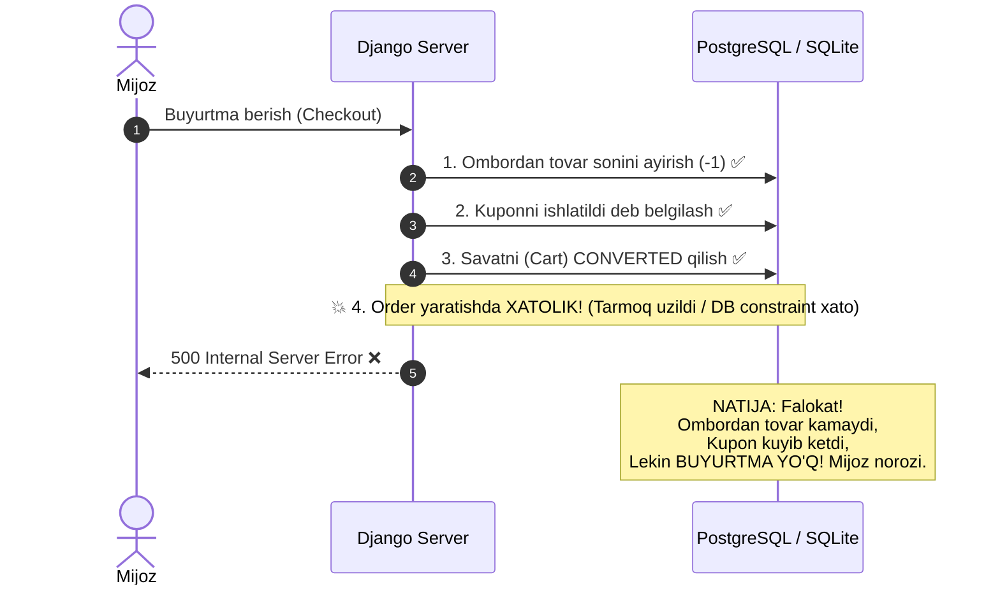
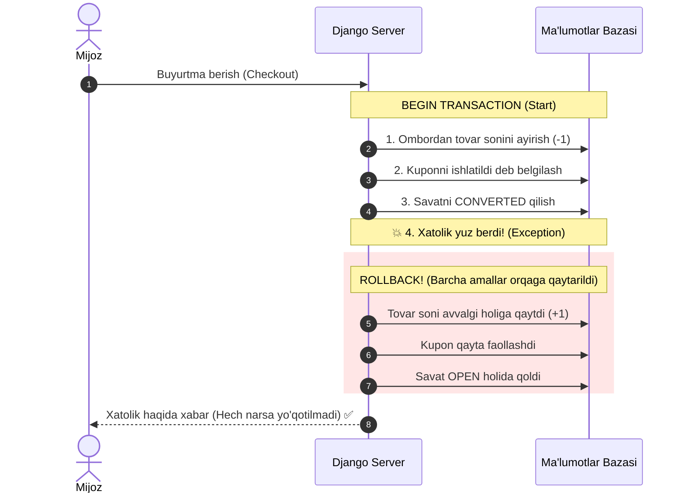
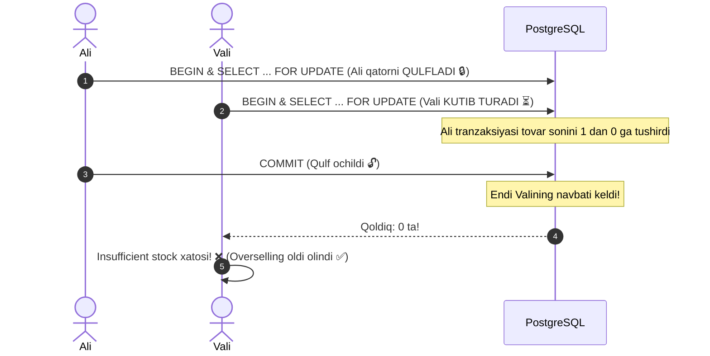
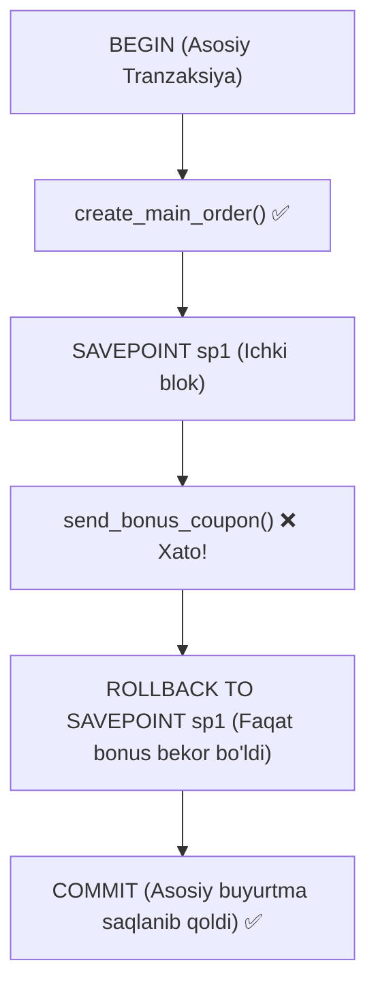

# Database Transactions (Django / Python) — Mohiyati va Amaliy Qo'llanilishi

## Mundarija
1. [Tranzaksiya nima va u nima uchun kerak?](#1-tranzaksiya-nima-va-u-nima-uchun-kerak)
2. [ACID Prinsiplari](#2-acid-prinsiplari)
3. [Tranzaksiyasiz Hayot: Falokat Ssenariysi (Vizualizatsiya)](#3-tranzaksiyasiz-hayot-falokat-ssenariysi-vizualizatsiya)
4. [Tranzaksiya bilan: Xavfsiz Hayot (Vizualizatsiya)](#4-tranzaksiya-bilan-xavfsiz-hayot-vizualizatsiya)
5. [Django'da `transaction.atomic` Qanday Ishlaydi?](#5-djangoda-transactionatomic-qanday-ishlaydi)
6. [Loyihamizdagi Jonli Misollar](#6-loyihamizdagi-jonli-misollar)
7. [Pessimistik Blokirovka (`select_for_update`) va Race Condition](#7-pessimistik-blokirovka-select_for_update-va-race-condition)
8. [Nested Transactions (Savepoints)](#8-nested-transactions-savepoints)
9. [Eng Katta Xatolar va Best Practices](#9-eng-katta-xatolar-va-best-practices)

---

## 1. Tranzaksiya nima va u nima uchun kerak?

Dasturlashda va ma'lumotlar bazasida (DB) **Tranzaksiya (Transaction)** — bu **bitta ajralmas butunlik (Atomic unit)** sifatida bajarilishi shart bo'lgan operatsiyalar ketma-ketligidir.

> **Tranzaksiyaning asosiy qoidasi:**  
> Yo barcha amallar **to'liq muvaffaqiyatli** bajariladi (**COMMIT**),  
> yoki bittasida xatolik yuz bersa, oldingi barcha amallar **bekor qilinadi** (**ROLLBACK**). Hech qachon "yarimta bajarilgan" holat qolmaydi!

---

## 2. ACID Prinsiplari

Har qanday ishonchli DB tranzaksiyasi 4 ta ustunga tayanadi:

| Harf | Nomi | Ma'nosi | Misol (E-commerce) |
|---|---|---|---|
| **A** | **Atomicity** (Bo'linmaslik) | "Hammasi yoki hech narsa". Yarimta buyurtma bo'lishi mumkin emas. | Pul yechildi, lekin buyurtma bazaga yozilmadi — bu holat bo'lmasligi kerak. |
| **C** | **Consistency** (Muvofiqlik) | Baza qoidalari (Constraints, Foreign Key, Balans) buzilmaydi. | Ombordagi tovar soni manfiy (-1) bo'lib qolmasligi shart. |
| **I** | **Isolation** (Alohidalik) | Parallel ishlayotgan tranzaksiyalar bir-biriga xalaqit bermaydi. | 2 kishi bir vaqtda oxirgi 1 ta iPhone'ni sotib ololmaydi. |
| **D** | **Durability** (Bardavomlik) | Tranzaksiya commit bo'ldimi, server o'chib yonsa ham ma'lumot yo'qolmaydi. | To'lov tasdiqlangach, server o'chsa ham buyurtma o'chib ketmaydi. |

---

## 3. Tranzaksiyasiz Hayot: Falokat Ssenariysi (Vizualizatsiya)

Tasavvur qiling: Mijoz buyurtma beryapti. Tranzaksiya yo'q (`atomic` ishlatilmagan). 4-bosqichda serverda xatolik yuz berdi:



---

## 4. Tranzaksiya bilan: Xavfsiz Hayot (Vizualizatsiya)

Endi xuddi shu operatsiyani `@transaction.atomic` ichiga olamiz:



---

## 5. Django'da `transaction.atomic` Qanday Ishlaydi?

Django'da tranzaksiya boshqarish uchun `django.db.transaction` moduli ishlatiladi.

Uni 2 xil usulda ishlatish mumkin:

### A) Dekorator sifatida (Funksiya yoki metod uchun)
```python
from django.db import transaction

@transaction.atomic
def my_view_or_service():
    # Bu funksiya ichidagi barcha DB amallari bitta tranzaksiya
    order = Order.objects.create(...)
    item = OrderItem.objects.create(...)
    # Agar bu yerda xato chiqsa -> hamma create lar bekor bo'ladi
```

### B) Kontekst menejer sifatida (`with` blogi)
Faqat ma'lum bir qismini tranzaksiyaga olish uchun:
```python
from django.db import transaction

def process_something():
    # Bu qism tranzaksiyasiz
    prepare_data()

    with transaction.atomic():
        # Faqat mana shu blok bitta tranzaksiya
        user.balance -= 10000
        user.save()
        Payment.objects.create(user=user, amount=10000)

    # Bu qism tranzaksiya commit bo'lgandan keyin ishlaydi
    send_email_notification()
```

---

## 6. Loyihamizdagi Jonli Misollar

### Misol 1: Buyurtma yaratish (`OrderService.create_order_from_cart`)
Fayl: [`apps/orders/services.py`](file:///Users/djumanov/network-school/Groups/NS26-BD-01/ecommerce/apps/orders/services.py#L198-L350)

Buyurtma berish juda murakkab jarayon bo'lib, quyidagi 6 ta bosqichni o'z ichiga oladi:
1. Ombordagi mahsulot qoldig'ini bloklash va tekshirish (`select_for_update`)
2. Asosiy `Order` yozuvini yaratish
3. Manzil snapshotini yaratish (`OrderAddress`)
4. Mahsulotlar snapshotini yaratish (`OrderItem`) va omborda zaxiralash (`reserved_quantity`)
5. Kupon ishlatilganini qayd etish (`CouponUsage`)
6. Savat holatini o'zgartirish (`Cart.status = CONVERTED`)

```python
@classmethod
@transaction.atomic  # <--- BARCHA AMALLAR BITTA TRANZAKSIYADA
def create_order_from_cart(cls, user, shipping_address_data, ...):
    # 1. Lock inventories
    locked_inventories = {
        inv.variant_id: inv
        for inv in Inventory.objects.select_for_update().filter(variant_id__in=variant_ids)
    }

    # 2. Omborda yetarliligini tekshirish
    for item in cart_items:
        if locked_inventories[item.variant_id].available_quantity < item.quantity:
            raise ValidationError("Yetarli tovar yo'q!")  # -> Tranzaksiya darhol ROLLBACK bo'ladi

    # 3. Order yaratish
    order = Order.objects.create(...)

    # 4. Address yaratish
    OrderAddress.objects.create(order=order, ...)

    # 5. Har bir itemni yaratish va zaxirani oshirish
    for item in cart_items:
        inv = locked_inventories[item.variant_id]
        inv.reserved_quantity += item.quantity
        inv.save()
        OrderItem.objects.create(order=order, ...)

    # 6. Savatni CONVERTED qilish
    cart.status = Cart.CartStatus.CONVERTED
    cart.save()

    return order  # Agar xatosiz yakunlansa -> DB ga COMMIT qilinadi!
```

---

### Misol 2: To'lov muvaffaqiyati (`Payment.mark_as_success`)
Fayl: [`apps/payments/models.py`](file:///Users/djumanov/network-school/Groups/NS26-BD-01/ecommerce/apps/payments/models.py#L181-L210)

```python
@transaction.atomic
def mark_as_success(self, provider_transaction_id=None, save=True, user=None):
    # 1. To'lov statusini SUCCESS qilish
    self.status = self.PaymentStatus.SUCCESS
    self.paid_at = timezone.now()
    self.save()

    # 2. Bog'langan Buyurtmani ham bir vaqtda PAID qilish
    if self.order:
        self.order.mark_as_paid(user=user)
```
> Agar `order.mark_as_paid()` da biron muammo bo'lsa, `payment.status` ham `SUCCESS` bo'lib qolmaydi, balki orqaga qaytariladi!

---

### Misol 3: Pul qaytarish (`RefundService.process_refund`)
Fayl: [`apps/payments/services/refund_service.py`](file:///Users/djumanov/network-school/Groups/NS26-BD-01/ecommerce/apps/payments/services/refund_service.py#L26-L73)

```python
@classmethod
@transaction.atomic
def process_refund(cls, payment: Payment, amount: Decimal, ...):
    # 1. Balansni tekshirish
    if not payment.can_refund(amount):
        raise ValidationError(...)

    # 2. Refund obyekti yaratish
    refund = Refund.objects.create(...)
    refund.mark_as_completed()

    # 3. Audit log yozish
    PaymentTransaction.objects.create(...)

    return refund
```

---

## 7. Pessimistik Blokirovka (`select_for_update`) va Race Condition

Oddiy tranzaksiyaning o'zi yetarli bo'lmagan holatlar mavjud: **Race Condition** (Poyga holati).

### Muammo: 2 kishi 1 ta oxirgi tovar ustida
Omborda faqat **1 ta** noutbuk qolgan. Ali va Vali bir vaqtda (1 millisekund farq bilan) "Sotib olish" tugmasini bosdi.

```mermaid
flowchart TD
    subgraph Tranzaksiyasiz yoki Qulflarsiz (Xato!)
        U1["Ali so'rovi"] --> R1["DB: Qoldiq 1 ta ekan"]
        U2["Vali so'rovi"] --> R2["DB: Qoldiq 1 ta ekan"]
        R1 --> S1["Ali buyurtma qildi (Qoldiq = 0)"]
        R2 --> S2["Vali ham buyurtma qildi (Qoldiq = -1) ❌ Overselling!"]
    end
```

### Yechim: `select_for_update()` (Pessimistic Lock)
Fayl: [`apps/orders/services.py` 231-qator](file:///Users/djumanov/network-school/Groups/NS26-BD-01/ecommerce/apps/orders/services.py#L231)

```python
Inventory.objects.select_for_update().filter(variant_id__in=variant_ids)
```

Bu SQL darajasida quyidagicha ishlaydi:
```sql
SELECT * FROM inventory WHERE variant_id IN (...) FOR UPDATE;
```



---

## 8. Nested Transactions (Savepoints)

Agar bitta `atomic` blok ichida yana bir `atomic` blok ochilsa nima bo'ladi?  
Django buni **Savepoint** (saqlash nuqtasi) mexanizmi bilan hal qiladi.

```python
with transaction.atomic():  # Asosiy tranzaksiya
    create_main_order()

    try:
        with transaction.atomic():  # Ichki tranzaksiya (Savepoint)
            send_bonus_coupon()
            raise Exception("Bonus xizmati ishlamayapti")
    except Exception:
        # Faqat ichki savepoint bekor bo'ladi!
        print("Bonus berilmadi, lekin asosiy buyurtma bekor qilinmaydi.")

    # Asosiy tranzaksiya muvaffaqiyatli COMMIT bo'ladi
```



---

## 9. Eng Katta Xatolar va Best Practices

### ❌ XATO 1: Tranzaksiya ichida tashqi API yoki Email chaqirish
```python
# ⛔ YOMON AMALIYOT:
@transaction.atomic
def pay_order(order):
    order.status = 'PAID'
    order.save()
    
    # ❌ Tranzaksiya ichida sekin tashqi so'rovlar qilmang!
    send_email_receipt()             # Agar SMTP 5 soniya qotsa, DB 5 soniya bloklanadi!
    call_external_delivery_api()     # Agar bu xato bersa, to'lov ham bekor bo'lib ketadi!
```

### ✅ TO'G'RI: `transaction.on_commit()` ishlatish
DB tranzaksiyasi to'liq bazaga yozilib bo'lgandan keyingina email jo'natish:
```python
# 🟢 TO'G'RI AMALIYOT:
@transaction.atomic
def pay_order(order):
    order.status = 'PAID'
    order.save()

    # Tranzaksiya COMMIT bo'lgandan keyingina ishga tushadi:
    transaction.on_commit(lambda: send_email_receipt(order.id))
```

---

### ❌ XATO 2: Tranzaksiya ichidagi xatolikni `try-except` bilan yutib yuborish
```python
# ⛔ XAVFLI:
@transaction.atomic
def broken_process():
    try:
        Order.objects.create(...)
        # DatabaseError yuz berdi
    except Exception:
        pass  # Xatoni yutib yuborildi, lekin tranzaksiya singan (broken state)
    
    # Keyingi DB so'rovi TransactionManagementError beradi!
```

---

### Qisqacha Xulosa Jadvali

| Savol | Javob |
|---|---|
| **Qachon ishlatish kerak?** | 2 yoki undan ortiq bir-biriga bog'liq DB yozuvlari bajarilganda (Order + Items + Inventory). |
| **Qachon `select_for_update` kerak?** | Qoldiq, balans yoki limitlar bilan parallel ishlaganda (Overselling/Race condition oldini olish uchun). |
| **Email/Telegram qachon yuboriladi?** | Tranzaksiya ichida emas, `transaction.on_commit` yordamida commit'dan keyin. |
| **Django sintaksisi nima?** | `@transaction.atomic` yoki `with transaction.atomic():`. |
