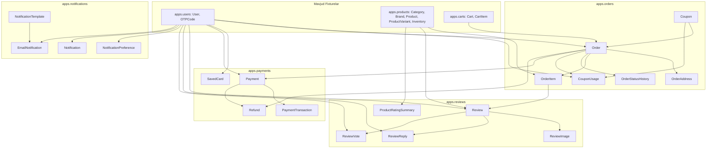

# Plan: Comprehensive Test Fixtures for Orders, Payments, Notifications, and Reviews Apps

## Metadata
- **Title**: Test Fixtures Architecture & Dataset Generation for Orders, Payments, Notifications, and Reviews
- **Date**: 2026-10-24
- **Status**: COMPLETED
- **Branch**: `feat/app-fixtures`
- **Author**: Antigravity

---

## 1. Context & Motivation

Loyiha doirasida `apps.users`, `apps.products`, va `apps.carts` ilovalari uchun test ma'lumotlari to'plami (Django Fixtures) ishlab chiqilgan bo'lib, ular `apps/*/fixtures/*_data.json` hamda birlashtirilgan `fixtures/ecommerce_data.json` fayllarida saqlanadi.

Biroq, tizimning qolgan muhim biznes ilovalari:
1. `apps.orders` (Buyurtmalar, chegirma kuponlari, buyurtma manzillari, elementlari va holat tarixi),
2. `apps.payments` (To'lov operatsiyalari, to'lov tizimlari transaksiyalari, pul qaytarish (refund) va saqlangan kartalar),
3. `apps.notifications` (Shablonlar, in-app bildirishnomalar, email xabarnomalari va foydalanuvchi xabarnoma sozlamalari),
4. `apps.reviews` (Mahsulot sharhlari, reytinglar, sharh rasmlari, admin javoblari, foydalilik ovozlari va umumiy reytinglar agregatsiyasi)

uchun fixture fayllari mavjud emas.

Ushbu reja orqali barcha qolgan ilovalar uchun to'liq izchil, Foreign Key munosabatlariga qat'iy mos, real ma'lumotlarni o'z ichiga oluvchi test fixturelari yaratiladi hamda master `fixtures/ecommerce_data.json` fayli to'liq yangilanadi.

---

## 2. Architecture & Technical Design

### 2.1. Model Bog'liqliklari (Dependency Hierarchy)

### 2.2. Yangi Fixture Fayllari Tuzilishi

1. **`apps/orders/fixtures/orders_data.json`**:
   - `orders.coupon`:
     - ID 1: `WELCOME10` (10% foizli chegirma, min 200,000 UZS, faol)
     - ID 2: `SUMMER50` (50,000 UZS qat'iy chegirma, min 300,000 UZS, faol)
     - ID 3: `EXPIRED20` (Muddati o'tgan chegirma kodi, testlash uchun)
   - `orders.order`:
     - ID 1 (`ORD-20261024-0001`): `john.doe@example.com`, status: `DELIVERED`, payment_status: `PAID`, payme, jami: 2,249.00
     - ID 2 (`ORD-20261024-0002`): `jane.doe@example.com`, status: `PROCESSING`, payment_status: `PAID`, click, jami: 999.00
     - ID 3 (`ORD-20261024-0003`): `john.doe@example.com`, status: `PENDING`, payment_status: `PENDING`, uzum, jami: 130.00
     - ID 4 (`ORD-20261024-0004`): `jane.doe@example.com`, status: `CANCELLED`, payment_status: `REFUNDED`, payme, jami: 2,499.00
   - `orders.orderaddress`:
     - Har bir buyurtma uchun yetkazib berish va hisob-kitob manzillari (Toshkent, Samarqand, to'liq geolokatsiya va telefon raqamlari).
   - `orders.orderitem`:
     - MacBook Pro 16", iPhone 15 Pro, Nike Air Max mahsulot variantlariga bog'langan buyurtma elementlari (narx, miqdor, snapshot).
   - `orders.orderstatushistory`:
     - Buyurtma holatlari o'zgarishi jurnali (`PENDING` -> `PAID` -> `PROCESSING` -> `DELIVERED`).
   - `orders.couponusage`:
     - `SUMMER50` kuponining John Doe tomonidan foydalanilganlik yozuvi.

2. **`apps/payments/fixtures/payments_data.json`**:
   - `payments.savedcard`:
     - ID 1: John Doe uchun Uzcard (`8600 **** **** 1234`), provayder: `PAYME`
     - ID 2: Jane Doe uchun Humo (`9860 **** **** 5678`), provayder: `CLICK`
   - `payments.payment`:
     - ID 1 (`PAY-20261024-0001`): Order 1 uchun, provider: `PAYME`, status: `PAID`, summa: 2,249.00
     - ID 2 (`PAY-20261024-0002`): Order 2 uchun, provider: `CLICK`, status: `PAID`, summa: 999.00
     - ID 3 (`PAY-20261024-0003`): Order 3 uchun, provider: `UZUM`, status: `PENDING`, summa: 130.00
     - ID 4 (`PAY-20261024-0004`): Order 4 uchun, provider: `PAYME`, status: `REFUNDED`, summa: 2,499.00
   - `payments.paymenttransaction`:
     - Har bir to'lov bo'yicha to'lov provayderi tranzaksiya yozuvlari (`SUCCESS`, `PENDING`).
   - `payments.refund`:
     - Payment 4 / Order 4 bo'yicha to'liq pul qaytarish (refund) tranzaksiyasi.

3. **`apps/notifications/fixtures/notifications_data.json`**:
   - `notifications.notificationtemplate`:
     - ID 1: `ORDER_CONFIRMED` ("Buyurtma qabul qilindi")
     - ID 2: `ORDER_SHIPPED` ("Buyurtma yo'lda")
     - ID 3: `ORDER_DELIVERED` ("Buyurtma yetkazildi")
     - ID 4: `PAYMENT_SUCCESS` ("To'lov muvaffaqiyatli amalga oshirildi")
   - `notifications.notificationpreference`:
     - Admin, John Doe va Jane Doe uchun bildirishnoma afzalliklari sozlamalari.
   - `notifications.notification`:
     - Foydalanuvchilar uchun in-app bildirishnomalar (o'qilgan va yangi holatda).
   - `notifications.emailnotification`:
     - Yuborilgan (`SENT`), navbatda turgan (`PENDING`) hamda qayta urinishdagi email bildirishnomalari.

4. **`apps/reviews/fixtures/reviews_data.json`**:
   - `reviews.review`:
     - ID 1: John Doe - MacBook Pro 16", 5 yulduz, `APPROVED`, tasdiqlangan xarid (`is_verified_purchase=True`), OrderItem 1 ga bog'langan.
     - ID 2: Jane Doe - iPhone 15 Pro, 4 yulduz, `APPROVED`, tasdiqlangan xarid, OrderItem 2 ga bog'langan.
     - ID 3: John Doe - Nike Air Max 270, 5 yulduz, `APPROVED`.
     - ID 4: Jane Doe - MacBook Pro 16", 3 yulduz, `PENDING` (moderatsiyada).
   - `reviews.reviewimage`:
     - Sharhga biriktirilgan rasmlar (muqobil URL va caption).
   - `reviews.reviewreply`:
     - Do'kon administratori tomonidan John Doe sharhiga berilgan rasmiy javob.
   - `reviews.reviewvote`:
     - Sharhlarga qoldirilgan foydali (`HELPFUL`) ovozlar.
   - `reviews.productratingsummary`:
     - MacBook Pro 16" va iPhone 15 Pro uchun agregat reyting va umumiy sharhlar soni xulosasi.

5. **`fixtures/ecommerce_data.json` (Master Consolidated Fixture)**:
   - Users -> Products -> Carts -> Orders -> Payments -> Reviews -> Notifications ketma-ketligida to'liq bog'langan global ma'lumotlar to'plami.
   - Buyruq orqali bir martada barcha ma'lumotlarni xatosiz yuklash: `python manage.py loaddata ecommerce_data`.

---

## 3. Detailed Sequential Checklist

- [x] Step 1: Create fixture directory structures (`apps/orders/fixtures/`, `apps/payments/fixtures/`, `apps/notifications/fixtures/`, `apps/reviews/fixtures/`)
- [x] Step 2: Author `apps/orders/fixtures/orders_data.json` with coupons, orders, addresses, items, status histories, and coupon usages
- [x] Step 3: Author `apps/payments/fixtures/payments_data.json` with saved cards, payments, transactions, and refunds
- [x] Step 4: Author `apps/notifications/fixtures/notifications_data.json` with templates, preferences, in-app notifications, and email logs
- [x] Step 5: Author `apps/reviews/fixtures/reviews_data.json` with reviews, images, replies, helpful votes, and product rating summaries
- [x] Step 6: Consolidate and update master fixture in `fixtures/ecommerce_data.json` combining all modules in dependency order
- [x] Step 7: Verify fixture loading via `python manage.py loaddata` for each individual app and the master dataset
- [x] Step 8: Write automated test suite to verify all app fixtures load and maintain model integrity
- [x] Step 9: Run full test suite (`python manage.py test`) ensuring all 224+ tests pass with zero regressions
- [x] Step 10: Finalize documentation, update plan status to COMPLETED, and commit changes following git workflow
