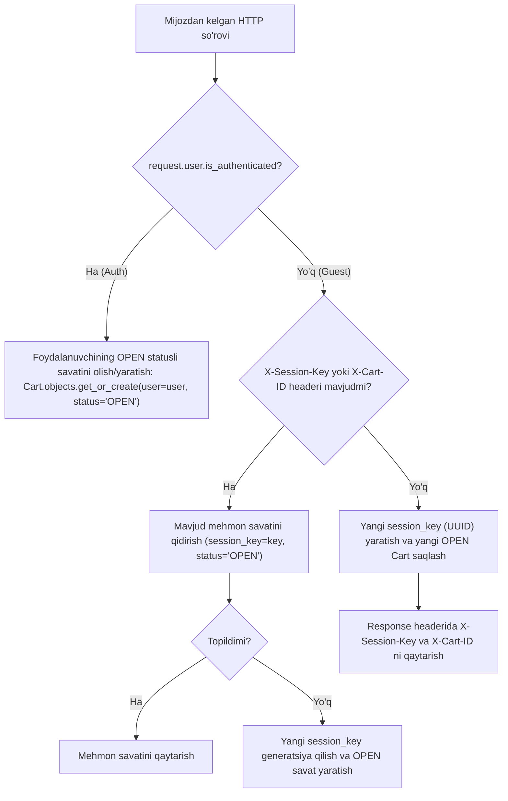

# Plan: Shopping Cart REST API Implementation (`apps/carts`)

## Metadata
- **Title**: Shopping Cart REST API: Full Lifecycle Management, Guest Sessions, Real-Time Inventory & Price Validation, Cart Merging
- **Date**: 2026-10-20
- **Status**: COMPLETED
- **Branch**: `feat/cart-api`

---

## 1. Context & Motivation

[plans/cart-models.md](file:///Users/djumanov/Academy/backend-development/Summer-2026/ecommerce/plans/cart-models.md) da belgilangan `Cart` va `CartItem` modellar arxitekturasi to'liq shakllantirilgan deb qabul qilinadi. Ushbu modellar o'zida:
- UUID asosidagi xavfsiz identifikatorlar (`id`),
- Foydalanuvchi (`user`) va mehmon sessiyalari (`session_key`),
- Aniq tovar modifikatsiyalariga bog'liqlik (`ProductVariant`),
- Qo'shilgan paytdagi narx snapshot'i (`unit_price_at_addition`),
- Savat hayot tsikli statuslari (`OPEN`, `MERGED`, `CONVERTED`, `ABANDONED`),
- Hisoblanadigan xususiyatlar (`total_items`, `subtotal`, `total_price`, `total_discount`, `is_price_changed`, `is_available`) va metodlar (`merge_with`, `clear`)ni mujassam etgan.

Ushbu rejaning maqsadi — frontend (Next.js/React), mobil ilovalar va boshqa mijozlar uchun yuqori unumdorlikka ega, to'liq optimallashgan (N+1 SQL muammolarisiz), xavfsiz va qat'iy biznes logikaga ega **Shopping Cart REST API (`/api/v1/cart/`)** tizimini loyihalashtirish va amalga oshirishdir.

---

## 2. API Endpoints Specification (`/api/v1/cart/`)

Savat moduli quyidagi 7 ta asosiy endpointdan iborat bo'ladi:

| # | Metod | URL | Ruxsat | Tavsif |
|---|:---|:---|:---|:---|
| 1 | `GET` | `/api/v1/cart/` | Public / Auth | Savatning to'liq holati (barcha tovarlar, narxlar, chegirmalar, ogohlantirishlar) |
| 2 | `GET` | `/api/v1/cart/count/` | Public / Auth | Yengil navbar/badge uchun savatdagi tovarlar soni va umumiy summa |
| 3 | `POST` | `/api/v1/cart/items/` | Public / Auth | Savatga mahsulot varianti (SKU) qo'shish |
| 4 | `PATCH` | `/api/v1/cart/items/<int:item_id>/` | Public / Auth | Savatdagi aniq tovar miqdorini (`quantity`) o'zgartirish |
| 5 | `DELETE` | `/api/v1/cart/items/<int:item_id>/` | Public / Auth | Tovarni savatdan butunlay o'chirish |
| 6 | `POST` | `/api/v1/cart/clear/` | Public / Auth | Savatdagi barcha tovarlarni tozalash |
| 7 | `POST` | `/api/v1/cart/merge/` | Authenticated | Mehmon savatini tizimga kirgan foydalanuvchi akkauntiga birlashtirish |

---

## 3. Architecture & Technical Design

### 3.1. Guest (Anonim) va Authenticated Mijozlar Sessiyasini Boshqarish

Savat tizimi gibrid mijozlarni (avtorizatsiyadan o'tgan yoki mehmon) uzluksiz qo'llab-quvvatlaydi:



- **Header Konvensiyasi**: Mehmon mijozlar so'rovlarida `X-Session-Key: <unique_string_or_uuid>` yoki `X-Cart-ID: <uuid>` yuborishadi.
- **Birinchi so'rov (Savat yaratish)**: Agar mehmon mijoz birinchi marta tovar qo'shsa va header yubormasa, backend avtomatik yangi `session_key` generatsiya qiladi va uni javobning `X-Session-Key` sarlavhasida hamda javob tanasida (response body) qaytaradi.
- **Frontend integratsiyasi**: SPA/Mobil ilovalar ushbu kalitni `localStorage` yoki `secure cookie`da saqlab, keyingi so'rovlarda `X-Session-Key` headeri orqali uzatadi.

---

### 3.2. Serializers Arxitekturasi (`apps/carts/serializers/`)

Savat ma'lumotlarini to'liq va optimal formatda uzatish uchun maxsus serializerlar tuzilmasi:

1. **`CartItemVariantSerializer`**:
   Savat ichidagi har bir tovar varianti haqida xaridorga kerakli barcha ma'lumotlarni beradi:
   - `id`: Variant ID
   - `sku`: SKU kodi (masalan, `IPHONE-15-BLK-128`)
   - `title`: Variant nomi
   - `product_name`: Asosiy mahsulot nomi
   - `product_slug`: Mahsulot slug'i (frontendda sahifaga havola qilish uchun)
   - `main_image`: Variantning o'z rasmi (agar bo'lmasa, mahsulotning asosiy rasmi)
   - `attributes`: Tanlangan atributlar ro'yxati (masalan, `{"Rang": "Qora", "Xotira": "128GB"}`)
   - `price`: Asl narxi
   - `discount_price`: Chegirmali narxi
   - `final_price`: Amaldagi yakuniy birlik narxi
   - `is_in_stock`: Omborda mavjudligi (`available_quantity > 0`)
   - `available_quantity`: Ombordagi ayni paytdagi erkin qoldiq miqdori

2. **`CartItemSerializer`**:
   Savat qatori tafsilotlari:
   - `id`: CartItem ID
   - `variant`: `CartItemVariantSerializer` (to'liq ob'ekt)
   - `quantity`: Tanlangan miqdor
   - `unit_price_at_addition`: Savatga qo'shilgan paytdagi narx snapshot'i
   - `current_unit_price`: Variantning ayni daqiqadagi amaldagi yakuniy narxi
   - `subtotal`: Chegirmasiz jami summa (`variant.price * quantity`)
   - `total_price`: Chegirmali yakuniy summa (`current_unit_price * quantity`)
   - `discount_amount`: Tejalgan summa (`subtotal - total_price`)
   - `is_price_changed`: Narx savatga qo'shilgandan keyin o'zgarganmi (`unit_price_at_addition != current_unit_price`)
   - `is_available`: Omborda yetarli qoldiq mavjudmi (`available_quantity >= quantity`)
   - `created_at`, `updated_at`

3. **`CartSerializer`**:
   Savatning umumiy holati va xulosa hisob-kitoblari:
   - `id`: Cart UUID
   - `status`: `OPEN`
   - `items`: `CartItemSerializer(many=True)`
   - `total_items`: Barcha tovarlarning umumiy soni (donasi)
   - `unique_items_count`: Turli xil tovarlar (SKU) soni
   - `subtotal`: Barcha tovarlarning asl narxlari bo'yicha jami summa
   - `total_price`: Mijoz to'lashi kerak bo'lgan yakuniy summa
   - `total_discount`: Umumiy tejalgan chegirma summasi
   - `is_empty`: Savat bo'shligi
   - `has_unavailable_items`: Omborda qolmagan yoki yetarli bo'lmagan tovarlar borligi
   - `warnings`: Mijozga foydali dinamik ogohlantirishlar ro'yxati (masalan: *"iPhone 15 Pro narxi 1,200,000 so'mga arzonlashdi"*, *"Tanlangan miqdor ombordagi qoldiqdan oshib ketdi"*).

4. **`CartSummarySerializer`**:
   Mobil ilovalar va headerdagi savat nishoni (badge) uchun juda yengil serializer:
   - `total_items`: Savatdagi tovarlar soni
   - `unique_items_count`: SKUlar soni
   - `total_price`: Umumiy summa

5. **`AddToCartSerializer`**:
   Validatsiya:
   - `variant_id`: `IntegerField(required=True)` (yoki `sku: CharField`)
   - `quantity`: `IntegerField(default=1, min_value=1)`
   - *Tekshiruvlar*:
     - Variant mavjud va `is_active=True` ekanligi.
     - Ombordagi zaxira (`available_quantity`) yetarliligi: Agar savatda ushbu tovardan avval `X` ta bo'lsa, `X + quantity <= available_quantity` ekanligi qat'iy tekshiriladi.

6. **`UpdateCartItemSerializer`**:
   - `quantity`: `IntegerField(required=True, min_value=1)`
   - *Tekshiruvlar*: Ombordagi erkin qoldiqdan oshmasligi.

7. **`MergeCartSerializer`**:
   - `guest_session_key`: `CharField(required=False)`
   - `guest_cart_id`: `UUIDField(required=False)`
   - *Tekshiruvlar*: Kamida bittasi uzatilishi, savat mavjudligi va `status='OPEN'` ekanligi.

---

### 3.3. Servis Qatlami (`apps/carts/services.py`)

Biznes mantiqni View'lardan ajratish va qayta ishlatilishini ta'minlash uchun `CartService` xizmat sinfi yaratiladi:

- `CartService.get_or_create_cart(request) -> Cart`:
  Foydalanuvchi yoki mehmon sessiyasini aniqlab, faol `Cart` ob'ektini topadi yoki yaratadi.
- `CartService.add_item(cart, variant_id, quantity) -> CartItem`:
  Tovarni savatga qo'shish, mavjud bo'lsa miqdorini oshirish, ombor zaxirasini tekshirish va snapshot narxini belgilash.
- `CartService.update_item_quantity(cart, item_id, quantity) -> CartItem`:
  Savatdagi mahsulot miqdorini yangilash va zaxirani tekshirish.
- `CartService.remove_item(cart, item_id) -> None`:
  Tovarni savatdan o'chirish (agar tovar ushbu savatga tegishli bo'lmasa xatolik qaytarish).
- `CartService.clear_cart(cart) -> None`:
  Savatdagi barcha qatorlarni o'chirish.
- `CartService.merge_carts(user, guest_cart_id_or_session) -> Cart`:
  Mehmon savatidagi tovarlarni foydalanuvchining faol savatiga xavfsiz birlashtirish (`cart.merge_with(...)`), dublikat SKU larni yig'ish (zaxira chegarasigacha) va mehmon savatini `MERGED` holatiga o'tkazish.

---

### 3.4. Yuqori Unumdorlik va N+1 SQL So'rovlarini Oldini Olish

Savat ma'lumotlarini yuklashda har bir tovar varianti, uning asosiy mahsuloti, brendi, attributlari va zaxirasi uchun alohida so'rovlar yuborilishining (N+1 query problem) oldini olish uchun yagona va chuqur optimallashgan queryset ishlatiladi:

```python
Cart.objects.filter(id=cart_id).prefetch_related(
    Prefetch(
        'items',
        queryset=CartItem.objects.select_related(
            'variant__product__brand',
            'variant__inventory'
        ).prefetch_related(
            'variant__attributes__attribute',
            'variant__attributes__attribute_value',
            'variant__media',
            'variant__product__media'
        ).order_by('-created_at')
    )
).first()
```
Bu orqali har qanday murakkablikdagi savat sahifasi **atigi 3-4 ta SQL so'rovi** bilan to'liq yuklanadi!

---

### 3.5. Chekka Holatlar va Xatoliklarni Boshqarish (Edge Cases & Errors)

1. **Yetarsiz Ombor Zaxirasi (`400 Bad Request`)**:
   Mijoz omborda boridan (`available_quantity`) ko'p miqdorda tovar qo'shmoqchi yoki yangilamoqchi bo'lsa:
   ```json
   {
       "error": "insufficient_stock",
       "detail": "Omborda yetarli mahsulot mavjud emas. Hozirda mavjud: 3 dona.",
       "available_quantity": 3
   }
   ```
2. **Tovar Savatda Topilmasligi (`404 Not Found`)**:
   Boshqa mijozning savatidagi `item_id` ni o'zgartirishga yoki o'chirishga uringanda, xavfsizlik maqsadida `404` qaytariladi (idorani yashirish).
3. **Narx O'zgarishi Ogohlantirishi**:
   Tovar savatga qo'shilgandan so'ng narxi o'zgarsa (aksiya boshlansa/tugasa), so'rov bloklanmaydi, balki `CartSerializer` ning `warnings` maydonida foydalanuvchiga aniq bildirishnoma ko'rsatiladi.
4. **Nofaol Variant yoki Mahsulot**:
   Agar mahsulot admin tomonidan o'chirilsa yoki `is_active=False` qilinsa, `CartItem.is_available` `False` bo'ladi va checkout jarayonida to'xtatiladi.
5. **Autentifikatsiya Birlashuvi (Merge) Paytidagi Zaxira Cheklovi**:
   Agar mehmon savatida 3 ta, foydalanuvchi savatida 2 ta tovar bo'lsa-yu, omborda jami 4 ta qolgan bo'lsa, birlashtirish paytida miqdor ombor maksimumiga (`4`) tenglashtiriladi va foydalanuvchiga ogohlantirish qaytariladi.

---

## 4. Master Postman Collection Integratsiyasi

[.agents/rules/postman-workflow.md](file:///.agents/rules/postman-workflow.md) talablariga muvofiq, `postman/ecommerce_api_collection.json` dagi `3. Cart & Items` papkasi to'liq yangilanadi:
- `GET /api/v1/cart/` (Get Active Cart - Auth & Guest)
- `GET /api/v1/cart/count/` (Get Cart Count / Badge)
- `POST /api/v1/cart/items/` (Add Variant to Cart)
- `PATCH /api/v1/cart/items/{{item_id}}/` (Update Item Quantity)
- `DELETE /api/v1/cart/items/{{item_id}}/` (Remove Item from Cart)
- `POST /api/v1/cart/clear/` (Clear Entire Cart)
- `POST /api/v1/cart/merge/` (Merge Guest Cart to Auth User)

Barcha so'rovlar real test ma'lumotlari (`variant_id`, miqdorlar), `{{base_url}}`, `X-Session-Key` va `Authorization: Bearer {{access_token}}` parametrlari bilan ta'minlanadi.

---

## 5. Testlash Strategiyasi (`apps/carts/tests/`)

API ishonchliligini kafolatlash uchun to'liq test ssenariylari ishlab chiqiladi:

1. **Guest Cart Flow**:
   - `X-Session-Key` siz mahsulot qo'shish va yangi sessiya kalitini qabul qilish.
   - `X-Session-Key` bilan mahsulotlar qo'shish, ro'yxatni ko'rish, miqdorni o'zgartirish va o'chirish.
2. **Authenticated Cart Flow**:
   - Tizimga kirgan foydalanuvchi savatiga mahsulot qo'shish va uning savati foydalanuvchiga qat'iy birikkanligini tekshirish.
3. **Cart Merge Flow**:
   - Avval mehmonda ochilgan savatni tizimga kirgach `/api/v1/cart/merge/` orqali birlashtirish.
   - Dublikat tovarlar miqdorlarining to'g'ri qo'shilishi va mehmon savatining `MERGED` holatiga o'tishini tasdiqlash.
4. **Zaxira Cheklovlari (Stock Limits)**:
   - Ombordagi qoldiqdan ko'p tovar so'ralganda `400 Bad Request` xatoligi qaytishi.
5. **Narx O'zgarishini Aniqlash**:
   - Narx snapshot'i (`unit_price_at_addition`) va joriy narx solishtirilishi, `is_price_changed` va `warnings` to'g'ri shakllanishi.
6. **Query Optimization Assertion**:
   - `assertNumQueries` orqali N+1 muammosi yo'qligini tekshirish.

---

## 6. Execution Checklist

- [x] Step 1: Git branch yaratish (`feat/cart-api`) va `dev` tarmog'idan yangilash
- [x] Step 2: `apps/carts/services.py` da `CartService` biznes mantiq va yordamchi metodlarini ishlab chiqish
- [x] Step 3: `apps/carts/serializers/` paketini yaratish va barcha savat serializerlarini modulli tarzda yozish
- [x] Step 4: `apps/carts/views.py` da barcha 7 ta API endpoint view'larini yaratish (N+1 optimallashgan queryset'lar bilan)
- [x] Step 5: `apps/carts/urls.py` ni yaratish va `config/urls.py` ga `/api/v1/cart/` prefiksi bilan ulash
- [x] Step 6: `apps/carts/tests/` paketida barcha ssenariylar uchun keng qamrovli API testlarini yozish va muvaffaqiyatli o'tkazish
- [x] Step 7: Master Postman kolleksiyasini (`postman/ecommerce_api_collection.json`) barcha 7 ta yangi cart endpointlari bilan yangilash
- [x] Step 8: `python manage.py check` va testlar bilan yakuniy verifikatsiya qilish hamda reja statusini yangilash
