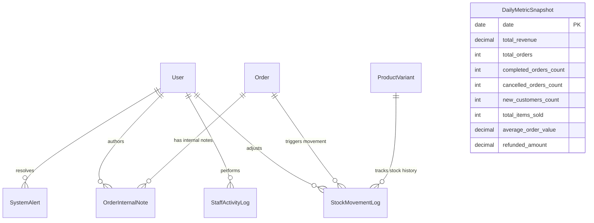

# Plan: Dashboard & Backoffice Models, Admin Panel, and REST API Architecture (`apps/dashboard`)

## Metadata
- **Title**: E-Commerce Dashboard, Analytics Snapshots, Staff Audit Trail, Inventory Logs, Manager Notes, System Alerts, Django Admin & REST API
- **Date**: 2026-10-24
- **Status**: COMPLETED
- **Completed**: 2026-10-24
- **Branch**: `feat/dashboard-app`
- **Author**: Antigravity

---

## 1. Context & Motivation

Zamonaviy professional e-commerce platformalarida (Amazon, Shopify, Uzum Market) ma'muriy boshqaruv (Backoffice / Merchant Dashboard) tizimning eng muhim qismlaridan biridir. Hozirgacha loyihada foydalanuvchilar (`apps/users`), mahsulotlar katalogi (`apps/products`), savat (`apps/carts`), buyurtmalar (`apps/orders`), to'lovlar (`apps/payments`), bildirishnomalar (`apps/notifications`) va sharhlar (`apps/reviews`) modullari yaratildi.

`apps/dashboard` ilovasi butun platformaning analitika, boshqaruv, operatsion xavfsizlik va nazorat markazi hisoblanadi. Mazkur rejada ushbu ilova uchun quyidagi asosiy yo'nalishlar to'liq amalga oshiriladi:

1. **Analitika va KPI hisoboti (DailyMetricSnapshot)**:
   - Katta hajmdagi buyurtmalar va to'lovlar jadvalini har safar qayta hisoblash o'rniga, kunlik umumiy daromad, buyurtmalar soni, muvaffaqiyatli yetkazilganlar, bekor qilinganlar, yangi mijozlar, sotilgan birliklar va o'rtacha chek (AOV) ni keshlovchi ma'lumotlar modeli.
   - O'tgan kunlar va davrlar bo'yicha dinamik tahlil hamda real-vaqtda agregatsiya.

2. **Xodimlar amallari auditi (StaffActivityLog)**:
   - Do'kon operatorlari va adminlarning barcha muhim harakatlarini (buyurtma holatini o'zgartirish, ombor zaxirasini tuzatish, mahsulot narxini o'zgartirish, mijozni bloklash, kuponlar) to'liq qayd etish (actor, action, module, target, diff, IP, user-agent).
   - O'zgartirib yoki o'chirib bo'lmaydigan qat'iy audit jurnali.

3. **Ombor va Zaxira harakati tarixi (StockMovementLog)**:
   - Ombordagi tovar qoldiqlari harakati (kirim, sotuv/chiqim, qo'lda to'g'rilash, qaytarish, brak/shikastlanish, buyurtmaga band qilish) ning to'liq tarixi.
   - Har bir harakatda o'zgarish miqdori (`quantity_delta`), oldingi va yangi qoldiq hamda javobgar xodim/buyurtma qayd etiladi.

4. **Buyurtmalar bo'yicha ichki izohlar (OrderInternalNote)**:
   - Mijozga ko'rinmaydigan, faqat call-center operatorlari va menejerlar uchun mo'ljallangan ichki ishchi eslatmalar va muhim izohlarni qadash (pinning) imkoniyati.

5. **Tizim ogohlantirishlari (SystemAlert)**:
   - Ombor zaxirasi kritik kamayishi (low/out of stock), to'lovdagi uzilishlar, g'ayritabiiy faollik kabi hodisalar bo'yicha admin panel ogohlantirishlari va ularni bartaraf etish (resolve) mexanizmi.

6. **Boyitilgan Django Admin paneli (`apps/dashboard/admin.py`)**:
   - Har bir model uchun zamonaviy filtrlash, qidiruv, hisoblangan ko'rsatkichlar (KPI badges, visual status tags), audit loglarni o'qish rejimida saqlash va maxsus admin actionlar.

7. **To'liq REST API va Postman integratsiyasi**:
   - Spetsifikatsiyadagi barcha endpointlar: analitika (KPI overview, sales charts, top products), inventar boshqaruvi va stock adjustment, buyurtmalar boshqaruvi va izohlar, mijozlar holatini boshqarish, audit loglar va tizim ogohlantirishlari.

---

## 2. Architecture & Technical Design

### 2.1. Entity-Relationship Diagram

### 2.2. Model Specifications (`apps/dashboard/models.py`)

#### 1. `DailyMetricSnapshot`
- **Fields**:
  - `date`: `DateField(unique=True, db_index=True)`
  - `total_revenue`: `DecimalField(max_digits=14, decimal_places=2, default=Decimal('0.00'))`
  - `total_orders`: `PositiveIntegerField(default=0)`
  - `completed_orders_count`: `PositiveIntegerField(default=0)`
  - `cancelled_orders_count`: `PositiveIntegerField(default=0)`
  - `new_customers_count`: `PositiveIntegerField(default=0)`
  - `total_items_sold`: `PositiveIntegerField(default=0)`
  - `average_order_value`: `DecimalField(max_digits=12, decimal_places=2, default=Decimal('0.00'))`
  - `refunded_amount`: `DecimalField(max_digits=14, decimal_places=2, default=Decimal('0.00'))`
  - `extra_metrics`: `JSONField(default=dict, blank=True)`
  - `created_at`: `DateTimeField(auto_now_add=True)`
  - `updated_at`: `DateTimeField(auto_now=True)`
- **Meta**: `db_table = 'dashboard_daily_metrics'`, `ordering = ['-date']`.
- **Methods**: `recalculate(date=None)` - buyurtmalar, to'lovlar va foydalanuvchilar modellaridan kunlik KPIlarni agregatsiya qilish.

#### 2. `StaffActivityLog`
- **Fields**:
  - `id`: `BigAutoField(primary_key=True)`
  - `actor`: `ForeignKey(settings.AUTH_USER_MODEL, null=True, on_delete=SET_NULL, related_name='staff_activities')`
  - `action`: `CharField(max_length=32, choices=ActivityAction.choices)`
    - `CREATE`, `UPDATE`, `DELETE`, `STATUS_CHANGE`, `STOCK_ADJUSTMENT`, `REFUND`, `LOGIN`, `EXPORT`
  - `module`: `CharField(max_length=32, choices=ActivityModule.choices)`
    - `ORDERS`, `PRODUCTS`, `INVENTORY`, `USERS`, `COUPONS`, `PAYMENTS`, `REVIEWS`, `SETTINGS`
  - `target_model`: `CharField(max_length=64, blank=True)`
  - `target_id`: `CharField(max_length=64, blank=True)`
  - `target_repr`: `CharField(max_length=255, blank=True)`
  - `description`: `TextField()`
  - `changes`: `JSONField(default=dict, blank=True)`
  - `ip_address`: `GenericIPAddressField(null=True, blank=True)`
  - `user_agent`: `TextField(blank=True)`
  - `created_at`: `DateTimeField(auto_now_add=True, db_index=True)`
- **Meta**: `db_table = 'dashboard_staff_activity_logs'`, `ordering = ['-created_at']`.
- Audit xavfsizligi: `save()` faqat yangi yozuv uchun ruxsat beriladi, tahrirlash va o'chirish taqiqlanadi.

#### 3. `StockMovementLog`
- **Fields**:
  - `id`: `BigAutoField(primary_key=True)`
  - `variant`: `ForeignKey('products.ProductVariant', on_delete=CASCADE, related_name='stock_movements')`
  - `actor`: `ForeignKey(settings.AUTH_USER_MODEL, null=True, blank=True, on_delete=SET_NULL, related_name='stock_movements')`
  - `movement_type`: `CharField(max_length=20, choices=StockMovementType.choices)`
    - `INCOMING` ("Kirim / Yetkazib berish"), `OUTGOING` ("Chiqim / Sotuv"), `ADJUSTMENT` ("Qo'lda to'g'rilash"), `RETURN` ("Qaytarilgan tovar"), `DAMAGED` ("Brak / Shikastlangan"), `RESERVED` ("Band qilingan")
  - `quantity_delta`: `IntegerField()` (+/- birlik)
  - `previous_quantity`: `PositiveIntegerField()`
  - `new_quantity`: `PositiveIntegerField()`
  - `reference_order`: `ForeignKey('orders.Order', null=True, blank=True, on_delete=SET_NULL, related_name='stock_movements')`
  - `reason`: `CharField(max_length=255, blank=True)`
  - `created_at`: `DateTimeField(auto_now_add=True, db_index=True)`
- **Meta**: `db_table = 'dashboard_stock_movement_logs'`, `ordering = ['-created_at']`.

#### 4. `OrderInternalNote`
- **Fields**:
  - `id`: `BigAutoField(primary_key=True)`
  - `order`: `ForeignKey('orders.Order', on_delete=CASCADE, related_name='internal_notes')`
  - `author`: `ForeignKey(settings.AUTH_USER_MODEL, on_delete=CASCADE, related_name='order_internal_notes')`
  - `note`: `TextField()`
  - `is_pinned`: `BooleanField(default=False, db_index=True)`
  - `created_at`: `DateTimeField(auto_now_add=True)`
  - `updated_at`: `DateTimeField(auto_now=True)`
- **Meta**: `db_table = 'dashboard_order_internal_notes'`, `ordering = ['-is_pinned', '-created_at']`.

#### 5. `SystemAlert`
- **Fields**:
  - `id`: `BigAutoField(primary_key=True)`
  - `alert_type`: `CharField(max_length=32, choices=AlertType.choices)`
    - `LOW_STOCK`, `PAYMENT_FAILURE`, `HIGH_ORDER_VOLUME`, `SECURITY`, `SYSTEM_ERROR`
  - `severity`: `CharField(max_length=16, choices=AlertSeverity.choices)`
    - `INFO`, `WARNING`, `CRITICAL`
  - `title`: `CharField(max_length=255)`
  - `message`: `TextField()`
  - `is_resolved`: `BooleanField(default=False, db_index=True)`
  - `resolved_by`: `ForeignKey(settings.AUTH_USER_MODEL, null=True, blank=True, on_delete=SET_NULL, related_name='resolved_alerts')`
  - `resolved_at`: `DateTimeField(null=True, blank=True)`
  - `created_at`: `DateTimeField(auto_now_add=True, db_index=True)`
- **Meta**: `db_table = 'dashboard_system_alerts'`, `ordering = ['is_resolved', '-created_at']`.
- **Methods**: `resolve(user)` - ogohlantirishni bartaraf etilgan deb belgilash.

---

### 2.3. Django Admin Specifications (`apps/dashboard/admin.py`)

1. **`DailyMetricSnapshotAdmin`**:
   - `list_display`: `('date', 'formatted_revenue', 'total_orders', 'completed_orders_count', 'average_order_value', 'new_customers_count')`
   - `date_hierarchy`: `'date'`
   - `readonly_fields`: barcha avtomatik hisoblangan maydonlar
   - `actions`: `['recalculate_metrics']` - tanlangan sanalar uchun agregatsiyani qayta hisoblash.

2. **`StaffActivityLogAdmin`**:
   - `list_display`: `('created_at', 'actor', 'action_badge', 'module_badge', 'target_repr', 'ip_address')`
   - `list_filter`: `('action', 'module', 'created_at')`
   - `search_fields`: `('actor__email', 'actor__first_name', 'target_repr', 'description', 'ip_address')`
   - `has_add_permission`: `False`, `has_delete_permission`: `False`, `has_change_permission`: `False` (faqat o'qish uchun audit xavfsizligi).

3. **`StockMovementLogAdmin`**:
   - `list_display`: `('created_at', 'variant_link', 'movement_badge', 'quantity_delta_display', 'previous_quantity', 'new_quantity', 'actor', 'reference_order')`
   - `list_filter`: `('movement_type', 'created_at')`
   - `search_fields`: `('variant__sku', 'variant__product__name', 'reason', 'actor__email')`
   - `has_add_permission`: `False`, `has_change_permission`: `False` (o'zgartirish taqiqlanadi).

4. **`OrderInternalNoteAdmin`**:
   - `list_display`: `('id', 'order_link', 'author', 'short_note', 'is_pinned', 'created_at')`
   - `list_filter`: `('is_pinned', 'created_at')`
   - `search_fields`: `('order__order_number', 'author__email', 'note')`
   - `list_editable`: `('is_pinned',)`

5. **`SystemAlertAdmin`**:
   - `list_display`: `('created_at', 'severity_badge', 'alert_type', 'title', 'is_resolved', 'resolved_by', 'resolved_at')`
   - `list_filter`: `('severity', 'alert_type', 'is_resolved', 'created_at')`
   - `search_fields`: `('title', 'message')`
   - `actions`: `['mark_as_resolved']`

---

### 2.4. REST API Endpoints Specification

| Method | Endpoint | Description | Permissions |
| :--- | :--- | :--- | :--- |
| `GET` | `/api/v1/dashboard/analytics/overview/` | Asosiy KPI ko'rsatkichlar (bugungi, haftalik, oylik tahlil) | Staff / Admin |
| `GET` | `/api/v1/dashboard/analytics/sales-chart/` | Sotuv va buyurtmalar dinamikasi (period: 7d, 30d, 12m) | Staff / Admin |
| `GET` | `/api/v1/dashboard/analytics/top-products/` | Eng ko'p sotilgan va daromadli mahsulotlar | Staff / Admin |
| `GET` | `/api/v1/dashboard/inventory/` | Ombor zaxiralari ro'yxati (jami, band, mavjud) | Staff / Admin |
| `GET` | `/api/v1/dashboard/inventory/low-stock/` | Zaxirasi kam qolgan tovarlar ro'yxati | Staff / Admin |
| `PATCH` | `/api/v1/dashboard/inventory/{variant_id}/adjust/` | Ombor qoldig'ini to'g'rilash (Stock Adjustment) | Staff / Admin |
| `GET` | `/api/v1/dashboard/inventory/logs/` | Zaxira harakati auditi | Staff / Admin |
| `GET` | `/api/v1/dashboard/orders/` | Barcha buyurtmalar ro'yxati (kengaytirilgan filtrlar) | Staff / Admin |
| `GET` | `/api/v1/dashboard/orders/{order_number}/` | Buyurtma to'liq ichki ma'lumotlari | Staff / Admin |
| `PATCH` | `/api/v1/dashboard/orders/{order_number}/status/` | Buyurtma holatini yangilash | Staff / Admin |
| `GET, POST` | `/api/v1/dashboard/orders/{order_number}/notes/` | Buyurtmaga ichki izohlar ro'yxati va yangi izoh qo'shish | Staff / Admin |
| `GET` | `/api/v1/dashboard/customers/` | Mijozlar ro'yxati va sarf-xarajatlar statistikasi | Staff / Admin |
| `GET` | `/api/v1/dashboard/customers/{id}/` | Mijoz profili va buyurtmalar tarixi | Staff / Admin |
| `PATCH` | `/api/v1/dashboard/customers/{id}/toggle-status/` | Mijozni bloklash / faollashtirish | Admin only |
| `GET` | `/api/v1/dashboard/audit-logs/` | Xodimlar harakatlari tarixi | Admin only |
| `GET` | `/api/v1/dashboard/alerts/` | Tizim ogohlantirishlari ro'yxati | Staff / Admin |
| `PATCH` | `/api/v1/dashboard/alerts/{id}/resolve/` | Ogohlantirishni hal etilgan deb belgilash | Staff / Admin |

---

## 3. Execution Checklist

- [x] Step 1: Create and verify git task branch `feat/dashboard-app`
- [x] Step 2: Implement models (`DailyMetricSnapshot`, `StaffActivityLog`, `StockMovementLog`, `OrderInternalNote`, `SystemAlert`) in `apps/dashboard/models.py`
- [x] Step 3: Create and apply Django migrations for `apps/dashboard`
- [x] Step 4: Implement Django Admin configuration in `apps/dashboard/admin.py` with custom widgets, filters, and actions
- [x] Step 5: Implement dashboard permissions, services, and audit logging utilities in `apps/dashboard/services/`
- [x] Step 6: Implement serializers in `apps/dashboard/serializers/`
- [x] Step 7: Implement REST API views in `apps/dashboard/views.py` (analytics, inventory, orders, customers, alerts, audit)
- [x] Step 8: Configure URL routing in `apps/dashboard/urls.py` and register in `config/urls.py`
- [x] Step 9: Write comprehensive unit and integration tests in `apps/dashboard/tests/` (models, admin, API)
- [x] Step 10: Update Postman master collection in `postman/ecommerce_api_collection.json` with Dashboard & Backoffice requests
- [x] Step 11: Execute complete project test suite verification
- [x] Step 12: Finalize documentation, update plan status to COMPLETED, and commit changes
