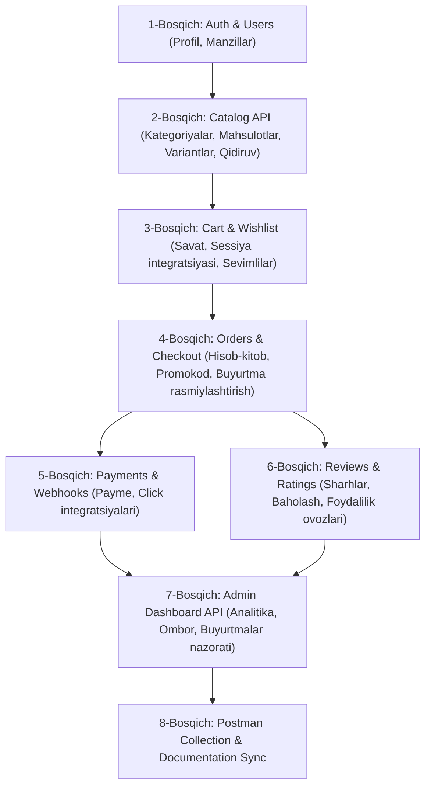

# Plan: E-Commerce REST API Architecture & Endpoints Specification

## Metadata
- **Title**: E-Commerce Full API Endpoints Specification & Routing Architecture
- **Date**: 2026-10-20
- **Status**: DRAFT / AWAITING APPROVAL
- **Author**: Antigravity

---

## 1. Overview & Architectural Principles

Mazkur hujjat butun e-commerce loyihasi uchun to'liq REST API arxitekturasi va endpointlar ro'yxatini belgilab beradi. Barcha ma'lumotlar modellari (`users`, `products`, `carts`, `orders`, `reviews`, `dashboard`) tayyor deb hisoblangan holda, API quyidagi qat'iy tamoyillarga asoslanadi:

1. **RESTful Standartlar**: Resurslarga asoslangan URL tuzilishi, standart HTTP metodlari (`GET`, `POST`, `PUT`, `PATCH`, `DELETE`) va to'g'ri HTTP status kodlari (`200 OK`, `201 Created`, `204 No Content`, `400 Bad Request`, `401 Unauthorized`, `403 Forbidden`, `404 Not Found`, `422 Unprocessable Entity`).
2. **Versiyalash**: Barcha URL lar `/api/v1/` prefiksi bilan boshlanadi.
3. **Autentifikatsiya & Huquqlar**:
   - `Public`: Ro'yxatdan o'tmagan barcha foydalanuvchilar uchun ochiq.
   - `Authenticated`: Faqat JWT access tokeniga ega bo'lgan foydalanuvchilar uchun.
   - `Admin / Staff`: Boshqaruv paneli va boshqaruv harakatlari uchun xodimlar/menejerlar huquqi talab qilinadi.
4. **Resurslar Strukturasi**:
   - `api/v1/auth/` & `api/v1/users/` — Autentifikatsiya, foydalanuvchi profili va yetkazib berish manzillari.
   - `api/v1/catalog/` — Mahsulotlar, kategoriyalar daraxti, brendlar, variantlar va dinamik filtrlar.
   - `api/v1/cart/` & `api/v1/wishlist/` — Savat (guest + user) va tanlangan tovarlar.
   - `api/v1/orders/` — Buyurtma hisob-kitobi (checkout preview), promokodlar va buyurtma berish.
   - `api/v1/payments/` — To'lov gatewaylari va webhooklar (Payme, Click, Uzum).
   - `api/v1/reviews/` — Mahsulot sharhlari va reyting tizimi.
   - `api/v1/dashboard/` — Admin/Menejer boshqaruv paneli (analitika, zaxira, buyurtmalar, mijozlar).

---

## 2. API Endpoints Specification

### 2.1. Authentication & Users (`apps/users`)

| Metod | URL | Huquq | Tavsif |
| :--- | :--- | :--- | :--- |
| `POST` | `/api/v1/auth/register/` | Public | Yangi foydalanuvchini ro'yxatdan o'tkazish (telefon/email, parol) |
| `POST` | `/api/v1/auth/verify-otp/` | Public | OTP kodni tekshirish, akkauntni tasdiqlash va JWT token olish |
| `POST` | `/api/v1/auth/resend-otp/` | Public | Yangi OTP tasdiqlash kodini yuborish |
| `POST` | `/api/v1/auth/login/` | Public | Telefon/Email + Parol orqali tizimga kirish (JWT Access & Refresh) |
| `POST` | `/api/v1/auth/token/refresh/` | Public | Refresh token orqali yangi Access token olish |
| `POST` | `/api/v1/auth/logout/` | Auth | Refresh tokenni qora ro'yxatga (blacklist) kiritish |
| `POST` | `/api/v1/auth/password/reset-request/` | Public | Parolni tiklash uchun OTP kod so'rash |
| `POST` | `/api/v1/auth/password/reset-confirm/` | Public | OTP kod va yangi parol orqali parolni yangilash |
| `GET` | `/api/v1/users/me/` | Auth | Joriy foydalanuvchi profil ma'lumotlarini olish |
| `PATCH` | `/api/v1/users/me/` | Auth | Profilni yangilash (ism, familiya, rasm, email) |
| `POST` | `/api/v1/users/me/change-password/` | Auth | Parolni o'zgartirish (eski parol + yangi parol) |
| `GET` | `/api/v1/users/addresses/` | Auth | Foydalanuvchining yetkazib berish manzillari ro'yxati |
| `POST` | `/api/v1/users/addresses/` | Auth | Yangi yetkazib berish manzilini qo'shish |
| `GET` | `/api/v1/users/addresses/{id}/` | Auth | Aniq manzil tafsilotlarini ko'rish |
| `PUT/PATCH`| `/api/v1/users/addresses/{id}/` | Auth | Manzil ma'lumotlarini tahrirlash |
| `DELETE` | `/api/v1/users/addresses/{id}/` | Auth | Manzilni o'chirish |
| `PATCH` | `/api/v1/users/addresses/{id}/set-default/` | Auth | Ushbu manzilni asosiy (default) manzil deb belgilash |

---

### 2.2. Product Catalog (`apps/products`)

| Metod | URL | Huquq | Tavsif |
| :--- | :--- | :--- | :--- |
| `GET` | `/api/v1/catalog/categories/` | Public | Barcha kategoriyalar ierarxik daraxti (bosh va ichki kategoriyalar) |
| `GET` | `/api/v1/catalog/categories/{slug}/` | Public | Kategoriya tafsilotlari va uning bevosita bolalari |
| `GET` | `/api/v1/catalog/brands/` | Public | Faol brendlar ro'yxati (qidiruv va saralash bilan) |
| `GET` | `/api/v1/catalog/brands/{slug}/` | Public | Brend tafsilotlari |
| `GET` | `/api/v1/catalog/products/` | Public | Mahsulotlar ro'yxati (qidiruv, filter, saralash, sahifalash) |
| `GET` | `/api/v1/catalog/products/{slug}/` | Public | Mahsulot batafsil sahifasi (variantlar, media, atributlar, reyting) |
| `GET` | `/api/v1/catalog/products/{slug}/variants/{sku}/` | Public | Aniq bir variant (SKU) narxi va zaxira holati |
| `GET` | `/api/v1/catalog/filters/` | Public | Kategoriya bo'yicha dinamik filtr parametrlarini olish (narx, brend, rang, o'lcham va h.k.) |
| `GET` | `/api/v1/catalog/search/suggest/` | Public | Qidiruv maydoni uchun tezkor takliflar (Autocomplete) |
| `GET` | `/api/v1/catalog/featured/` | Public | Tanlangan, ommabop yoki yangi mahsulotlar to'plami |

---

### 2.3. Cart & Wishlist (`apps/carts`)

| Metod | URL | Huquq | Tavsif |
| :--- | :--- | :--- | :--- |
| `GET` | `/api/v1/cart/` | Public/Auth | Savat holati (mahsulotlar, narxlar, jami summa, chegirmalar) |
| `POST` | `/api/v1/cart/items/` | Public/Auth | Savatga mahsulot qo'shish (`variant_id`/`sku`, `quantity`) |
| `PATCH` | `/api/v1/cart/items/{item_id}/` | Public/Auth | Savatdagi mahsulot miqdorini o'zgartirish (`quantity`) |
| `DELETE` | `/api/v1/cart/items/{item_id}/` | Public/Auth | Mahsulotni savatdan o'chirish |
| `DELETE` | `/api/v1/cart/clear/` | Public/Auth | Savatni butunlay tozalash |
| `POST` | `/api/v1/cart/merge/` | Auth | Mehmon (guest session) savatini foydalanuvchi akkauntiga birlashtirish |
| `GET` | `/api/v1/wishlist/` | Auth | Foydalanuvchining sevimlilar (saralangan) ro'yxati |
| `POST` | `/api/v1/wishlist/toggle/` | Auth | Mahsulotni saralanganlarga qo'shish yoki olib tashlash (Toggle) |
| `DELETE` | `/api/v1/wishlist/{product_id}/` | Auth | Mahsulotni saralanganlardan o'chirish |

---

### 2.4. Orders & Checkout (`apps/orders`)

| Metod | URL | Huquq | Tavsif |
| :--- | :--- | :--- | :--- |
| `POST` | `/api/v1/orders/checkout/preview/` | Auth | Buyurtma oldi hisob-kitobi (tovarlar narxi, yetkazib berish, chegirma, jami summa, zaxira tekshiruvi) |
| `POST` | `/api/v1/orders/coupons/apply/` | Auth | Promo-kod yoki kupon kiritish va tekshirish |
| `POST` | `/api/v1/orders/create/` | Auth | Buyurtma berish (manzil, to'lov turi tanlanadi, zaxira `reserve` qilinadi) |
| `GET` | `/api/v1/orders/` | Auth | Foydalanuvchining buyurtmalar tarixi (status bo'yicha filter, pagination) |
| `GET` | `/api/v1/orders/{order_number}/` | Auth | Buyurtma batafsil ma'lumoti va holat bosqichlari (tracking) |
| `POST` | `/api/v1/orders/{order_number}/cancel/` | Auth | Buyurtmani bekor qilish (agar yetkazib berishga chiqmagan bo'lsa) |
| `GET` | `/api/v1/orders/{order_number}/invoice/` | Auth | Buyurtma invoys/chek ma'lumotlarini olish |

---

### 2.5. Payments & Webhooks (`apps/orders` / `apps/payments`)

| Metod | URL | Huquq | Tavsif |
| :--- | :--- | :--- | :--- |
| `POST` | `/api/v1/payments/{order_number}/pay/` | Auth | To'lovni boshlash (Payme, Click, Uzum yoki karta orqali to'lov havolasi olish) |
| `GET` | `/api/v1/payments/{order_number}/status/` | Auth | To'lovning joriy holatini tekshirish |
| `POST` | `/api/v1/payments/webhooks/payme/` | Public/Sign | Payme billing tizimi integratsiya webhooki |
| `POST` | `/api/v1/payments/webhooks/click/` | Public/Sign | Click billing tizimi integratsiya webhooki |
| `POST` | `/api/v1/payments/webhooks/uzum/` | Public/Sign | Uzum Bank billing tizimi webhooki |

---

### 2.6. Reviews & Ratings (`apps/reviews`)

| Metod | URL | Huquq | Tavsif |
| :--- | :--- | :--- | :--- |
| `GET` | `/api/v1/products/{slug}/reviews/` | Public | Mahsulotga yozilgan sharhlar va umumiy reyting statistikasini ko'rish |
| `POST` | `/api/v1/products/{slug}/reviews/` | Auth | Mahsulotga sharh va baho (1-5) qoldirish (xarid qilganligini tekshirish bilan) |
| `PUT/PATCH`| `/api/v1/reviews/{id}/` | Auth | O'zining qoldirgan sharhini tahrirlash |
| `DELETE` | `/api/v1/reviews/{id}/` | Auth | O'z sharhini o'chirish |
| `POST` | `/api/v1/reviews/{id}/vote/` | Auth | Sharh foydali deb baholash (Helpful vote / Like) |

---

### 2.7. Dashboard & Backoffice (`apps/dashboard`)

Adminlar, ombor mudirlari va buyurtma menejerlari uchun maxsus API:

#### A. Analitika va Boshqaruv Paneli
| Metod | URL | Huquq | Tavsif |
| :--- | :--- | :--- | :--- |
| `GET` | `/api/v1/dashboard/analytics/overview/` | Admin/Staff | Asosiy KPI ko'rsatkichlar (kunlik/oylik daromad, buyurtmalar soni, o'rtacha chek) |
| `GET` | `/api/v1/dashboard/analytics/sales-chart/` | Admin/Staff | Sotuv dinamikasi grafigi (kun, hafta, oy bo'yicha) |
| `GET` | `/api/v1/dashboard/analytics/top-products/` | Admin/Staff | Eng ko'p sotilgan va eng ko'p daromad keltirgan tovarlar |

#### B. Katalog Boshqaruvi
| Metod | URL | Huquq | Tavsif |
| :--- | :--- | :--- | :--- |
| `GET, POST` | `/api/v1/dashboard/categories/` | Admin/Staff | Kategoriyalar ro'yxati va yangi kategoriya yaratish |
| `GET, PUT, PATCH, DELETE` | `/api/v1/dashboard/categories/{id}/` | Admin/Staff | Kategoriyani ko'rish, tahrirlash va o'chirish |
| `GET, POST` | `/api/v1/dashboard/brands/` | Admin/Staff | Brendlar ro'yxati va yangi brend qo'shish |
| `GET, PUT, PATCH, DELETE` | `/api/v1/dashboard/brands/{id}/` | Admin/Staff | Brendni ko'rish, tahrirlash va o'chirish |
| `GET, POST` | `/api/v1/dashboard/attributes/` | Admin/Staff | Dinamik xususiyatlar (Attribute va AttributeValues) ro'yxati va yaratish |
| `GET, POST` | `/api/v1/dashboard/products/` | Admin/Staff | Mahsulotlar ro'yxati va yangi mahsulot yaratish |
| `GET, PUT, PATCH, DELETE` | `/api/v1/dashboard/products/{id}/` | Admin/Staff | Mahsulotni ko'rish, yangilash va o'chirish |
| `POST` | `/api/v1/dashboard/products/{id}/media/` | Admin/Staff | Mahsulotga yangi rasm/video yuklash |
| `DELETE` | `/api/v1/dashboard/products/media/{media_id}/` | Admin/Staff | Mahsulot rasmini o'chirish |
| `POST` | `/api/v1/dashboard/products/{id}/variants/` | Admin/Staff | Mahsulotga yangi variant (SKU, narx, atributlar) qo'shish |
| `PATCH, DELETE` | `/api/v1/dashboard/products/variants/{variant_id}/` | Admin/Staff | Mahsulot variantini tahrirlash yoki o'chirish |

#### C. Ombor va Zaxira Boshqaruvi (Inventory)
| Metod | URL | Huquq | Tavsif |
| :--- | :--- | :--- | :--- |
| `GET` | `/api/v1/dashboard/inventory/` | Admin/Staff | Ombor zaxiralari ro'yxati (jami miqdor, band qilingan, sotuvdagi) |
| `GET` | `/api/v1/dashboard/inventory/low-stock/` | Admin/Staff | Zaxirasi kam qolgan (ogohlantirish chegarasidagi) tovarlar |
| `PATCH` | `/api/v1/dashboard/inventory/{variant_id}/adjust/` | Admin/Staff | Ombordagi mahsulot sonini qo'lda to'g'irlash (Stock adjustment) |
| `GET` | `/api/v1/dashboard/inventory/logs/` | Admin/Staff | Zaxira harakati tarixi (kirim, chiqim, buyurtmaga band qilinishi) |

#### D. Buyurtmalar va Mijozlar Boshqaruvi
| Metod | URL | Huquq | Tavsif |
| :--- | :--- | :--- | :--- |
| `GET` | `/api/v1/dashboard/orders/` | Admin/Staff | Barcha mijozlarning buyurtmalari (kengaytirilgan filtrlar bilan) |
| `GET` | `/api/v1/dashboard/orders/{order_number}/` | Admin/Staff | Buyurtma to'liq ichki ma'lumotlari |
| `PATCH` | `/api/v1/dashboard/orders/{order_number}/status/` | Admin/Staff | Buyurtma holatini o'zgartirish (Processing, Shipped, Delivered, Cancelled) |
| `POST` | `/api/v1/dashboard/orders/{order_number}/notes/` | Admin/Staff | Buyurtmaga operator/menejer ichki izohini qo'shish |
| `GET` | `/api/v1/dashboard/customers/` | Admin/Staff | Mijozlar ro'yxati, ularning umumiy buyurtmalari va xarajatlari |
| `GET` | `/api/v1/dashboard/customers/{id}/` | Admin/Staff | Mijoz tafsilotlari va shaxsiy buyurtmalar tarixi |
| `PATCH` | `/api/v1/dashboard/customers/{id}/toggle-status/` | Admin/Staff | Mijoz akkauntini bloklash yoki faollashtirish |

#### E. Marketing va Chegirmalar (Promotions)
| Metod | URL | Huquq | Tavsif |
| :--- | :--- | :--- | :--- |
| `GET, POST` | `/api/v1/dashboard/coupons/` | Admin/Staff | Promo-kodlar va kuponlar ro'yxati hamda yangi kupon yaratish |
| `GET, PUT, PATCH, DELETE` | `/api/v1/dashboard/coupons/{id}/` | Admin/Staff | Kuponni boshqarish (chegirma foizi/summasi, amal qilish muddati, ishlatilish limiti) |

---

## 3. Implementation Phases & Step-by-Step Roadmap

---

## 4. Master Postman Collection Integration

Loyihaning qat'iy talablariga binoan, har bir modul ishlab chiqilishi bilan birgalikda:
- `postman/ecommerce_api_collection.json` fayli tegishli papkalar, namunaviy so'rovlar, parametrlar va JWT tokenni avtomatik zanjirlash (token chaining) skriptlari bilan yangilanadi.
- Har bir endpoint uchun `200 OK`, `400 Bad Request`, `401 Unauthorized` namunaviy javoblar kiritiladi.
