# Plan: Test Fixtures for Users, Products, and Carts Models

## Metadata
- **Title**: Test Fixtures Architecture & Dataset Generation for Users, Products, and Carts Apps
- **Date**: 2026-10-22
- **Status**: COMPLETED
- **Branch**: `test/model-fixtures`

---

## 1. Context & Motivation

Loyiha doirasida `apps.users`, `apps.products`, va `apps.carts` ilovalarining ma'lumotlar modellari va REST API endpointlari to'liq ishlab chiqilgan. 
Biroq dasturchi (yoki testlovchi) tizimni mahalliy muhitda (local development), qo'lda (manual API / Postman / Swagger / Django Admin) yoki avtomatlashtirilgan testlarda (`TestCase.fixtures`) sinovdan o'tkazishi uchun izchil, real hayotga mos va barcha biznes-holatlarni qamrab oluvchi ma'lumotlar to'plami (Django Fixtures) talab etiladi.

### Yechilishi kerak bo'lgan masalalar:
1. **Model Bog'liqliklari (Dependency Order)**:
   - `User` -> `OTPCode`
   - `Category`, `Brand`, `Attribute`, `AttributeValue` -> `Product` -> `ProductCategory`, `ProductVariant` -> `ProductVariantAttributeValue`, `ProductMedia`, `Inventory`
   - `User`, `ProductVariant` -> `Cart` -> `CartItem`
   Fixturelar yuklanayotganda Foreign Key xatolari yuz bermasligi uchun qat'iy ketma-ketlikda yuklanishi kerak.

2. **Har xil Test Senariylari (Edge Cases & Business Scenarios)**:
   - **Users**: Admin foydalanuvchi, faol oddiy xaridorlar, nofaol foydalanuvchilar, yaroqli va muddati o'tgan OTP kodlar. Barcha foydalanuvchilar uchun haqiqiy PBKDF2 xeshlangan parol (`testpass123`) taqdim etiladi, bu orqali JWT login va Admin panelga bemalol kirib sinash mumkin bo'ladi.
   - **Products & Catalog**: Ierarxik kategoriyalar (Root > Sub > Leaf), brendlar, mahsulotlar, variantlar (asosiy va qo'shimcha), atributlar (Rang, Xotira, O'lcham), chegirmali va to'liq narxdagi mahsulotlar, hamda har xil ombor qoldiqlari: yetarli zaxira (`in_stock`), kam qolgan zaxira (`low_stock`), tugagan mahsulot (`out_of_stock`).
   - **Carts**: Tizimga kirgan foydalanuvchining faol (`OPEN`) savati, mehmon (guest session) savati, turli miqdordagi va chegirmali variantlarga ega `CartItem`lar, shuningdek tarixiy (`MERGED`, `CONVERTED`) savatlar.

3. **Modullilik va Qulaylik**:
   - Har bir app ichida alohida fixture (`apps/users/fixtures/users.json`, `apps/products/fixtures/products.json`, `apps/carts/fixtures/carts.json`)
   - Barcha ma'lumotlarni bir martada yuklash imkonini beruvchi birlashtirilgan fixture (`fixtures/ecommerce_data.json`)
   - `config/settings.py` faylida `FIXTURE_DIRS` sozlanishi.

---

## 2. Architecture & Technical Design

### 2.1. Model Relyatsiyalari va Ma'lumotlar Tuzilmasi

```mermaid
graph TD
    subgraph Users App
        U1["User: admin@ecommerce.uz (Admin)"]
        U2["User: john.doe@example.com (Customer)"]
        U3["User: jane.doe@example.com (Customer)"]
        U4["User: inactive.user@example.com (Inactive)"]
        OTP1["OTPCode: Register (Valid)"]
        OTP2["OTPCode: Password Reset (Valid)"]
        OTP3["OTPCode: Expired"]
        U2 --> OTP2
        U4 --> OTP1
        U3 --> OTP3
    end

    subgraph Products App
        C1["Categories: Electronics > Computers > Laptops"]
        B1["Brands: Apple, Samsung, Nike, Sony"]
        A1["Attributes: Color, Storage, RAM, Size"]
        AV1["Attribute Values: Space Gray, 512GB, etc."]
        P1["Product: MacBook Pro 16"]
        P2["Product: iPhone 15 Pro"]
        P3["Product: Samsung Galaxy S24"]
        P4["Product: Nike Air Max 270"]
        PV1["ProductVariant: MBP16-M3-512-SG"]
        PV2["ProductVariant: IPH15P-128-TI"]
        PV3["ProductVariant: NIKE-AM270-BLK-42"]
        INV1["Inventory: in_stock (50 dona)"]
        INV2["Inventory: low_stock (3 dona)"]
        INV3["Inventory: out_of_stock (0 dona)"]

        C1 --> P1
        B1 --> P1
        P1 --> PV1
        A1 --> AV1
        AV1 --> PV1
        PV1 --> INV1
        PV2 --> INV2
        PV3 --> INV3
    end

    subgraph Carts App
        CRT1["Cart (Auth): john.doe (OPEN)"]
        CRT2["Cart (Guest): session_guest_001 (OPEN)"]
        CRT3["Cart (Historical): MERGED"]
        CI1["CartItem: 1x MacBook Pro"]
        CI2["CartItem: 2x Nike Air Max"]
        CI3["CartItem: 1x iPhone 15 Pro"]

        U2 --> CRT1
        CRT1 --> CI1
        CRT1 --> CI2
        CRT2 --> CI3
        PV1 --> CI1
        PV3 --> CI2
        PV2 --> CI3
    end
```

### 2.2. Fayllar Joylashuvi

1. **`apps/users/fixtures/users_data.json`**:
   - `users.user`:
     - ID 1: `admin@ecommerce.uz` (Admin, is_staff=True, is_superuser=True, parol: `testpass123`)
     - ID 2: `john.doe@example.com` (Customer, is_active=True, parol: `testpass123`)
     - ID 3: `jane.doe@example.com` (Customer, is_active=True, parol: `testpass123`)
     - ID 4: `inactive.user@example.com` (Customer, is_active=False, parol: `testpass123`)
   - `users.otpcode`:
     - ID 1: Ro'yxatdan o'tish OTP kodi (`777111`), foydalanuvchi 4 uchun
     - ID 2: Parolni tiklash OTP kodi (`888222`), foydalanuvchi 2 uchun
     - ID 3: Muddati o'tgan OTP kodi (`999333`), foydalanuvchi 3 uchun

2. **`apps/products/fixtures/products_data.json`**:
   - `products.category`:
     - 1: Electronics (root)
     - 2: Computers (parent: 1)
     - 3: Laptops (parent: 2)
     - 4: Smartphones (parent: 1)
     - 5: Fashion (root)
     - 6: Footwear (parent: 5)
   - `products.brand`:
     - 1: Apple
     - 2: Samsung
     - 3: Nike
     - 4: Sony
   - `products.attribute` & `products.attributevalue`:
     - Rang (Space Gray, Natural Titanium, Black)
     - Xotira (256GB, 512GB, 1TB)
     - RAM (16GB, 32GB)
     - O'lcham (41, 42, 43, M, L)
   - `products.product`:
     - 1: Apple MacBook Pro 16" M3 Max
     - 2: Apple iPhone 15 Pro
     - 3: Samsung Galaxy S24 Ultra
     - 4: Nike Air Max 270 Sneakers
   - `products.productcategory`:
     - Asosiy va qo'shimcha kategoriyalar bog'lanishi
   - `products.productvariant`:
     - 1: MacBook Pro 16 (16GB/512GB/Space Gray) - SKU: `MBP16-M3-16-512-SG`, narx: 2499.00, chegirma: 2299.00, is_default: True
     - 2: MacBook Pro 16 (32GB/1TB/Space Gray) - SKU: `MBP16-M3-32-1TB-SG`, narx: 2999.00, discount: None, is_default: False
     - 3: iPhone 15 Pro (128GB/Natural Titanium) - SKU: `IPH15P-128-TI`, narx: 999.00, discount: None, is_default: True
     - 4: Samsung Galaxy S24 Ultra (256GB/Black) - SKU: `GALS24-256-BLK`, narx: 1199.00, discount: 1099.00, is_default: True
     - 5: Nike Air Max 270 (Size 42/Black) - SKU: `NIKE-AM270-BLK-42`, narx: 160.00, discount: 130.00, is_default: True
   - `products.productvariantattributevalue`:
     - Variantlarni atribut qiymatlariga bog'lash
   - `products.productmedia`:
     - Mahsulot rasmlari va muqova (is_main) holatlari
   - `products.inventory`:
     - Variant 1 uchun: 50 dona (in stock, reserved: 2)
     - Variant 2 uchun: 15 dona (in stock, reserved: 0)
     - Variant 3 uchun: 3 dona (low stock, threshold: 5)
     - Variant 4 uchun: 0 dona (out of stock - xatolar va limitlarni tekshirish uchun)
     - Variant 5 uchun: 25 dona (in stock, reserved: 1)

3. **`apps/carts/fixtures/carts_data.json`**:
   - `carts.cart`:
     - Cart 1 (`c1000000-0000-0000-0000-000000000001`): `john.doe@example.com` foydalanuvchisiga tegishli faol (`OPEN`) savat.
     - Cart 2 (`c2000000-0000-0000-0000-000000000002`): Anonim mehmon (`session_key: guest_session_alpha_123`) faol (`OPEN`) savati.
     - Cart 3 (`c3000000-0000-0000-0000-000000000003`): Birlashtirilgan (`MERGED`) tarixiy savat.
     - Cart 4 (`c4000000-0000-0000-0000-000000000004`): Buyurtmaga aylangan (`CONVERTED`) tarixiy savat.
   - `carts.cartitem`:
     - Cart 1 ichida:
       - 1x MacBook Pro variant (SKU: `MBP16-M3-16-512-SG`, narx: 2299.00)
       - 2x Nike Air Max variant (SKU: `NIKE-AM270-BLK-42`, narx: 130.00)
     - Cart 2 ichida:
       - 1x iPhone 15 Pro variant (SKU: `IPH15P-128-TI`, narx: 999.00)
     - Cart 3 ichida:
       - 1x Nike Air Max variant (MERGED holatdagi eski savat elementi)

4. **`fixtures/ecommerce_data.json`**:
   - Loyiha ildizidagi umumiy fixture bo'lib, `users`, `products` va `carts` ma'lumotlarini bitta to'plamda o'z ichiga oladi.
   - Buyruq: `python manage.py loaddata ecommerce_data`

### 2.3. Sozlamalar yangilanishi
- `config/settings.py` fayliga `FIXTURE_DIRS = [BASE_DIR / 'fixtures']` qo'shiladi. Bu Django'ga ham loyiha darajasidagi, ham app darajasidagi fixturelarni avtomatik aniqlash imkonini beradi.

---

## 3. Detailed Checklist

- [x] Step 1: Configure `FIXTURE_DIRS` in `config/settings.py` to recognize root-level and app-level fixtures.
- [x] Step 2: Create directory structure `apps/users/fixtures/`, `apps/products/fixtures/`, `apps/carts/fixtures/`, and `fixtures/`.
- [x] Step 3: Author `apps/users/fixtures/users_data.json` covering admin, customers, inactive users, valid passwords, and OTP codes.
- [x] Step 4: Author `apps/products/fixtures/products_data.json` covering categories hierarchy, brands, products, attributes, variants, media, and inventory states.
- [x] Step 5: Author `apps/carts/fixtures/carts_data.json` covering user cart, guest cart, merged cart, and respective cart items.
- [x] Step 6: Create consolidated master fixture `fixtures/ecommerce_data.json` containing the entire relational dataset.
- [x] Step 7: Verify fixture loading via `python manage.py loaddata` into an in-memory or SQLite database and ensure zero errors.
- [x] Step 8: Create an automated fixture verification test in `apps/carts/tests/test_fixtures.py` (or project test suite) to ensure test framework compatibility.
- [x] Step 9: Run full test suite (`python manage.py test`) to verify all 84+ existing tests continue to pass without regression.
- [x] Step 10: Commit changes adhering to git workflow guidelines and update plan status to COMPLETED.
