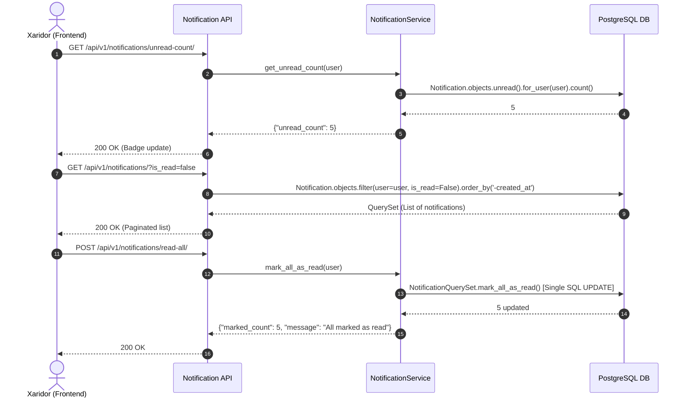
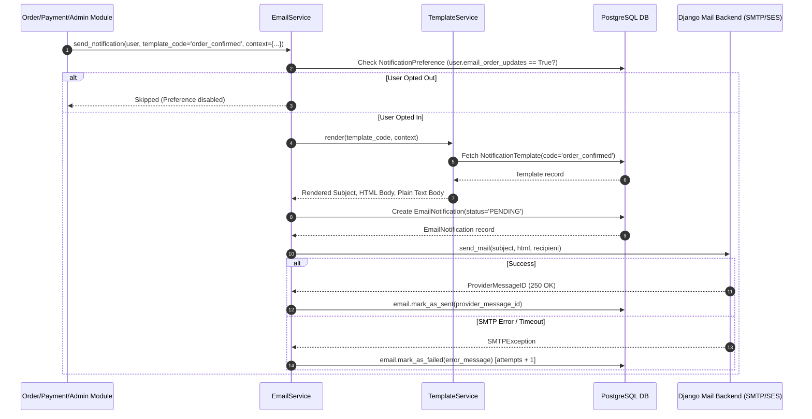

# Plan: Notification REST API Implementation (`apps/notifications`)

## Metadata
- **Title**: Notification REST API: In-App Notifications, Preference Settings, Outbound Email Queue & Dispatch, Dynamic Templates, and Admin Controls
- **Date**: 2026-10-22
- **Status**: COMPLETED
- **Branch**: `feat/notification-api`
- **Completed**: 2026-10-22
- **Author**: Antigravity

---

## 1. Context & Motivation

[plans/notification-models.md](file:///Users/djumanov/Academy/backend-development/Summer-2026/ecommerce/plans/notification-models.md) rejasida ishlab chiqilgan va loyihaga kiritilgan 4 ta asosiy model:
1. `Notification` (`account_notifications`): Foydalanuvchining shaxsiy akkaunt/in-app bildirishnomalari (qo'ng'iroqcha/bell icon),
2. `EmailNotification` (`email_notifications`): Tranzaksion va marketing email xabarlari navbati, holati va jo'natish loglari,
3. `NotificationPreference` (`notification_preferences`): Foydalanuvchining kanallar va toifalar bo'yicha bildirishnoma sozlamalari (opt-in/opt-out),
4. `NotificationTemplate` (`notification_templates`): Ko'p martalik dinamik email va akkaunt shablonlari tizimi.

Ushbu rejaning asosiy maqsadi — barcha foydalanuvchilar (xaridorlar) va platforma ma'murlari (adminlar) uchun to'liq RESTful tamoyillariga asoslangan, yuqori xavfsizlikka ega, unumdor (high-performance caching & batch updating), filtrlash va sahifalash imkoniyatlari mavjud bo'lgan **Notification REST API (`/api/v1/notifications/`)** tizimini loyihalashtirish va amalga oshirishdan iborat.

---

## 2. API Endpoints Specification (`/api/v1/notifications/`)

Bildirishnomalar moduli 3 ta asosiy bo'limdan va jami 17 ta endpointdan iborat:

### 2.1. Foydalanuvchi Akkaunt Bildirishnomalari (Customer In-App Notifications)

| # | Metod | URL | Ruxsat | Tavsif |
|---|:---|:---|:---|:---|
| 1 | `GET` | `/api/v1/notifications/` | Authenticated | Foydalanuvchining bildirishnomalari ro'yxati (filtrlash: `is_read`, `type`, `priority`; qidiruv; sahifalash) |
| 2 | `GET` | `/api/v1/notifications/unread-count/` | Authenticated | O'qilmagan bildirishnomalar soni (navbardagi qo'ng'iroqcha/badge uchun yengil va tezkor endpoint) |
| 3 | `GET` | `/api/v1/notifications/<int:pk>/` | Authenticated (Owner) | Bildirishnomaning to'liq ma'lumotlari (`title`, `message`, `data`, `action_url`, `created_at`) |
| 4 | `POST` | `/api/v1/notifications/<int:pk>/read/` | Authenticated (Owner) | Bildirishnomani o'qilgan deb belgilash (`is_read=True`, `read_at=now`) |
| 5 | `POST` | `/api/v1/notifications/<int:pk>/unread/` | Authenticated (Owner) | Bildirishnomani o'qilmagan holatga qaytarish (`is_read=False`, `read_at=None`) |
| 6 | `POST` | `/api/v1/notifications/read-all/` | Authenticated | Foydalanuvchining barcha o'qilmagan xabarlarini bitta SQL so'rovida o'qilgan qilish (`mark_all_as_read`) |
| 7 | `DELETE` | `/api/v1/notifications/<int:pk>/` | Authenticated (Owner) | Bildirishnomani shaxsiy ro'yxatdan o'chirish |
| 8 | `DELETE` | `/api/v1/notifications/clear-read/` | Authenticated | Barcha o'qilgan bildirishnomalarni ommaviy tozalash/o'chirish |

### 2.2. Foydalanuvchi Bildirishnoma Sozlamalari (Notification Preferences)

| # | Metod | URL | Ruxsat | Tavsif |
|---|:---|:---|:---|:---|
| 9 | `GET` | `/api/v1/notifications/preferences/` | Authenticated | Foydalanuvchining bildirishnoma sozlamalarini ko'rish (avtomatik `get_or_create`) |
| 10 | `PATCH` / `PUT` | `/api/v1/notifications/preferences/` | Authenticated | Sozlamalarni yangilash (`email_order_updates`, `email_promotions`, `in_app_order_updates`, ...) |

### 2.3. Ma'muriyat / Admin Boshqaruvi (Admin & Staff Controls)

| # | Metod | URL | Ruxsat | Tavsif |
|---|:---|:---|:---|:---|
| 11 | `GET` | `/api/v1/notifications/admin/in-app/` | IsAdminUser | Barcha foydalanuvchilarning akkaunt bildirishnomalarini ko'rish va kengaytirilgan filtrlash |
| 12 | `POST` | `/api/v1/notifications/admin/in-app/broadcast/` | IsAdminUser | Bildirishnoma tarqatish: barcha foydalanuvchilarga (broadcast) yoki belgilangan foydalanuvchilar guruhiga (`user_ids`) |
| 13 | `GET` | `/api/v1/notifications/admin/emails/` | IsAdminUser | Chiqish email xabarlari navbati va loglari (`status`, `recipient_email`, `priority`, sana filtrlari bilan) |
| 14 | `GET` | `/api/v1/notifications/admin/emails/<int:pk>/` | IsAdminUser | Email tafsilotlari (mavzu, HTML va matn tanasi, xatolik logi, urinishlar soni, `provider_message_id`) |
| 15 | `POST` | `/api/v1/notifications/admin/emails/<int:pk>/retry/` | IsAdminUser | Yuborilmay qolgan (`FAILED` / `CANCELLED`) emailni qayta navbatga qo'yish yoki qayta yuborish |
| 16 | `POST` | `/api/v1/notifications/admin/emails/<int:pk>/cancel/` | IsAdminUser | Navbatda turgan (`PENDING`) emailni bekor qilish |
| 17 | `GET`, `POST` | `/api/v1/notifications/admin/templates/` | IsAdminUser | Dinamik xabarnoma shablonlari ro'yxati va yangi shablon yaratish |
| 18 | `GET`, `PUT`, `PATCH`, `DELETE` | `/api/v1/notifications/admin/templates/<str:code>/` | IsAdminUser | Bitta shablonni ko'rish, tahrirlash va o'chirish/nofaol qilish |
| 19 | `POST` | `/api/v1/notifications/admin/templates/<str:code>/test-send/` | IsAdminUser | Shablonni sinovdan o'tkazish (berilgan test `context_data` bo'yicha render qilib, ko'rsatilgan emailga yuborish) |

---

## 3. Architecture & Technical Design

### 3.1. Workflows & Sequence Diagrams

#### 1. In-App Bildirishnomalarni Qabul Qilish va O'qish Jarayoni:


#### 2. Email Yuborish, Shablon Render Qilish va Qayta Urinish Jarayoni:


---

### 3.2. Biznes Qoidalar va Xavfsizlik Tamoyillari

1. **Foydalanuvchi Maxfiyligi va Sozlamalari (Notification Preferences)**:
   - Tranzaksion xabarlar (parol tiklash, xavfsizlik ogohlantirishlari) foydalanuvchi sozlamalaridan qat'i nazar doim yetkaziladi (`email_security_alerts`).
   - Marketing xabarlari (`PROMOTION`) faqatgina foydalanuvchi o'z sozlamalarida rozilik bergan bo'lsa (`email_promotions=True` yoki `in_app_promotions=True`) yuboriladi. Standart bo'yicha marketing email sozlamasi o'chiq (`False`) bo'ladi (GDPR / CAN-SPAM qoidalariga muvofiq).
2. **Yuqori Unumdor Ommaviy Amallar (Bulk Operations)**:
   - Barcha xabarlarni o'qilgan deb belgilash (`/read-all/`) va o'qilganlarni tozalash (`/clear-read/`) har bir obyektni alohida `save()` qilmasdan, `NotificationQuerySet.mark_all_as_read()` orqali bitta SQL `UPDATE` yoki `DELETE` so'rovi bilan amalga oshiriladi.
   - Admin tomonidan ommaviy xabarnoma tarqatilganda (`/broadcast/`), `Notification.objects.bulk_create()` dan foydalaniladi (xotira va baza so'rovlarini minimallashtirish uchun `batch_size=1000`).
3. **Qattiq Huquqiy Cheklovlar (Object-Level Permissions)**:
   - Foydalanuvchi faqat o'ziga tegishli (`notification.user == request.user`) bildirishnomalarni ko'rishi, o'qilgan deb belgilashi yoki o'chirishi mumkin. Boshqa foydalanuvchi ID si orqali murojaat qilinganda `404 Not Found` yoki `403 Forbidden` qaytariladi.
   - Barcha `/admin/` yo'nalishlari qat'iy `IsAdminUser` (yoki `IsStaff`) huquqini talab qiladi.
4. **Email Xatoliklarini Boshqarish va Qayta Urinish (Retry Mechanism)**:
   - Email jo'natishda xatolik yuz bersa, tranzaksiya to'xtab qolmaydi (`fail_silently` yoki `try...except`). Xatolik matni `EmailNotification.error_message` da saqlanadi va `attempts` oshiriladi.
   - Agar `attempts < max_retries` bo'lsa, holat `PENDING` bo'lib qoladi va admin yoki foniy topshiriq (Celery/Cron) orqali qayta urinish imkoni saqlanadi. Maksimal urinishlar sonidan oshgach `FAILED` statusi belgilanadi.
5. **Dinamik Shablonlarni Xavfsiz Render Qilish**:
   - `NotificationTemplate` matnlarini render qilishda Django shablon tizimi (`django.template.Template`) xavfsiz kontekst bilan ishlatiladi va zararli kodlar yoki server ma'lumotlari sizib chiqishi cheklanadi.

---

### 3.3. Papkalar va Fayllar Strukturasi (`apps/notifications/`)

Bildirishnomalar ilovasi quyidagi toza va modulli arxitekturada tashkil etiladi:

```
apps/notifications/
├── __init__.py
├── admin.py                        # Mavjud admin paneli
├── apps.py                         # App konfiguratsiyasi
├── models.py                       # Mavjud modellar (Notification, EmailNotification, Preference, Template)
├── permissions.py                  # YANGA: IsNotificationOwner, IsAdminUser
├── services.py                     # YANGA: NotificationService, EmailService, TemplateRenderService
├── urls.py                         # YANGA: Barcha API routinglari
├── views.py                        # YANGA: Customer va Admin API Viewlari
├── serializers/                    # YANGA: Modulli serializerlar to'plami
│   ├── __init__.py
│   ├── notification_serializers.py # NotificationListSerializer, NotificationDetailSerializer, BroadcastSerializer
│   ├── preference_serializers.py   # NotificationPreferenceSerializer
│   ├── email_serializers.py        # EmailNotificationListSerializer, EmailNotificationDetailSerializer
│   └── template_serializers.py     # NotificationTemplateSerializer, TemplateTestSendSerializer
└── tests/                          # Keng qamrovli testlar to'plami
    ├── __init__.py
    ├── test_models.py              # Mavjud model unit testlari
    ├── test_services.py            # YANGA: Service qatlami unit testlari
    └── test_api.py                 # YANGA: 17 ta API endpoint bo'yicha integratsion testlar
```

---

### 3.4. Serializers Arxitekturasi Tafsilotlari

1. **`NotificationListSerializer`**:
   - Yengil serializer: `id`, `notification_type`, `priority`, `title`, `is_read`, `created_at`, `action_url`.
2. **`NotificationDetailSerializer`**:
   - To'liq serializer: `id`, `notification_type`, `priority`, `title`, `message`, `is_read`, `read_at`, `action_url`, `data`, `created_at`, `updated_at`.
3. **`NotificationUnreadCountSerializer`**:
   - `unread_count`, `urgent_count`.
4. **`NotificationBroadcastSerializer`**:
   - Admin uchun kiritish serializeri: `title`, `message`, `notification_type`, `priority`, `action_url`, `data`, `broadcast` (bool, ixtiyoriy), `user_ids` (ro'yxat, ixtiyoriy).
5. **`NotificationPreferenceSerializer`**:
   - Foydalanuvchi sozlamalari: `email_order_updates`, `email_payment_receipts`, `email_promotions`, `email_security_alerts`, `in_app_order_updates`, `in_app_payment_updates`, `in_app_promotions`, `updated_at`.
6. **`EmailNotificationListSerializer`**:
   - Admin email navbati ro'yxati: `id`, `recipient_email`, `subject`, `status`, `priority`, `attempts`, `template_code`, `sent_at`, `scheduled_at`, `created_at`.
7. **`EmailNotificationDetailSerializer`**:
   - To'liq email tafsilotlari: barcha maydonlar, shu jumladan `body_text`, `body_html`, `error_message`, `provider_message_id`, `context_data`.
8. **`NotificationTemplateSerializer`**:
   - Shablon boshqaruvi: `id`, `code`, `name`, `description`, `notification_type`, `email_subject_template`, `email_body_html_template`, `email_body_text_template`, `in_app_title_template`, `in_app_message_template`, `is_active`, `updated_at`.
9. **`TemplateTestSendSerializer`**:
   - Shablon sinovi uchun kiritish parametrlari: `test_email` (ixtiyoriy), `user_id` (ixtiyoriy), `context_data` (JSON).

---

### 3.5. Servis Qatlami (`apps/notifications/services.py`)

Barcha biznes mantiqlar viewlardan ajratilib, 3 ta servis klassiga yuklanadi:
1. **`NotificationService`**:
   - `send_in_app(user, notification_type, title, message, priority, action_url, data)`:
     - Foydalanuvchi sozlamasini (`NotificationPreference`) tekshiradi.
     - `Notification` obyektini yaratadi va saqlaydi.
   - `broadcast(users, title, message, notification_type, priority, action_url, data)`:
     - Foydalanuvchilar to'plamiga `bulk_create` yordamida tezkor bildirishnoma tarqatadi.
   - `mark_as_read(notification, user)` / `mark_as_unread(notification, user)`.
   - `mark_all_as_read(user)`: Barcha o'qilmagan xabarlarni bitta SQL so'rovida o'qilgan qiladi.
   - `clear_read_notifications(user)`: O'qilgan xabarlarni o'chiradi.
2. **`EmailService`**:
   - `send_or_queue_email(recipient_email, subject, body_text, body_html, user=None, template_code=None, context_data=None, priority=NORMAL, scheduled_at=None, send_immediately=True)`:
     - Foydalanuvchi sozlamasini tekshiradi (masalan, promokod yoki marketing bo'lsa).
     - Shablon kodi berilgan bo'lsa, mavzu va matn tanasini render qiladi.
     - `EmailNotification` obyektini bazada `PENDING` holatida yaratadi.
     - Agar `send_immediately=True` bo'lsa, SMTP orqali yuborishni amalga oshiradi va statusni `SENT` yoki `FAILED` ga o'tkazadi.
   - `retry_email(email_notification)`: Xatolik yuz bergan xatni qayta yuborishga urinadi.
   - `cancel_email(email_notification)`: Navbatdagi xatni bekor qiladi.
3. **`TemplateRenderService`**:
   - `render_template(template_code, context)`: Shablonni bazadan topadi, Django `Template` dvigateli yordamida `context` ma'lumotlarini joylashtirib, render qilingan obyektni qaytaradi.

---

## 4. Execution Checklist

Reja foydalanuvchi tomonidan tasdiqlangandan so'ng quyidagi qat'iy ketma-ketlikda amalga oshiriladi:

- [x] **Step 1: Tizim tayyorgarligi va Git tarmog'i**
  - Git tarmog'i `feat/notification-api` ekanligini tasdiqlash (yoki yaratish).
  - `apps/notifications/serializers/` katalogini yaratish.

- [x] **Step 2: Servis Qatlamini (`apps/notifications/services.py`) ishlab chiqish**
  - `TemplateRenderService`: Shablonlarni kontekst bilan xavfsiz render qilish mexanizmi.
  - `NotificationService`: In-app xabarnomalar yaratish, sozlamalarga ko'ra filtrlash, ommaviy broadcast (`bulk_create`) va o'qilganlik holatlarini boshqarish.
  - `EmailService`: Email yaratish, sozlamalarni tekshirish, shablon bilan integratsiya, SMTP orqali yuborish, retry va cancel funksiyalari.

- [x] **Step 3: Modulli Serializerlarni (`apps/notifications/serializers/`) joriy qilish**
  - `notification_serializers.py`: `NotificationListSerializer`, `NotificationDetailSerializer`, `NotificationUnreadCountSerializer`, `NotificationBroadcastSerializer`.
  - `preference_serializers.py`: `NotificationPreferenceSerializer`.
  - `email_serializers.py`: `EmailNotificationListSerializer`, `EmailNotificationDetailSerializer`.
  - `template_serializers.py`: `NotificationTemplateSerializer`, `TemplateTestSendSerializer`.
  - `__init__.py`: Toza eksportlarni tashkil etish.

- [x] **Step 4: Ruxsatlar va Xavfsizlik Klasslarini (`apps/notifications/permissions.py`) yaratish**
  - `IsNotificationOwner`: Faqat bildirishnoma egasiga ko'rish va boshqarish huquqini ta'minlovchi object-level permission.

- [x] **Step 5: API Viewlarini (`apps/notifications/views.py`) ishlab chiqish**
  - Foydalanuvchi In-App bildirishnomalari: ro'yxat, unread count, tafsilot, o'qilgan deb belgilash, o'qilmagan qilish, barchasini o'qilgan qilish, o'chirish, tozalash.
  - Foydalanuvchi sozlamalari: ko'rish va qisman yangilash (`PATCH`).
  - Admin boshqaruvi: barcha in-app xabarlar, broadcast yuborish, chiqish email navbati, retry, cancel, shablonlar CRUD va test yuborish endpointlari.

- [x] **Step 6: URL Konfiguratsiyasi va Marshrutlash**
  - `apps/notifications/urls.py` faylini barcha 17 ta endpoint bilan shakllantirish (`app_name = 'notifications'`).
  - `config/urls.py` da `path('api/v1/notifications/', include('apps.notifications.urls', namespace='notifications'))` ni ulash.

- [x] **Step 7: Keng Qamrovli Unit va Integratsion Testlarni Yozish (`apps/notifications/tests/`)**
  - `test_services.py`: `NotificationService` va `EmailService` mantiqlari (sozlamalarga ko'ra taqiqlash, shablon render, retry limiti, bulk tarqatish).
  - `test_api.py`: Barcha mijoz va admin endpointlari (autentifikatsiya, ruxsatlar, o'zgalar xabarini ko'rish taqiqlanishi, o'qilganlik amallari, unread counter, shablonlar va test-send).
  - Barcha testlarni to'liq ishga tushirib 100% yashil (PASS) natijaga erishish.

- [x] **Step 8: Master Postman Kolleksiyasini (`postman/ecommerce_api_collection.json`) yangilash**
  - Kolleksiyaga yangi `6. Notifications` bo'limini qo'shish.
  - Har bir endpoint uchun autentifikatsiya tokenlari, URL parametrlari, so'rov tanasi (body) va test skriptlarini kiritish.

- [x] **Step 9: Yakuniy Tekshiruv va Reja Holatini Yangilash**
  - Django tizim tekshiruvi: `python manage.py check`.
  - Barcha testlar to'plami: `python manage.py test`.
  - Reja holatini `COMPLETED` ga o'tkazish.
