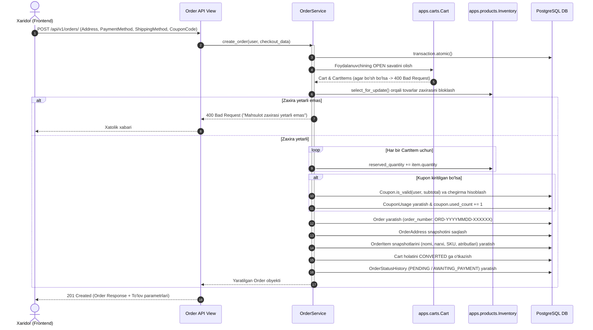

# Plan: Order REST API Implementation (`apps/orders`)

## Metadata
- **Title**: Order & Checkout REST API: Complete Order Lifecycle, Checkout Preview, Coupon Validation, Inventory Concurrency, Tracking, and Admin Controls
- **Date**: 2026-10-22
- **Status**: COMPLETED
- **Branch**: `feat/order-api`
- **Completed**: 2026-10-22
- **Author**: Antigravity

---

## 1. Context & Motivation

[plans/order-models.md](file:///Users/djumanov/Academy/backend-development/Summer-2026/ecommerce/plans/order-models.md) da ishlab chiqilgan va sinovdan o'tkazilgan `Order`, `OrderItem`, `OrderAddress`, `OrderStatusHistory`, `Coupon` hamda `CouponUsage` modellar arxitekturasi to'liq shakllantirildi va `dev` tarmog'iga birlashtirildi. Ushbu ma'lumotlar bazasi modellari quyidagi imkoniyatlarni ta'minlaydi:
- Xavfsiz, o'zgarmas narx va atribut snapshotlari (`OrderItem`),
- Mijoz profilidan mustaqil yetkazib berish manzili snapshotlari (`OrderAddress`),
- Ko'p bosqichli buyurtma holatlari auditi va monitoringi (`OrderStatusHistory`),
- Kupon va vaucherlar bilan chegirma hisoblash (`Coupon`, `CouponUsage`),
- Katta hajmdagi tranzaksiyalarni boshqarish va xavfsiz bekor qilish (`cancel()`, `transition_status()`).

Ushbu rejaning maqsadi — mijozlar (web, mobil ilovalar) va ma'muriyat (admin/operatorlar) uchun to'liq RESTful tamoyillariga asoslangan, yuqori darajada himoyalangan, tranzaksiyaviy jihatdan barqaror (ACID & `select_for_update()`) va yuqori unumdorlikka ega **Order REST API (`/api/v1/orders/`)** tizimini loyihalashtirish va amalga oshirishdir.

---

## 2. API Endpoints Specification (`/api/v1/orders/`)

Buyurtmalar moduli mijozlar va boshqaruv xodimlari uchun quyidagi 9 ta asosiy endpointdan iborat bo'ladi:

### 2.1. Mijozlar (Customer) uchun Endpointlar

| # | Metod | URL | Ruxsat | Tavsif |
|---|:---|:---|:---|:---|
| 1 | `POST` | `/api/v1/orders/checkout/preview/` | Authenticated | Buyurtma oldi hisob-kitobi (subtotal, yetkazib berish haqi, kupon chegirmasi, jami summa va ombor zaxirasini oldindan tekshirish) |
| 2 | `POST` | `/api/v1/orders/coupons/validate/` | Authenticated | Promo-kod/kuponni tekshirish va kutilayotgan chegirma summasini hisoblash |
| 3 | `POST` | `/api/v1/orders/` | Authenticated | Savatdan buyurtma yaratish (Checkout: manzil, to'lov va yetkazib berish turini tanlash, zaxira band qilish, savatni `CONVERTED` ga o'tkazish) |
| 4 | `GET` | `/api/v1/orders/` | Authenticated | Foydalanuvchining shaxsiy buyurtmalar ro'yxati (holat, to'lov holati, sana filtri va sahifalash bilan) |
| 5 | `GET` | `/api/v1/orders/<str:order_number>/` | Authenticated | Buyurtma haqida to'liq ma'lumot (tovarlar ro'yxati, narxlar, manzil, yetkazib berish va to'lov tafsilotlari) |
| 6 | `POST` | `/api/v1/orders/<str:order_number>/cancel/` | Authenticated | Buyurtmani bekor qilish (agar `can_cancel` ruxsat bersa; ombor zaxirasi avtomatik qaytariladi) |
| 7 | `GET` | `/api/v1/orders/<str:order_number>/tracking/` | Authenticated | Buyurtmaning vaqt bo'yicha bosqichlari (Timeline: PENDING -> CONFIRMED -> PROCESSING -> SHIPPED -> DELIVERED) va kuryer ma'lumotlari |
| 8 | `GET` | `/api/v1/orders/<str:order_number>/invoice/` | Authenticated | Buyurtma hisob-fakturasi / elektron kvitansiya ma'lumotlari (chop etish va hisobotlar uchun) |

### 2.2. Xodimlar (Admin / Staff) uchun Endpointlar

| # | Metod | URL | Ruxsat | Tavsif |
|---|:---|:---|:---|:---|
| 9 | `GET` | `/api/v1/orders/admin/` | IsAdminUser | Barcha mijozlarning buyurtmalari ro'yxati (kengaytirilgan filtrlar, qidiruv va pagination) |
| 10 | `PATCH` | `/api/v1/orders/admin/<str:order_number>/status/` | IsAdminUser | Buyurtma holatini yangilash (`CONFIRMED`, `PROCESSING`, `SHIPPED`, `DELIVERED`, `CANCELLED`), izoh kiritish va tracking raqamini belgilash |
| 11 | `POST` | `/api/v1/orders/admin/<str:order_number>/notes/` | IsAdminUser | Buyurtmaga operator/menejer ichki izohlarini (`admin_notes`) qo'shish |

---

## 3. Architecture & Technical Design

### 3.1. Checkout & Order Creation Workflow (Mermaid Diagram)



---

### 3.2. Biznes Qoidalar va Xavfsizlik Tamoyillari

1. **Pessimistik Qulflash (Pessimistic Locking & Concurrency)**:
   - Buyurtma yaratish vaqtida mahsulot qoldig'i `Inventory.objects.select_for_update()` yordamida qulflanadi. Bu bir vaqtning o'zida bir nechta xaridor bitta oxirgi tovarni sotib olishga uringanda overselling (ortiqcha sotib yuborish) xavfini 100% bartaraf etadi.
2. **Kuponlarning Qat'iy Validatsiyasi**:
   - Kupon amal qilish muddati (`valid_from`, `valid_until`), faollik holati (`is_active`), umumiy cheklov (`usage_limit`), har bir foydalanuvchi limiti (`usage_limit_per_user`) va buyurtmaning minimal summasi (`min_order_amount`) to'liq tekshiriladi.
3. **Zaxirani Qaytarish (Stock Rollback on Cancel)**:
   - Xaridor yoki admin buyurtmani bekor qilganda (`/cancel/`), `Order.cancel()` metodi ishga tushadi: buyurtma holati `CANCELLED` bo'ladi va ombordagi `reserved_quantity` kamaytirilib, boshqa xaridorlar uchun bo'shatiladi.
4. **Idempotentlik va Takroriy So'rovlardan Himoya**:
   - Agar savat allaqachon `CONVERTED` bo'lgan bo'lsa, xatolik qaytariladi va qayta buyurtma yaratilmaydi.
5. **Xavfsiz Ruxsatlar (Object-Level Permissions)**:
   - Oddiy foydalanuvchi faqat o'ziga tegishli buyurtmalarni (`order.user == request.user`) ko'rishi va bekor qilishi mumkin.
   - Admin/Staff xodimlari barcha buyurtmalarni ko'rish va boshqarish huquqiga ega.

---

### 3.3. Papkalar va Fayllar Strukturasi (`apps/orders/`)

Buyurtmalar ilovasi quyidagi modulli arxitekturada tashkil etiladi:

```
apps/orders/
├── __init__.py
├── admin.py                    # Mavjud admin interfeysi
├── apps.py
├── models.py                   # Mavjud modellar (Order, OrderItem, OrderAddress, ...)
├── services.py                 # YANGA: OrderService, CheckoutService, CouponService
├── urls.py                     # YANGA: URL routinglar
├── views.py                    # YANGA: API View'lar
├── serializers/                # YANGA: Modulli serializerlar to'plami
│   ├── __init__.py
│   ├── address_serializers.py  # OrderAddressSerializer
│   ├── item_serializers.py     # OrderItemSerializer
│   ├── coupon_serializers.py   # CouponValidateSerializer, CouponDetailSerializer
│   ├── status_serializers.py   # OrderStatusHistorySerializer, AdminStatusUpdateSerializer
│   ├── preview_serializers.py  # CheckoutPreviewSerializer, CheckoutPreviewItemSerializer
│   └── order_serializers.py    # OrderListSerializer, OrderDetailSerializer, OrderCreateSerializer, OrderCancelSerializer, OrderInvoiceSerializer
└── tests/                      # Kengaytiriladigan testlar
    ├── __init__.py
    ├── test_models.py          # Mavjud model testlari
    ├── test_services.py        # YANGA: OrderService unit testlari
    └── test_api.py             # YANGA: Barcha endpointlar bo'yicha integratsion testlar
```

---

### 3.4. Serializers Arxitekturasi Tafsilotlari

1. **`OrderAddressSerializer`**:
   - Manzil ma'lumotlarini qabul qilish va tekshirish (`recipient_name`, `phone_number`, `alternative_phone_number`, `region`, `district`, `street_address`, `apartment_office`, `postal_code`, `landmark`, `delivery_instructions`).
2. **`OrderItemSerializer`**:
   - Buyurtma qatorlarini qaytarish (`id`, `product_name`, `variant_sku`, `variant_attributes_display`, `unit_price`, `quantity`, `total_price`, `image_url`).
3. **`OrderStatusHistorySerializer`**:
   - Tarixiy holatlar xronologiyasi (`old_status`, `new_status`, `comment`, `created_at`, `created_by_name`).
4. **`CheckoutPreviewSerializer`**:
   - `subtotal`: Savatdagi tovarlar summasi,
   - `shipping_fee`: Tanlangan yetkazib berish usuliga ko'ra narx,
   - `discount_amount`: Kupon orqali tejalgan summa,
   - `total_price`: To'lanishi kerak bo'lgan yakuniy summa,
   - `items`: Savatdagi mahsulotlar va ularning zaxira holati (ogohlantirishlar bilan),
   - `coupon_details`: Qo'llanilgan kupon haqida ma'lumot.
5. **`OrderCreateSerializer`**:
   - Kirish ma'lumotlari: `shipping_address` (ichki obyekt), `shipping_method`, `payment_method`, `coupon_code` (ixtiyoriy), `customer_notes` (ixtiyoriy).
6. **`OrderListSerializer`**:
   - Ro'yxat uchun yengil serializer: `order_number`, `created_at`, `status`, `payment_status`, `total_items`, `total_price`, `currency`.
7. **`OrderDetailSerializer`**:
   - To'liq serializer: barcha moliyaviy ma'lumotlar, `shipping_address`, `items` (ro'yxat), `status_history` (mijozga ko'rinadigan qismi), `tracking_number`, `paid_at`, `delivered_at`, `can_cancel`.
8. **`OrderInvoiceSerializer`**:
   - Kvitansiya formati: xaridor ma'lumotlari, sana, to'lov usuli, mahsulotlar jadvali, QQS/chegirmalar/yetkazib berish, umumiy to'lov.

---

### 3.5. Servis Qatlami (`OrderService`)

Barcha og'ir biznes mantiqi view lardan ajratilib, `OrderService` klassiga yuklanadi:
- `validate_and_apply_coupon(user, code, subtotal)`: Kupon to'g'riligini tekshiradi va chegirma summasini hisoblaydi.
- `calculate_shipping_fee(shipping_method, region)`: Yetkazib berish narxini hisoblaydi (masalan, Toshkent bo'yicha STANDARD 25,000 UZS, EXPRESS 45,000 UZS, viloyatlarga 40,000 UZS, PICKUP 0 UZS).
- `preview_checkout(user, shipping_method, coupon_code, region)`: Xarid oldi hisobini tuzadi.
- `create_order_from_cart(user, checkout_data)`: Tranzaksiyaviy xavfsiz holda savatdan buyurtma yaratadi, zaxirani band qiladi.
- `cancel_order(order, user, reason)`: Buyurtmani bekor qiladi va zaxirani qaytaradi.
- `admin_update_order_status(order, new_status, comment, admin_user, tracking_number)`: Admin tomonidan holatni o'zgartirish.

---

## 4. Detailed Checklist

Quyidagi rejani bosqichma-bosqich, qat'iy ketma-ketlikda amalga oshirish:

- [x] **Step 1: Muhit va Branch tayyorgarligi**
  - Git tarmog'i `feat/order-api` ekanligini tasdiqlash.
  - `apps/orders/serializers/` katalogini yaratish.

- [x] **Step 2: Xizmatlar qatlamini (`OrderService`) joriy qilish**
  - `apps/orders/services.py` faylida `OrderService` klassini yaratish.
  - Checkout oldi hisob-kitobi (`preview_checkout`), yetkazib berish narxini hisoblash (`calculate_shipping_fee`).
  - Kupon tekshirish va chegirma hisoblash mantiqini bog'lash.
  - `create_order_from_cart` metodini `transaction.atomic()` va `select_for_update()` bilan yaratish.
  - Bekor qilish (`cancel_order`) va admin holat o'zgartirish mantiqlarini joylashtirish.

- [x] **Step 3: Modulli Serializerlarni (`apps/orders/serializers/`) ishlab chiqish**
  - `address_serializers.py`: `OrderAddressSerializer`.
  - `item_serializers.py`: `OrderItemSerializer`.
  - `coupon_serializers.py`: `CouponValidateSerializer`, `CouponDetailSerializer`.
  - `status_serializers.py`: `OrderStatusHistorySerializer`, `AdminStatusUpdateSerializer`.
  - `preview_serializers.py`: `CheckoutPreviewSerializer`, `CheckoutPreviewItemSerializer`.
  - `order_serializers.py`: `OrderListSerializer`, `OrderDetailSerializer`, `OrderCreateSerializer`, `OrderCancelSerializer`, `OrderInvoiceSerializer`.
  - `__init__.py` orqali toza eksportlarni tashkil etish.

- [x] **Step 4: API Viewlarini (`apps/orders/views.py`) amalga oshirish**
  - `CheckoutPreviewView`: Buyurtma oldi hisob-kitobi.
  - `CouponValidateView`: Kuponni tekshirish endpointi.
  - `OrderListCreateView`: Buyurtma yaratish (`POST`) va shaxsiy buyurtmalar ro'yxati (`GET`).
  - `OrderDetailView`: Buyurtma tafsilotlari (`GET`).
  - `OrderCancelView`: Buyurtmani bekor qilish (`POST`).
  - `OrderTrackingView`: Buyurtma holatlari xronologiyasi (`GET`).
  - `OrderInvoiceView`: Buyurtma invoys/kvitansiya ma'lumotlari (`GET`).
  - `AdminOrderListView` va `AdminOrderStatusUpdateView`: Xodimlar uchun boshqaruv endpointlari.

- [x] **Step 5: URL Konfiguratsiyasi va Marshrutlash**
  - `apps/orders/urls.py` faylini yaratish va barcha endpointlarni nomlari (`app_name = 'orders'`) bilan ro'yxatdan o'tkazish.
  - `config/urls.py` ga `path('api/v1/orders/', include('apps.orders.urls', namespace='orders'))` ni ulash.

- [x] **Step 6: Keng qamrovli testlar to'plamini yozish (`apps/orders/tests/`)**
  - `apps/orders/tests/test_services.py`: `OrderService` unit testlari (checkout preview, coupon validation, concurrency reservation, cancellation rollback).
  - `apps/orders/tests/test_api.py`: Barcha 11 ta endpoint bo'yicha integratsion testlar (muvaffaqiyatli buyurtma yaratish, bo'sh savat xatoligi, zaxira yetishmovchiligi, ruxsatlar tekshiruvi, bekor qilish, invoys olish, admin harakatlari).
  - Barcha mavjud va yangi testlarni to'liq ishga tushirib 100% yashil natijaga erishish.

- [x] **Step 7: Postman Kolleksiyasini (`postman/ecommerce_api_collection.json`) yangilash**
  - Postman kolleksiyasining `4. Orders & Checkout` bo'limiga barcha yangi endpointlarni to'liq test ssenariylari, autentifikatsiya tokenlari va namuna body ma'lumotlari bilan qo'shish.

- [x] **Step 8: Yakuniy Tekshiruv va Hujjatlashtirish**
  - Django tizim tekshiruvi: `python manage.py check`.
  - Testlar to'plami: `python manage.py test`.
  - Reja fayli statusini `COMPLETED` ga yangilash.
  - Git commit va dev tarmog'iga birlashtirishga tayyorlash.
