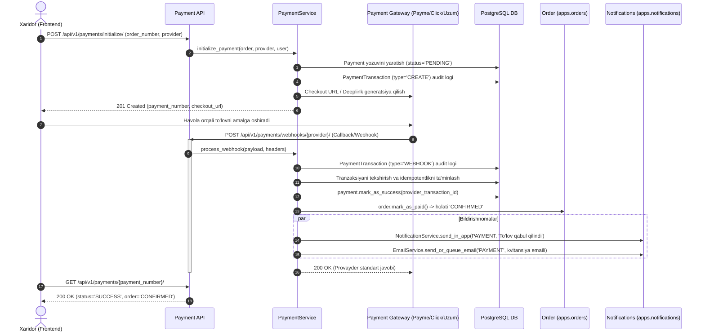
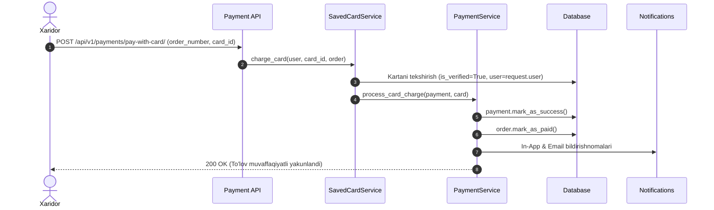
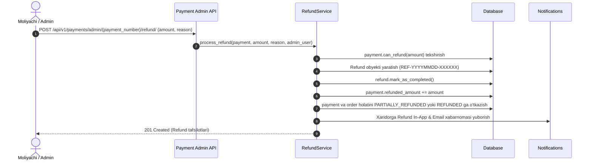

# Plan: Payment REST API Implementation (`apps/payments`)

## Metadata
- **Title**: Payment REST API: Multi-Provider Checkout (Payme, Click, Uzum, COD), Saved Cards (1-Click Pay), Webhooks, Audit Logs, Refunds, and Order-Notification Synchronization
- **Date**: 2026-10-22
- **Status**: IN_PROGRESS
- **Branch**: `feat/payments-api`
- **Author**: Antigravity

---

## 1. Context & Motivation

[plans/payment-models.md](file:///Users/djumanov/Academy/backend-development/Summer-2026/ecommerce/plans/payment-models.md) doirasida loyihamizda to'lov ma'lumotlar bazasi modellari (`Payment`, `PaymentTransaction`, `Refund`, `SavedCard`) to'liq ishlab chiqildi, sinovdan o'tkazildi va `dev` tarmog'iga birlashtirildi. 

Shuningdek:
- [plans/order-api.md](file:///Users/djumanov/Academy/backend-development/Summer-2026/ecommerce/plans/order-api.md) orqali buyurtmalar hayot sikli (`apps/orders`) to'liq yaratildi. Unda buyurtma yaratilganda online to'lov usullari (`PAYME`, `CLICK`, `UZUM`) tanlansa, buyurtma `status=AWAITING_PAYMENT`, `payment_status=PENDING` holatida saqlanadi. Buyurtma to'langanda `order.mark_as_paid()` chaqirilib, holat `CONFIRMED` ga, to'lov esa `PAID` ga o'tadi.
- [plans/notification-api.md](file:///Users/djumanov/Academy/backend-development/Summer-2026/ecommerce/plans/notification-api.md) orqali bildirishnomalar tizimi (`apps/notifications`) yaratildi. Unda `NotificationService` (In-App) va `EmailService` (elektron kvitansiyalar) to'lov jarayonlari uchun maxsus `PAYMENT` toifasidagi xabarlarni yuborishga to'liq tayyor.

Ushbu rejaning asosiy maqsadi — `apps/payments` ilovasida quyidagi talablarni qondiruvchi to'liq, xavfsiz va ishlab chiqarishga (production) tayyor **Payment REST API (`/api/v1/payments/`)** tizimini loyihalashtirish va amalga oshirish:

1. **Mijozlar uchun To'lov Jarayoni (Customer Checkout & Payment)**:
   - Buyurtma uchun to'lovni boshlash (`initialize`): to'lov tizimini tanlash yoki o'zgartirish, to'lov uchun havola (`checkout_url`) yoki QR deep-link olish,
   - To'lov holatini tekshirish va to'lov urinishini bekor qilish (`cancel`),
   - Xaridorning to'lovlar tarixini ko'rish.
2. **Saqlangan Bank Kartalari (Saved Cards & 1-Click Checkout)**:
   - PCI-DSS talablariga mos ravishda kartani tokenlashtirish (OTP orqali tasdiqlash),
   - Saqlangan kartalar ro'yxati, birlamchi (default) kartani belgilash, o'chirish,
   - Saqlangan karta orqali to'g'ridan-to'g'ri 1 tugma bilan to'lash (`pay-with-card`).
3. **To'lov Provayderlari Webhook/Callback integratsiyasi**:
   - **Payme JSON-RPC 2.0**: `CheckPerformTransaction`, `PerformTransaction`, `CancelTransaction`, `CheckTransaction`, `GetStatement` metodlari, Basic Auth avtorizatsiya va tiyinlar konvertatsiyasi.
   - **Click Shop API**: `Prepare` va `Complete` bosqichlari, MD5 imzo (sign) tekshiruvi.
   - **Uzum Bank**: Webhook xabarnomalarini qabul qilish va tasdiqlash.
   - Barcha kiruvchi so'rov va javoblarni `PaymentTransaction` jadvalida to'liq audit qilib borish va idempotentlikni ta'minlash.
4. **`apps/orders` va `apps/notifications` bilan uzviy integratsiya**:
   - To'lov muvaffaqiyatli bo'lganda (`SUCCESS`): avtomatik ravishda `order.mark_as_paid()` chaqiriladi, xaridorga In-App xabarnoma (`NotificationService`) va to'lov kvitansiyasi emaili (`EmailService`) yuboriladi.
   - To'lov muvaffaqiyatsiz bo'lganda (`FAILED`): buyurtmaning to'lov holati yangilanadi va foydalanuvchiga xatolik haqida bildirishnoma yuboriladi (qayta urinish imkoniyati saqlanadi).
5. **Ma'muriyat va Moliyaviy Audit (Admin Controls & Refunds)**:
   - Adminlar uchun barcha to'lovlar va xom tranzaksiyalar auditi (reconciliation),
   - Pulni to'liq yoki qisman qaytarish (`Refund` yaratish va uni provayder/bank darajasida tasdiqlash), buyurtma va to'lov holatini sinxron yangilash, mijozga pul qaytarilgani haqida xabarnoma yuborish.

---

## 2. API Endpoints Specification (`/api/v1/payments/`)

Modul jami 17 ta asosiy endpointdan iborat bo'ladi:

### 2.1. Mijozlar (Customer) uchun Endpointlar

| # | Metod | URL | Ruxsat | Tavsif |
|---|:---|:---|:---|:---|
| 1 | `POST` | `/api/v1/payments/initialize/` | Authenticated | Buyurtma uchun to'lovni boshlash (provayder checkout havolasi yoki to'lov parametrlarini generatsiya qilish) |
| 2 | `GET` | `/api/v1/payments/` | Authenticated | Foydalanuvchining shaxsiy to'lov operatsiyalari ro'yxati (holat, provayder, sana filtrlari va sahifalash bilan) |
| 3 | `GET` | `/api/v1/payments/<str:payment_number>/` | Authenticated (Owner) | To'lov haqida batafsil ma'lumot (holati, to'langan vaqt, order ma'lumotlari, checkout URL) |
| 4 | `POST` | `/api/v1/payments/<str:payment_number>/cancel/` | Authenticated (Owner) | Kutilayotgan (`PENDING`) to'lov urinishini xaridor tomonidan bekor qilish |
| 5 | `GET` | `/api/v1/payments/cards/` | Authenticated | Foydalanuvchining saqlangan bank kartalari ro'yxati (niqoblangan ko'rinishda) |
| 6 | `POST` | `/api/v1/payments/cards/` | Authenticated | Yangi bank kartasini ulash (karta tokenizatsiyasi va SMS OTP yuborish) |
| 7 | `POST` | `/api/v1/payments/cards/<int:pk>/verify/` | Authenticated (Owner) | SMS OTP kodini kiritib kartani faollashtirish (`is_verified=True`) |
| 8 | `DELETE` | `/api/v1/payments/cards/<int:pk>/` | Authenticated (Owner) | Saqlangan kartani o'chirib tashlash |
| 9 | `POST` | `/api/v1/payments/cards/<int:pk>/default/` | Authenticated (Owner) | Kartani asosiy to'lov vositasi (`is_default=True`) qilib belgilash |
| 10 | `POST` | `/api/v1/payments/pay-with-card/` | Authenticated | Saqlangan karta tokeni orqali to'g'ridan-to'g'ri (1-click) to'lovni amalga oshirish |

### 2.2. To'lov Shlyuzlari Webhooklari (Payment Gateways Server-to-Server)

| # | Metod | URL | Ruxsat | Tavsif |
|---|:---|:---|:---|:---|
| 11 | `POST` | `/api/v1/payments/webhooks/payme/` | AllowAny (Basic Auth) | Payme Merchant JSON-RPC 2.0 protokoli (Check, Perform, Cancel, CheckTransaction) |
| 12 | `POST` | `/api/v1/payments/webhooks/click/` | AllowAny (MD5 Sign) | Click Shop API protokoli (Prepare va Complete amallari) |
| 13 | `POST` | `/api/v1/payments/webhooks/uzum/` | AllowAny (Webhook Secret) | Uzum Bank / Uzum Pay callback xabarnomalari |

### 2.3. Boshqaruv va Moliyaviy Audit (Admin / Staff Endpoints)

| # | Metod | URL | Ruxsat | Tavsif |
|---|:---|:---|:---|:---|
| 14 | `GET` | `/api/v1/payments/admin/` | IsAdminUser | Barcha to'lovlar ro'yxati (kengaytirilgan filtrlar, qidiruv, statistika) |
| 15 | `GET` | `/api/v1/payments/admin/<str:payment_number>/` | IsAdminUser | To'lov tafsilotlari va unga bog'liq barcha shlyuz tranzaksiyalari (`PaymentTransaction` loglari) |
| 16 | `POST` | `/api/v1/payments/admin/<str:payment_number>/refund/` | IsAdminUser | Pulni qaytarish (to'liq yoki qisman qaytarish, order va to'lov holatini avtomatik o'zgartirish) |
| 17 | `GET` | `/api/v1/payments/admin/refunds/` | IsAdminUser | Barcha rasmiylashtirilgan qaytarishlar (`Refund`) ro'yxati |
| 18 | `GET` | `/api/v1/payments/admin/refunds/<str:refund_number>/` | IsAdminUser | Qaytarish amaliyotining batafsil ma'lumotlari |
| 19 | `GET` | `/api/v1/payments/admin/transactions/` | IsAdminUser | Bank shlyuzlarining xom tranzaksiya loglari auditi (reconciliation va xatoliklarni tahlil qilish uchun) |

---

## 3. Architecture & Technical Design

### 3.1. Payment Lifecycle & Webhook Flow (Mermaid Diagram)



### 3.2. Saqlangan Karta Bilan 1-Click To'lov (Mermaid Diagram)



### 3.3. Qaytarish (Refund) Arxitekturasi



---

## 4. File Structure & Component Breakdown

Quyidagi fayllar yaratiladi yoki yangilanadi:

```
apps/payments/
├── __init__.py
├── admin.py
├── apps.py
├── models.py                   # Mavjud modellar (Payment, PaymentTransaction, Refund, SavedCard)
├── pagination.py               # PaymentPagination, RefundPagination, TransactionPagination
├── permissions.py              # IsOwnerOrStaff, IsStaffUser, WebhookAuthentication
├── serializers/
│   ├── __init__.py
│   ├── card_serializers.py     # SavedCardList, Create, Verify, Charge serializers
│   ├── payment_serializers.py  # PaymentInitialize, Detail, List, Cancel serializers
│   ├── refund_serializers.py   # RefundCreate, Detail, List serializers
│   ├── transaction_serializers.py # PaymentTransaction audit log serializers
│   └── webhook_serializers.py  # Payme JSON-RPC, Click Prepare/Complete, Uzum serializers
├── services/
│   ├── __init__.py
│   ├── card_service.py         # Karta tokenizatsiyasi, OTP generatsiya, tekshirish va yechish
│   ├── gateways/
│   │   ├── __init__.py
│   │   ├── click.py            # Click Shop API integratsiyasi (Prepare, Complete, MD5 imzo)
│   │   ├── payme.py            # Payme JSON-RPC 2.0 protokoli (Check, Perform, Cancel, Basic Auth)
│   │   └── uzum.py             # Uzum Bank / Uzum Pay webhook protokoli
│   ├── payment_service.py      # Asosiy to'lov xizmati (initialize, process, cancel, order sync)
│   └── refund_service.py       # Pulni qaytarish, limitlarni tekshirish va hisobotlar
├── urls.py                     # Modul ichki yo'llari
├── views.py                    # API View classlari (Customer, Gateways, Admin)
└── tests/
    ├── __init__.py
    ├── test_api_admin.py       # Admin to'lovlar, refundlar va audit loglari testlari
    ├── test_api_cards.py       # Saqlangan kartalar va 1-click pay testlari
    ├── test_api_customer.py    # Xaridor to'lov jarayoni, status va cancel testlari
    ├── test_api_webhooks.py    # Payme, Click va Uzum webhook testlari
    ├── test_models.py          # Mavjud model testlari
    └── test_services.py        # Payment, Refund va Gateway xizmatlarining unit testlari
```

---

## 5. Security, Concurrency & Idempotency Rules

1. **Idempotentlik (Idempotency)**:
   - Webhooklar qayta yuborilganda (tarmoq xatoliklari sababli) bir xil tranzaksiya ikki marta tasdiqlanmasligi uchun `provider_transaction_id` va `idempotency_key` bo'yicha qat'iy tekshiruv amalga oshiriladi.
   - Agar to'lov allaqachon `SUCCESS` bo'lsa, xato bermasdan provayder kutgan muvaffaqiyatli javob qaytariladi.
2. **Tranzaksiyaviy Butunlik (ACID)**:
   - To'lov va buyurtma holatini yangilash, audit tranzaksiyasini yozish va zaxira o'zgarishlari `@transaction.atomic` ichida bajariladi.
3. **Maxfiylik va PCI-DSS talablari**:
   - Hech qanday ochiq karta raqami (PAN) yoki CVV saqlanmaydi. Faqat niqoblangan maska (`8600 12** **** 1234`) va shifrlangan token saqlanadi.
4. **Shlyuz Avtorizatsiyasi**:
   - Payme: `Authorization: Basic ...` headeri (Merchant ID va Key tekshiruvi).
   - Click: `sign_string` MD5 xesh tekshiruvi.
   - Uzum: Webhook signature / secret key tekshiruvi.
5. **Bildirishnomalar Ishonchliligi**:
   - Bildirishnoma jo'natishdagi xatoliklar asosiy moliyaviy tranzaksiyani to'xtatib qo'ymasligi uchun xavfsiz blok (`try...except`) ichida bajariladi.

---

## 6. Execution Checklist

- [x] Step 1: Git branch yaratish (`feat/payments-api`) va `config/settings.py` da to'lov shlyuzlari (Payme, Click, Uzum) sozlamalarini tayyorlash
- [x] Step 2: `apps/payments/pagination.py` va `apps/payments/permissions.py` xavfsizlik vositalarini yaratish
- [ ] Step 3: `apps/payments/services/` (Gateways: Payme, Click, Uzum; PaymentService, RefundService, CardService) xizmatlar qatlamini yaratish va `apps/orders`, `apps/notifications` integratsiyasini ulash
- [ ] Step 4: `apps/payments/serializers/` (payment, card, refund, transaction, webhook serializers) yaratish
- [ ] Step 5: `apps/payments/views.py` da mijozlar (Customer) to'lov va saqlangan kartalar endpointlarini yaratish
- [ ] Step 6: `apps/payments/views.py` da Payme, Click, Uzum webhook API endpointlarini yaratish
- [ ] Step 7: `apps/payments/views.py` da Admin / Staff (Payments, Refunds, Transactions audit) endpointlarini yaratish
- [ ] Step 8: `apps/payments/urls.py` ni yaratish va `config/urls.py` ga ulash
- [ ] Step 9: `apps/payments/tests/` to'liq testlar to'plamini (services, customer API, webhooks, admin API) yozish va barcha testlarni muvaffaqiyatli ishga tushirish
- [ ] Step 10: `postman/ecommerce_api_collection.json` to'plamiga to'lovlar, webhooklar va admin API larni to'liq integratsiya qilish
- [ ] Step 11: Yakuniy tekshiruv, reja holatini `COMPLETED` ga o'tkazish va o'zgarishlarni git ga commit qilish

---

## 7. Approval & Next Steps

Mazkur reja tasdiqlangandan so'ng, [Planning and Execution Workflow Rules](file:///.agents/rules/planning-workflow.md) ga binoan:
1. Reja holati `APPROVED` / `IN_PROGRESS` ga o'tkaziladi.
2. `feat/payments-api` tarmog'i ochiladi.
3. Yuqoridagi 11 ta bosqich ketma-ket, har bir qadamdan so'ng reja faylidagi checklist darhol yangilanib (`- [ ]` -> `- [x]`) amalga oshiriladi.
