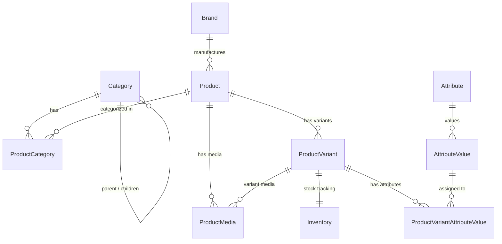

# Plan: Product Catalog Data Models Architecture

## Metadata
- **Title**: Product Catalog Models: Categories, Brands, Products, Variants, Media, Dynamic Attributes & Inventory
- **Date**: 2026-10-17
- **Status**: COMPLETED
- **Branch**: `feat/products-models`

---

## Context & Motivation
An e-commerce platform requires a highly structured, scalable, and performant product catalog architecture. A simple flat product model is insufficient because real-world e-commerce requires:
1. **Multi-level Categories**: Hierarchical category tree (e.g., Electronics > Computers > Laptops) with parent-child relationships.
2. **Brand Management**: Associating products with manufacturers / brands.
3. **Product & Variants Separation**: A base `Product` (concept) paired with concrete sellable units (`ProductVariant`), each having its own SKU, price, discount price, and inventory.
4. **Primary vs Secondary Categories**: Through `ProductCategory`, allowing products to belong to multiple categories while designating a canonical/primary category for breadcrumbs and SEO.
5. **Product & Variant Media**: Supporting multiple images/videos per product, with option to bind media directly to specific variants (e.g., Red vs Blue color).
6. **Dynamic Attributes (EAV Pattern)**: Flexible specifications (`Attribute` and `AttributeValue`, linked to variants via `ProductVariantAttributeValue`), allowing products like smartphones, laptops, clothing, or shoes to define custom attributes (RAM, Color, Size, Storage, Material) without altering database schema.
7. **Real-time Inventory Control**: An `Inventory` model linked to variants tracking total stock, reserved quantities (for active carts / checkouts), and low-stock thresholds to prevent overselling.

---

## Architecture & Technical Design

### 1. Entity-Relationship Diagram

---

### 2. Models Specification (`apps/products/models.py`)

#### A. `Category` (`categories`)
- `id`: `BigAutoField` (Primary Key)
- `name`: `CharField(max_length=255, verbose_name="nomi")`
- `slug`: `SlugField(max_length=255, unique=True, db_index=True)`
- `parent`: `ForeignKey('self', on_delete=CASCADE, null=True, blank=True, related_name='children')`
- `icon`: `ImageField(upload_to='categories/icons/', null=True, blank=True)`
- `image`: `ImageField(upload_to='categories/images/', null=True, blank=True)`
- `description`: `TextField(blank=True)`
- `is_active`: `BooleanField(default=True, db_index=True)`
- `created_at`: `DateTimeField(auto_now_add=True)`
- `updated_at`: `DateTimeField(auto_now=True)`
- **Properties/Methods**: `get_full_path()`, `__str__()` ("Electronics > Computers > Laptops")

#### B. `Brand` (`brands`)
- `id`: `BigAutoField` (Primary Key)
- `name`: `CharField(max_length=255, unique=True)`
- `slug`: `SlugField(max_length=255, unique=True, db_index=True)`
- `logo`: `ImageField(upload_to='brands/logos/', null=True, blank=True)`
- `description`: `TextField(blank=True)`
- `website`: `URLField(max_length=500, blank=True, null=True)`
- `is_active`: `BooleanField(default=True, db_index=True)`
- `created_at`: `DateTimeField(auto_now_add=True)`
- `updated_at`: `DateTimeField(auto_now=True)`

#### C. `Product` (`products`)
- `id`: `BigAutoField` (Primary Key)
- `name`: `CharField(max_length=255)`
- `slug`: `SlugField(max_length=255, unique=True, db_index=True)`
- `brand`: `ForeignKey(Brand, on_delete=SET_NULL, null=True, blank=True, related_name='products')`
- `categories`: `ManyToManyField(Category, through='ProductCategory', related_name='products')`
- `description`: `TextField(blank=True)`
- `short_description`: `CharField(max_length=500, blank=True)`
- `is_active`: `BooleanField(default=True, db_index=True)`
- `created_at`: `DateTimeField(auto_now_add=True, db_index=True)`
- `updated_at`: `DateTimeField(auto_now=True)`
- **Indexes**: `Index(fields=['slug'])`, `Index(fields=['is_active', 'created_at'])`

#### D. `ProductCategory` (`product_categories`)
- Explicit Many-to-Many junction table
- `product`: `ForeignKey(Product, on_delete=CASCADE, related_name='product_categories')`
- `category`: `ForeignKey(Category, on_delete=CASCADE, related_name='product_categories')`
- `is_primary`: `BooleanField(default=False)` (Determines primary category for breadcrumbs & canonical URL)
- `created_at`: `DateTimeField(auto_now_add=True)`
- **Constraint**: `unique_together = ('product', 'category')`

#### E. `ProductVariant` (`product_variants`)
- The sellable SKU unit
- `id`: `BigAutoField` (Primary Key)
- `product`: `ForeignKey(Product, on_delete=CASCADE, related_name='variants')`
- `title`: `CharField(max_length=255, blank=True)` (e.g. "Space Black / 256GB")
- `sku`: `CharField(max_length=100, unique=True, db_index=True)`
- `price`: `DecimalField(max_digits=14, decimal_places=2)`
- `discount_price`: `DecimalField(max_digits=14, decimal_places=2, null=True, blank=True)`
- `is_default`: `BooleanField(default=False)` (Default variant displayed on catalog listing)
- `is_active`: `BooleanField(default=True, db_index=True)`
- `attributes`: `ManyToManyField(AttributeValue, through='ProductVariantAttributeValue', related_name='variants', blank=True)`
- `created_at`: `DateTimeField(auto_now_add=True)`
- `updated_at`: `DateTimeField(auto_now=True)`
- **Properties**:
  - `final_price`: returns `discount_price` if discount is active and lower than `price`, else `price`
  - `is_on_sale`: `bool`

#### F. `ProductMedia` (`product_media`)
- `id`: `BigAutoField` (Primary Key)
- `product`: `ForeignKey(Product, on_delete=CASCADE, related_name='media')`
- `variant`: `ForeignKey(ProductVariant, on_delete=SET_NULL, null=True, blank=True, related_name='media')`
- `file`: `FileField(upload_to='products/%Y/%m/')` (Supports images and videos)
- `alt_text`: `CharField(max_length=255, blank=True)`
- `media_type`: `CharField(max_length=20, choices=[('image', 'Image'), ('video', 'Video')], default='image')`
- `is_main`: `BooleanField(default=False)`
- `order`: `PositiveIntegerField(default=0)`
- `created_at`: `DateTimeField(auto_now_add=True)`
- **Ordering**: `['order', '-is_main', 'id']`

#### G. Dynamic Attributes: `Attribute`, `AttributeValue`, `ProductVariantAttributeValue`
- `Attribute` (`attributes`):
  - `name`: `CharField(max_length=100)` (e.g., "Color", "RAM", "Screen Size")
  - `slug`: `SlugField(max_length=100, unique=True)`
  - `created_at`, `updated_at`
- `AttributeValue` (`attribute_values`):
  - `attribute`: `ForeignKey(Attribute, on_delete=CASCADE, related_name='values')`
  - `value`: `CharField(max_length=255)` (e.g., "Midnight Black", "16GB", "6.7 inch")
  - `slug`: `SlugField(max_length=255)`
  - `created_at`, `updated_at`
  - **Constraint**: `unique_together = ('attribute', 'value')`
- `ProductVariantAttributeValue` (`variant_attribute_values`):
  - `variant`: `ForeignKey(ProductVariant, on_delete=CASCADE, related_name='variant_attributes')`
  - `attribute_value`: `ForeignKey(AttributeValue, on_delete=CASCADE, related_name='variant_attributes')`
  - **Constraint**: `unique_together = ('variant', 'attribute_value')`

#### H. `Inventory` (`inventory`)
- Real stock monitoring and reservation control:
- `variant`: `OneToOneField(ProductVariant, on_delete=CASCADE, related_name='inventory')`
- `quantity`: `PositiveIntegerField(default=0)` (Physical on-hand inventory)
- `reserved_quantity`: `PositiveIntegerField(default=0)` (Items reserved in active checkouts/pending orders)
- `low_stock_threshold`: `PositiveIntegerField(default=5)`
- `updated_at`: `DateTimeField(auto_now=True)`
- **Properties & Methods**:
  - `available_quantity`: `property -> max(0, quantity - reserved_quantity)`
  - `is_in_stock`: `property -> available_quantity > 0`
  - `is_low_stock`: `property -> available_quantity <= low_stock_threshold and available_quantity > 0`
  - `reserve(amount)`: validates and reserves stock
  - `release(amount)`: releases reserved stock back to available pool
  - `deduct(amount)`: finalizes purchase by decreasing physical stock

---

### 3. Media Files Configuration
- Configure `MEDIA_URL = '/media/'` and `MEDIA_ROOT = BASE_DIR / 'media'` in `config/settings.py`.
- Configure `static(settings.MEDIA_URL, document_root=settings.MEDIA_ROOT)` in `config/urls.py` for local development.

---

### 4. Django Admin Integration (`apps/products/admin.py`)
- `CategoryAdmin`: search, slug auto-prepopulate, parent hierarchy filter.
- `BrandAdmin`: logo preview, slug prepopulate, search.
- `ProductAdmin`:
  - Inlines: `ProductCategoryInline`, `ProductVariantInline`, `ProductMediaInline`.
  - Filters: brand, active status, created date.
- `ProductVariantAdmin`:
  - Inlines: `InventoryInline`, `ProductVariantAttributeValueInline`, `ProductMediaInline`.
  - Display: SKU, product, price, discount, default status, inventory stock status.
- `AttributeAdmin`:
  - Inline: `AttributeValueInline`.
- `InventoryAdmin`:
  - Display: variant, total quantity, reserved quantity, available quantity, stock status badge.

---

## Execution Checklist

- [x] Step 1: Switch to dedicated branch `feat/products-models` from `dev`
- [x] Step 2: Configure `MEDIA_URL` and `MEDIA_ROOT` in `config/settings.py` and `config/urls.py`
- [x] Step 3: Implement `Category`, `Brand`, and `Product` models in `apps/products/models.py`
- [x] Step 4: Implement `ProductCategory` and `ProductVariant` models in `apps/products/models.py`
- [x] Step 5: Implement `ProductMedia` model in `apps/products/models.py`
- [x] Step 6: Implement dynamic attributes (`Attribute`, `AttributeValue`, `ProductVariantAttributeValue`) in `apps/products/models.py`
- [x] Step 7: Implement `Inventory` model with real stock control logic in `apps/products/models.py`
- [x] Step 8: Generate and apply migrations (`makemigrations products`, `migrate`)
- [x] Step 9: Configure comprehensive Django Admin in `apps/products/admin.py` with inlines and filters
- [x] Step 10: Write comprehensive unit tests in `apps/products/tests.py` covering model creation, validation, inventory logic, and relationships
- [x] Step 11: Execute Django system check and test suite (`python manage.py check`, `python manage.py test apps.products`)
- [x] Step 12: Final verification, update plan status to `COMPLETED`, and prepare git commit
