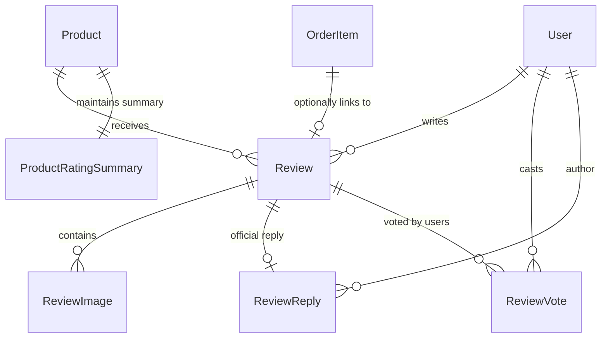

# Plan: Reviews & Ratings Data Models Architecture (`apps/reviews`)

## Metadata
- **Title**: Customer Reviews, Ratings, Media, Replies, and Aggregated Analytics Architecture
- **Date**: 2026-10-22
- **Status**: COMPLETED
- **Completed**: 2026-10-22
- **Branch**: `feat/reviews-models`
- **Author**: Antigravity

---

## 1. Context & Motivation

Zamonaviy professional e-commerce platformalarida (Amazon, Uzum Market, Ozon) foydalanuvchilarning mahsulotlar bo'yicha fikr-mulohazalari (reviews) va baholari (ratings) konversiya hamda xarid qarorini qabul qilishda eng hal qiluvchi omillardan biri hisoblanadi.

Loyiha arxitekturasida mijozlar (`apps/users`), mahsulotlar katalogi (`apps/products`), savat (`apps/carts`) va buyurtmalar (`apps/orders`) modullari to'liq yaratilgan. `apps/reviews` ilovasi hozirda bo'sh turibdi va ushbu modulni to'liq e-commerce talablariga mos ravishda modellashtirish talab etiladi:

1. **Mahsulot Sharhlari va Baholash (Review & Rating)**:
   - Mijoz mahsulotga 1 dan 5 gacha yulduzcha baho (rating), sharh sarlavhasi (title), batafsil matn (comment), afzalliklari (pros) va kamchiliklari (cons) ni qoldirishi.
   - Har bir mijoz bitta mahsulotga bitta sharh qoldira olish cheklovi (`unique_together = ('user', 'product')`).

2. **Haqiqiy Xaridni Tasdiqlash (Verified Purchase)**:
   - Sharh qoldiruvchi haqiqatdan ham ushbu mahsulotni xarid qilganmi (`is_verified_purchase`)? Tizim `apps.orders.OrderItem` / `Order` orqali xaridor ushbu tovar uchun to'lov qilib buyurtmani olganligini aniqlashi va unga maxsus ishonch nishoni (badge) berishi.

3. **Sharhlar Moderatsiyasi (Content Moderation Lifecycle)**:
   - Spam, haqorat yoki qoidabuzarliklarni oldini olish uchun sharhlar hayot sikliga ega bo'lishi: `PENDING` (kutilmoqda) -> `APPROVED` (tasdiqlangan) / `REJECTED` (rad etilgan).
   - Rad etilgan taqdirda rad etish sababi (`rejection_reason`) qayd etilishi.

4. **Sharh Fotosuratlari va Mediasi (Review Images)**:
   - Xaridorlar olgan mahsulotlarini suratga olib sharhga yuklash imkoniyati (`ReviewImage` modeli).

5. **Sotuvchi yoki Do'kon Ma'muriyatining Rasmiy Javobi (Review Reply)**:
   - Do'kon vakili yoki sotuvchi mijoz sharhiga rasmiy minnatdorchilik yoki tushuntirish javobini qoldirishi (`ReviewReply` modeli - 1:1 bog'liqlik).

6. **Sharhning Foydaliligi Ovoz berish Tizimi (Helpful / Unhelpful Votes)**:
   - Boshqa xaridorlar sharhga "Foydali bo'ldi" yoki "Foydasiz" deb ovoz berishi (`ReviewVote` modeli).
   - Katta yuklamada tezkor ishlash uchun `Review` modelida `likes_count` va `dislikes_count` denormalizatsiya qilingan hisoblagichlari bo'lishi.

7. **Mahsulot Reytingi Agregatsiyasi va Keshlash (ProductRatingSummary)**:
   - Millionlab so'rovlar kelganda har safar mahsulot ro'yxati va sahifasida `AVG(rating)` yoki `COUNT(*)` hisoblash ma'lumotlar bazasiga og'ir yuk tushiradi.
   - Alohida `ProductRatingSummary` modeli har bir mahsulot uchun o'rtacha ball (`average_rating`), umumiy sharhlar soni (`total_reviews`) va yulduzlar taqsimoti (1, 2, 3, 4, 5 yulduzlar soni) ni saqlaydi va sharh tasdiqlanganda yoki o'chirilganda avtomatik qayta hisoblanadi.

---

## 2. Architecture & Technical Design

### 2.1. Entity-Relationship Diagram

### 2.2. Model Specifications

#### 1. `Review`
- **Fields**:
  - `id`: `BigAutoField` (Primary Key)
  - `user`: `ForeignKey(settings.AUTH_USER_MODEL, on_delete=CASCADE, related_name='reviews')`
  - `product`: `ForeignKey('products.Product', on_delete=CASCADE, related_name='reviews')`
  - `order_item`: `ForeignKey('orders.OrderItem', on_delete=SET_NULL, null=True, blank=True, related_name='reviews')`
  - `rating`: `PositiveSmallIntegerField(validators=[MinValueValidator(1), MaxValueValidator(5)])`
  - `title`: `CharField(max_length=255, blank=True)`
  - `comment`: `TextField()`
  - `pros`: `CharField(max_length=500, blank=True)`
  - `cons`: `CharField(max_length=500, blank=True)`
  - `status`: `CharField(max_length=20, choices=ReviewStatus.choices, default=ReviewStatus.PENDING)`
    - Choices: `PENDING` ("Pending Moderation"), `APPROVED` ("Approved"), `REJECTED` ("Rejected")
  - `rejection_reason`: `TextField(blank=True)`
  - `is_verified_purchase`: `BooleanField(default=False, db_index=True)`
  - `likes_count`: `PositiveIntegerField(default=0)`
  - `dislikes_count`: `PositiveIntegerField(default=0)`
  - `created_at`: `DateTimeField(auto_now_add=True, db_index=True)`
  - `updated_at`: `DateTimeField(auto_now=True)`
- **Meta**:
  - `db_table = 'reviews'`
  - `unique_together = ('user', 'product')`
  - `indexes = [Index(fields=['product', 'status', '-created_at']), Index(fields=['status', '-created_at']), Index(fields=['product', 'rating'])]`
  - `ordering = ['-created_at']`
- **Methods**:
  - `clean()`: validate 1 <= rating <= 5
  - `approve()`: statusni `APPROVED` ga o'tkazadi va mahsulot reyting summarysini yangilaydi
  - `reject(reason)`: statusni `REJECTED` ga o'tkazadi
  - `update_helpful_counts()`: ovozlar asosida `likes_count` va `dislikes_count` ni qayta hisoblaydi

#### 2. `ReviewImage`
- **Fields**:
  - `id`: `BigAutoField` (Primary Key)
  - `review`: `ForeignKey(Review, on_delete=CASCADE, related_name='images')`
  - `image`: `ImageField(upload_to='reviews/%Y/%m/')`
  - `caption`: `CharField(max_length=255, blank=True)`
  - `created_at`: `DateTimeField(auto_now_add=True)`
- **Meta**:
  - `db_table = 'review_images'`
  - `ordering = ['created_at']`

#### 3. `ReviewReply`
- **Fields**:
  - `id`: `BigAutoField` (Primary Key)
  - `review`: `OneToOneField(Review, on_delete=CASCADE, related_name='reply')`
  - `user`: `ForeignKey(settings.AUTH_USER_MODEL, on_delete=CASCADE, related_name='review_replies')`
  - `comment`: `TextField()`
  - `created_at`: `DateTimeField(auto_now_add=True)`
  - `updated_at`: `DateTimeField(auto_now=True)`
- **Meta**:
  - `db_table = 'review_replies'`
  - `ordering = ['-created_at']`

#### 4. `ReviewVote`
- **Fields**:
  - `id`: `BigAutoField` (Primary Key)
  - `review`: `ForeignKey(Review, on_delete=CASCADE, related_name='votes')`
  - `user`: `ForeignKey(settings.AUTH_USER_MODEL, on_delete=CASCADE, related_name='review_votes')`
  - `vote_type`: `CharField(max_length=15, choices=VoteType.choices)`
    - Choices: `HELPFUL` ("Helpful"), `UNHELPFUL` ("Unhelpful")
  - `created_at`: `DateTimeField(auto_now_add=True)`
- **Meta**:
  - `db_table = 'review_votes'`
  - `unique_together = ('review', 'user')`

#### 5. `ProductRatingSummary`
- **Fields**:
  - `product`: `OneToOneField('products.Product', on_delete=CASCADE, related_name='rating_summary', primary_key=True)`
  - `average_rating`: `DecimalField(max_digits=3, decimal_places=2, default=Decimal('0.00'))`
  - `total_reviews`: `PositiveIntegerField(default=0)`
  - `rating_1_count`: `PositiveIntegerField(default=0)`
  - `rating_2_count`: `PositiveIntegerField(default=0)`
  - `rating_3_count`: `PositiveIntegerField(default=0)`
  - `rating_4_count`: `PositiveIntegerField(default=0)`
  - `rating_5_count`: `PositiveIntegerField(default=0)`
  - `updated_at`: `DateTimeField(auto_now=True)`
- **Meta**:
  - `db_table = 'product_rating_summaries'`
- **Methods**:
  - `recalculate()`: `product` ga tegishli `status=APPROVED` bo'lgan sharhlar bo'yicha agregatsiya qilib maydonlarni yangilaydi.

---

## 3. Detailed Checklist

- [x] Step 1: Implement `ReviewStatus`, `VoteType`, `Review`, `ReviewImage`, `ReviewReply`, `ReviewVote`, and `ProductRatingSummary` models in `apps/reviews/models.py`.
- [x] Step 2: Implement model signals / helper methods in `apps/reviews/signals.py` (or models methods) to maintain `ProductRatingSummary` synchronization upon review approval, modification, or deletion.
- [x] Step 3: Register `Review`, `ReviewImage`, `ReviewReply`, `ReviewVote`, and `ProductRatingSummary` with custom admin classes in `apps/reviews/admin.py`.
- [x] Step 4: Generate and execute database migrations (`python manage.py makemigrations reviews`, `python manage.py migrate`).
- [x] Step 5: Write comprehensive unit test suite in `apps/reviews/tests/` covering model validation, uniqueness constraints, voting logic, rating calculations, verified purchase checks, and admin integration.
- [x] Step 6: Run full test suite and project verification (`python manage.py check`, `python manage.py test apps.reviews`).
- [x] Step 7: Finalize plan status to `COMPLETED` and commit changes to `feat/reviews-models` branch.
